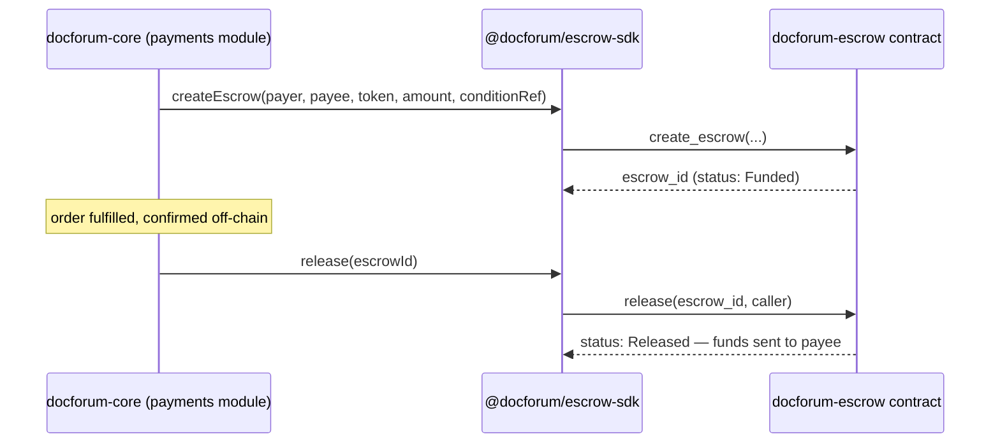

# docforum-escrow


**🔗 Live on testnet:** [`CAFI5QOTNLK5OIHEHGGQ7B22RN5IUOFGKKEID2OQCZSCJAQS4FLSS2DR`](https://stellar.expert/explorer/testnet/contract/CAFI5QOTNLK5OIHEHGGQ7B22RN5IUOFGKKEID2OQCZSCJAQS4FLSS2DR) — current upstream main deployment, including sponsored refunds (`refund_to`), verified with real create, release, refund, timeout refund, and `BalanceMismatch` calls. History and transaction links: [`docs/testnet-deployments.md`](docs/testnet-deployments.md).

A [Soroban](https://developers.stellar.org/docs/build/smart-contracts) (Stellar) smart contract for conditional payment escrow — lock funds, and release them to the payee only when release is authorized, or return them to the payer on refund. Paired with a TypeScript client SDK, `@docforum/escrow-sdk`.

This repo is deliberately **generic and domain-agnostic**. It has no
database, no server, and no knowledge of patients, doctors, referrals, or
any other healthcare concept — it is a reusable create/release/refund
escrow primitive, in the same category as other Stellar ecosystem escrow
projects (e.g. Trustless Work). Anything domain-specific — what condition
triggers a release, who the parties are — lives in the consuming
application, not here.

## Table of contents

- [Why this repo exists](#why-this-repo-exists-honestly)
- [Contract surface](#contract-surface)
- [How it's used](#how-its-used)
- [Repo layout](#repo-layout)
- [Getting started](#getting-started)
- [Documentation](#documentation)
- [Project status](#project-status)
- [Contributing](#contributing)
- [License](#license)

## Why this repo exists, honestly

Two reasons, stated plainly rather than blended together:

1. **Product reason.** [`docforum-core`](https://github.com/DocForum/docforum-core)'s facility-fulfillment flow needs a way to hold payment until a facility confirms it did the work, without trusting the facility's self-report alone.
2. **Ecosystem reason.** This is the one piece of the `DocForum` organization that's actually built *on* Stellar, as opposed to an application that merely accepts Stellar payments — see [`docforum-core`'s ADR 0002](https://github.com/DocForum/docforum-core/blob/main/docs/adr/0002-stellar-escrow-for-fulfillment-payout.md) for why that distinction shaped how the org is structured, and [`docs/adr/0001-generic-escrow-not-healthcare-specific.md`](docs/adr/0001-generic-escrow-not-healthcare-specific.md) for why the contract itself stays domain-blind.

## Contract surface

One generic escrow contract. A payer locks a token amount for a payee, and
the payout is settled by release (to the stored payee) or refund (to the
stored `refund_to`, which is the payer unless set otherwise at creation).
Creation options: a single releaser or an M-of-N releaser quorum, an
optional payee-acceptance gate, an optional `refund_after` timeout that
lets anyone trigger the refund, an optional `refund_to`, and an optional
release callback to a contract payee. Funded escrows can be topped up by
the original payer, and `get_status`/`get_escrow` are read-only. A token
allowlist is fixed at deploy time.

| Function | Status | Description |
|---|---|---|
| `__constructor(allowed_tokens)` | ✅ Implemented | Stores the immutable deploy-time token allowlist; an empty list allows all tokens. |
| `create_escrow(payer, payee, token, amount, condition_ref, releaser, refund_after, notify_payee) -> escrow_id` | ✅ Implemented locally (callback not deployed) | Pulls funds from `payer`, stores a bounded `condition_ref`, and stores the single `releaser` as a one-address set with threshold 1. Requires payer auth; when `notify_payee` is true, also requires payee auth and calls `on_escrow_released` on release. |
| `create_escrow_with_acceptance(..., requires_acceptance) -> escrow_id` | ✅ Implemented locally | Optional payee acceptance gate. When enabled, the payee must call `accept(escrow_id, payee)` before a releaser can release; refunds remain available. |
| `accept(escrow_id, payee)` | ✅ Implemented locally | Payee-authorized, one-time acceptance for a funded escrow configured with the acceptance gate. |
| `create_escrow_with_releasers(payer, payee, token, amount, condition_ref, releasers, threshold, refund_after, notify_payee) -> escrow_id` | ✅ Implemented | Same, but settles by M-of-N: 1–10 distinct `releasers` (`MAX_RELEASERS`), `1 <= threshold <= releasers.len()`. Callback opt-in has the same payee-authorization requirement. See [ADR 0007](docs/adr/0007-in-contract-m-of-n-releaser-quorum.md). |
| `create_escrow_with_arbiter(..., arbiter, notify_payee) -> escrow_id` | ✅ Implemented | Same as `create_escrow`, plus the only address allowed to adjudicate a dispute over this escrow. Escrows created without one can be disputed but never resolved. See [ADR 0009](docs/adr/0009-disputes-and-split-settlement.md). |
| `raise_dispute(escrow_id, caller) -> Result<()>` | ✅ Implemented | `payer`, `payee` or any `releaser` may open a dispute on a `Funded` escrow. Moves it to `Disputed`, which rejects every direct settlement path until the arbiter's split is settled. |
| `resolve_dispute(escrow_id, caller, payer_bps, payee_bps) -> Result<()>` | ✅ Implemented | Arbiter-only, one-time. Records the split in basis points (`payer_bps + payee_bps == 10_000`); moves no funds. |
| `settle(escrow_id) -> Result<()>` | ✅ Implemented | Permissionless once a split is recorded: pays both sides from it and marks the escrow `Released`, leaving no dust. |
| `get_dispute(escrow_id) -> DisputeState` | ✅ Implemented | Read-only: the escrow's `arbiter` and recorded split, if any. |
| `get_status(escrow_id) -> EscrowStatus` | ✅ Implemented | Read-only. Errors on an unknown id. |
| `get_escrow(escrow_id) -> EscrowData` | ✅ Implemented | Read-only: everything stored about the escrow, including `releasers`, `threshold` and `refund_after`, so payees can check the deal before relying on it. |
| `release(escrow_id, caller) -> Result<()>` | ✅ Implemented | Restricted to the escrow's designated `releaser` when the threshold is 1; moves funds to `payee`. Never gated by `refund_after`. |
| `release_with_approvals(escrow_id, approvers) -> Result<()>` | ✅ Implemented | M-of-N release: at least `threshold` distinct releasers, each authorizing this exact invocation. Approvals are not stored, so nothing can be replayed. Only while `Funded`. |
| `refund(escrow_id, caller) -> Result<()>` | ✅ Implemented | Returns funds to `payer`. The `releaser` may always call it (threshold 1); once `refund_after` has passed, anyone may — still only back to `payer` (see [ADR 0004](docs/adr/0004-timeout-refund-path.md)). |
| `refund_with_approvals(escrow_id, approvers) -> Result<()>` | ✅ Implemented | M-of-N refund with the same approval rules; the timeout path above needs no approvals. |
| `top_up(escrow_id, payer, amount) -> Result<()>` | ✅ Implemented | Adds funds to a `Funded` escrow; original payer only. Emits a `top_up` event. |

```
EscrowStatus = Funded | Released | Refunded | Disputed
```

`refund_after` is optional: an escrow created without one behaves exactly
as it did before the timeout existed — releaser-only refunds, forever.
That's the answer to "what if the releaser's key is lost?" (threat model
T2): instead of locking funds permanently, a deadline lets anyone return
them to the payer. See [ADR 0004](docs/adr/0004-timeout-refund-path.md)
for the decision and what it means for payees.

Single-releaser escrows are unchanged by the M-of-N option: `create_escrow`
stores the one address with `threshold = 1`, `release`/`refund` behave exactly
as before, and the approval entry points simply accept that one address too.
Disputes are the non-binary settlement path: while an escrow is `Funded`, the
payer, the payee or any releaser may `raise_dispute`; only the arbiter recorded
at creation may `resolve_dispute` (once, as basis points of the amount); and
`settle` then pays both sides. `release`/`refund` are frozen while the dispute
is open, so it cannot be raced. `settle` needs no caller auth because the split
is already fixed and can only pay the escrow's own `payer`/`payee` — that way a
disappeared arbiter cannot strand the funds. See
[ADR 0009](docs/adr/0009-disputes-and-split-settlement.md).

No new admin, owner, pause or upgrade role exists — `releasers` is escrow data
chosen by the payer, not authority over the contract (see
[ADR 0006](docs/adr/0006-openzeppelin-stellar-library-evaluation.md) for why
OpenZeppelin's pause/upgradeable/access modules are deliberately **not**
adopted).

**The full function list, signatures and rules are in
[`ARCHITECTURE_ESSENTIALS.md` → Contract surface](ARCHITECTURE_ESSENTIALS.md#contract-surface).**
It's kept in that one place so that adding or changing a contract function
is a single edit. Update that list, not this summary.

**Design rule, enforced deliberately:** the contract decides **who** may
call `release`/`refund`, never **why**. `condition_ref` is an opaque
string the contract stores but never interprets; all domain
interpretation (what counts as "fulfilled", who's authorized to attest to
it) is the consuming application's job. See
[ADR 0001](docs/adr/0001-generic-escrow-not-healthcare-specific.md).

## How it's used



`docforum-core` imports `@docforum/escrow-sdk` as a **library dependency**
— it never calls this contract as a running network service, and this
repo never crosses back into `docforum-core`'s database or domain model.

## Repo layout

```
contracts/escrow/
  src/lib.rs             Contract implementation
  tests/                 Integration tests (soroban-sdk testutils) — required for any contract change
  test_snapshots/        Committed Soroban snapshots (events/auth/storage) per test — issue #120
  Cargo.toml
sdk/
  src/index.ts           @docforum/escrow-sdk — hand-written public surface
  src/generated/         Machine-generated contract bindings — never hand-edit (issue #121)
  package.json
scripts/
  check-generated-bindings.sh   CI/regeneration check for the generated bindings
  stellar-cli-version           Pinned generator version (+ release checksum)
docs/adr/                Architecture decision records
.github/                 CI workflow, issue/PR templates
```

## Getting started

Requires the pinned Rust toolchain in [`rust-toolchain.toml`](rust-toolchain.toml), which includes `wasm32v1-none`.
For a hash-comparable release build, run `bash scripts/build-wasm.sh` from
the repository root; it normalizes source paths and the build timestamp.

```bash
git clone https://github.com/DocForum/docforum-escrow.git
cd docforum-escrow/contracts/escrow

# Run the test suite (also writes the
# committed test_snapshots/ files — see CONTRIBUTING.md)
cargo test

# Build the deployable contract
cargo build --target wasm32v1-none --release
# → target/wasm32v1-none/release/docforum_escrow.wasm
```

Already deployed to Stellar **testnet** — see
[`docs/testnet-deployments.md`](docs/testnet-deployments.md) for the
contract id, transaction links, and the exact `stellar` CLI commands to
redeploy. **Mainnet is out of scope until the Phase E4 security review is
complete — see [hard rule 4](ARCHITECTURE_ESSENTIALS.md#hard-rules).**

The SDK supports relayed release/refund calls. `authorizeRelease` and
`authorizeRefund` simulate the invocation, ask the releaser to sign only
its short-lived contract authorization entry, and return a serialized
transaction. `submitRelayed` restores that transaction and lets a separate
relayer sign the envelope and pay its fee. The auth entry is bound to the
simulated invocation and expires after ten ledgers:

```ts
const authorization = await client.authorizeRelease({ escrowId, releaser, relayer });
const { txHash } = await client.submitRelayed("release", authorization, relayer);
```

Keep the serialized authorization private until submission and do not
retry it after its expiration ledger.

## Verify this deployment

Contract WASM releases attach `docforum_escrow.wasm` and its
`docforum_escrow.wasm.sha256` checksum to each `contract-v*` GitHub
release. Download both files and verify the artifact with
`sha256sum -c docforum_escrow.wasm.sha256`.

To compare a fresh source build with a deployed contract, use Linux or
macOS with Rust 1.96.0, Docker, and Stellar CLI 28.1.0. The CLI archive
version and Linux x86-64 SHA-256 are recorded in
[`scripts/stellar-cli-version`](scripts/stellar-cli-version). For the
Linux x86-64 release archive, verify its checksum before extracting it:

```bash
curl -fsSLO https://github.com/stellar/stellar-cli/releases/download/v28.1.0/stellar-cli-28.1.0-x86_64-unknown-linux-gnu.tar.gz
echo 'c1680deee94301d33ada7a17f98411e642a4248c727afbd2e43050d345746462  stellar-cli-28.1.0-x86_64-unknown-linux-gnu.tar.gz' | sha256sum -c -
```

On other systems, install Stellar CLI 28.1.0 using its official
instructions and check `stellar --version` before continuing.

From the repository root, run the verifier with the contract ID. It builds
the current source and fetches deployed WASM from testnet:

```bash
bash scripts/verify-deployment CAFI5QOTNLK5OIHEHGGQ7B22RN5IUOFGKKEID2OQCZSCJAQS4FLSS2DR
```

Matching SHA-256 values mean the deployed bytes equal this source build.
A mismatch is a verification failure; confirm the contract ID, source
revision, toolchain, and build inputs match the deployment. The recorded
testnet deployment predates later contract changes, so its hash is
expected to differ from newer source. To confirm that different checkout
paths produce identical bytes, run
`bash scripts/check-wasm-reproducibility.sh`; CI runs the comparison in
the pinned `rust:1.96.0-bookworm` container. No `stellar contract optimize`
step is used.

An escrow created with `createQuorumEscrow` settles with M-of-N approvals;
each supplied keypair signs only the contract auth entry for that one call, and
the first pays the fee:

```ts
const { escrowId } = await client.createQuorumEscrow({
  payer, payee, token, amount, conditionRef,
  releasers: [a, b, c],
  threshold: 2,
});
await client.releaseWithApprovals({ escrowId, approvers: [a, c] });
```

### Fee estimation and fee-bump sponsorship

Sponsors can price a call before paying for it, and wrap a user-signed
transaction in a fee-bump with a hard cap. `estimate` simulates against
the configured RPC — nothing is signed or sent — and returns the resource
fee (with a 20% buffer over the simulated minimum, rounded up), the
inclusion fee, and their total, all in stroops:

```ts
import { Address, nativeToScVal } from "@stellar/stellar-sdk";

const estimate = await client.estimate({
  source: payer,
  method: "release",
  args: [nativeToScVal(escrowId, { type: "u64" }), new Address(releaser).toScVal()],
});
if (estimate.total > budget) throw new Error("too expensive to sponsor");
```

`guardSponsorship` decides whether a transaction is safe to sponsor: it
inspects **every** operation and every contract-address auth entry, and
rejects anything that is not an invocation of the escrow contract (a
foreign contract id, a smuggled payment, a double fee-bump). Account
auth entries — the payer's and releaser's signatures — are expected and
allowed:

```ts
const guard = client.guardSponsorship(signedXdr);
if (!guard.ok) throw new Error(guard.reasons.join("; "));
// or: client.assertSponsorable(signedXdr) — throws SponsorshipGuardError
```

`feeBump` wraps the signed envelope for the sponsor. Its fee is
`baseFee × (inner operations + 1)` (the inner fee is refunded), and it
throws `MaxFeeExceededError` before building anything if that would
exceed `maxFee` — the cap is never silently overshot:

```ts
const { xdr, fee } = client.feeBump(signedXdr, sponsor, { maxFee: 10_000n });
```

An escrow created with an `arbiter` can be adjudicated instead of settled
directly. `raiseDispute` is open to the payer, payee or a releaser;
`resolveDispute` is arbiter-only and records basis points; `settle` pays both
sides from the recorded split and is permissionless (the signer only pays the
fee):

```ts
const { escrowId } = await client.createEscrow({
  payer, payee: payee.publicKey(), token, amount, conditionRef,
  releaser: releaser.publicKey(),
  arbiter: arbiter.publicKey(),
});

await client.raiseDispute({ escrowId, caller: payee });
await client.resolveDispute({ escrowId, caller: arbiter, payerBps: 4_000, payeeBps: 6_000 });
await client.settle({ escrowId, signer: relayer });
```

`availableActions(escrow, address, now)` is the pure, contract-mirroring helper
for UIs: it returns the calls that address may make at ledger time `now`
(`now` is compared against `refundAfter`, so pass ledger time rather than
`Date.now()`).

## Documentation

| Doc | Purpose |
|---|---|
| [`ARCHITECTURE_ESSENTIALS.md`](ARCHITECTURE_ESSENTIALS.md) | Stack, contract surface, hard rules (no PHI ever, tests required for contract changes, testnet-only until security review). |
| [`ROADMAP.md`](ROADMAP.md) | Phase breakdown and current status. |
| [`AGENTS.md`](AGENTS.md) / [`CLAUDE.md`](CLAUDE.md) | Rules for coding agents working in this repo — read `README.md` + `ARCHITECTURE_ESSENTIALS.md` first; you should rarely need `docforum-core`'s docs to work here. |
| [`docs/adr/0001-generic-escrow-not-healthcare-specific.md`](docs/adr/0001-generic-escrow-not-healthcare-specific.md) | Why the contract stays domain-blind. |

## Project status

**Phase E1 (contract skeleton): done.** `create_escrow` and `get_status`
are implemented, tested, and deployed live on testnet — not just locally
tested. Phases E2 (release/refund), E3 (TypeScript SDK), and E4 (security
review, blocking for any mainnet use) are tracked as open issues. Phase E5
now also includes an optional in-contract M-of-N releaser quorum
([ADR 0007](docs/adr/0007-in-contract-m-of-n-releaser-quorum.md)) and a
documented decision **not** to adopt OpenZeppelin's pause/upgradeable/access
modules ([ADR 0006](docs/adr/0006-openzeppelin-stellar-library-evaluation.md));
both are implemented, tested, and deployed on testnet (see
[`docs/testnet-deployments.md`](docs/testnet-deployments.md)). Phase E7 adds
committed contract test snapshots (issue #120) and a CI check that the
generated SDK bindings match the contract WASM (issue #121):

| Issue | Phase | Complexity |
|---|---|---|
| ~~#1 Deploy to testnet~~ — done, see above | E1 | Trivial |
| [#2 Implement `release()`](https://github.com/DocForum/docforum-escrow/issues/2) | E2 | High |
| [#3 Implement `refund()`](https://github.com/DocForum/docforum-escrow/issues/3) | E2 | High |
| [#4 SDK: wrap `create_escrow`/`get_status`](https://github.com/DocForum/docforum-escrow/issues/4) | E3 | Medium |
| [#5 ADR: npm vs GitHub Packages](https://github.com/DocForum/docforum-escrow/issues/5) | E3 | Trivial |
| [#6 Threat model + external security review](https://github.com/DocForum/docforum-escrow/issues/6) | E4 | High |

Full breakdown: [`ROADMAP.md`](ROADMAP.md).

## Contributing

Issues are scoped as small, independent units with a stated complexity
(Trivial/Medium/High) — see the
[good-first-issue template](.github/ISSUE_TEMPLATE/good-first-issue.md).
Any contract logic change **must** include tests in `contracts/escrow/tests/`
in the same PR — see `AGENTS.md` hard rules. This repo targets the Stellar
ecosystem's [Drips Wave](https://docs.drips.network/wave/) program; see
`docforum-core`'s
[ADR 0002](https://github.com/DocForum/docforum-core/blob/main/docs/adr/0002-stellar-escrow-for-fulfillment-payout.md)
for the readiness plan.

Questions, or want to talk through an issue before picking it up? Join the
DocForum contributor chat on [Telegram](https://t.me/+J9eZoFker_E4Y2M8).

## License

[Apache License 2.0](LICENSE)