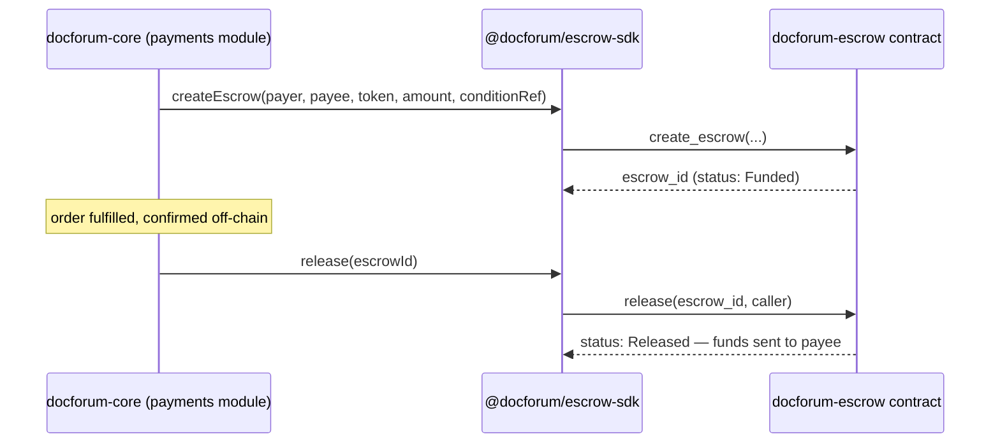

# docforum-escrow


**🔗 Live on testnet:** [`CAHQ4J3T23WSIBBG6SI6EAYR5Q2HIPKG5YMC4SMZBOTYA6MYK2VADEV5`](https://stellar.expert/explorer/testnet/contract/CAHQ4J3T23WSIBBG6SI6EAYR5Q2HIPKG5YMC4SMZBOTYA6MYK2VADEV5) — current deployment (Phase E4: adds the `refund_after` timeout refund), verified with real calls, not just uploaded. History and details: [`docs/testnet-deployments.md`](docs/testnet-deployments.md).

A [Soroban](https://developers.stellar.org/docs/build/smart-contracts) (Stellar) smart contract for conditional payment escrow — lock funds, and release them to the payee only when release is authorized, or return them to the payer on refund. Paired with a TypeScript client SDK, `@docforum/escrow-sdk`.

This repo is deliberately **generic and domain-agnostic**. It has no
database, no server, and no knowledge of patients, doctors, referrals, or
any other healthcare concept — it is a reusable create/release/refund
escrow primitive, in the same category as other Stellar ecosystem escrow
projects (e.g. Trustless Work). Anything domain-specific — what condition
triggers a release, who the parties are — lives in the consuming
application, not here.

## Table of contents

- [Why this repo exists](#why-this-repo-exists-honestly)
- [Contract surface](#contract-surface)
- [How it's used](#how-its-used)
- [Cross-contract integration](#cross-contract-integration)
- [Repo layout](#repo-layout)
- [Getting started](#getting-started)
- [Documentation](#documentation)
- [Project status](#project-status)
- [Contributing](#contributing)
- [License](#license)

## Why this repo exists, honestly

Two reasons, stated plainly rather than blended together:

1. **Product reason.** [`docforum-core`](https://github.com/DocForum/docforum-core)'s facility-fulfillment flow needs a way to hold payment until a facility confirms it did the work, without trusting the facility's self-report alone.
2. **Ecosystem reason.** This is the one piece of the `DocForum` organization that's actually built *on* Stellar, as opposed to an application that merely accepts Stellar payments — see [`docforum-core`'s ADR 0002](https://github.com/DocForum/docforum-core/blob/main/docs/adr/0002-stellar-escrow-for-fulfillment-payout.md) for why that distinction shaped how the org is structured, and [`docs/adr/0001-generic-escrow-not-healthcare-specific.md`](docs/adr/0001-generic-escrow-not-healthcare-specific.md) for why the contract itself stays domain-blind.

## Contract surface

The deploy-time `__constructor(allowed_tokens)` stores an immutable token
allowlist. Pass the token addresses the deployment accepts; an empty list
keeps the legacy open-token behavior. This policy cannot be changed after
deployment, so choosing an empty list deliberately disables the protection.

| Function | Status | Description |
|---|---|---|
| `__constructor(allowed_tokens)` | ✅ Implemented | Stores the immutable deploy-time token allowlist; an empty list allows all tokens. |
| `create_escrow(payer, payee, token, amount, condition_ref, releaser, refund_after) -> escrow_id` | ✅ Implemented | Pulls `amount` of `token` from `payer` (requires `payer` auth), stores an opaque `condition_ref`, sets status `Funded`. Rejects non-positive amounts, and any `refund_after` that isn't strictly in the future. |
| `get_status(escrow_id) -> EscrowStatus` | ✅ Implemented | Read-only. Errors on an unknown id. |
| `get_escrow(escrow_id) -> EscrowData` | ✅ Implemented | Read-only: everything stored about the escrow, including `releaser` and `refund_after`, so payees can check the deal before relying on it. |
| `release(escrow_id, caller) -> Result<()>` | ✅ Implemented | Restricted to the escrow's designated `releaser`; moves funds to `payee`. Never gated by `refund_after`. |
| `refund(escrow_id, caller) -> Result<()>` | ✅ Implemented | Returns funds to `payer`. The `releaser` may always call it; once `refund_after` has passed, anyone may — still only back to `payer` (see [ADR 0004](docs/adr/0004-timeout-refund-path.md)). |

```
EscrowStatus = Funded | Released | Refunded
```

`refund_after` is optional: an escrow created without one behaves exactly
as it did before the timeout existed — releaser-only refunds, forever.
That's the answer to "what if the releaser's key is lost?" (threat model
T2): instead of locking funds permanently, a deadline lets anyone return
them to the payer. See [ADR 0004](docs/adr/0004-timeout-refund-path.md)
for the decision and what it means for payees.

**Design rule, enforced deliberately:** the contract decides **who** may
call `release`/`refund`, never **why**. `condition_ref` is an opaque
string the contract stores but never interprets — all domain
interpretation (what counts as "fulfilled," who's authorized to attest to
it) is the consuming application's job. See
[ADR 0001](docs/adr/0001-generic-escrow-not-healthcare-specific.md).

## How it's used



`docforum-core` imports `@docforum/escrow-sdk` as a **library dependency**
— it never calls this contract as a running network service, and this
repo never crosses back into `docforum-core`'s database or domain model.

## Cross-contract integration

Soroban contracts (upgrades, vaults, marketplaces) that want to create or settle an escrow from their own logic should depend on the published interface crate instead of copying the WASM and using `contractimport!` adhoc.

`crates/escrow_interface/` exposes a contractclient-generated client and the shared types (`EscrowData`, `EscrowStatus`, `Error`). The escrow contract itself depends on the shared types, so the two can't drift. A working example contract lives in `contracts/examples/`.

Add the dependency and use the client:

```toml
[dependencies]
escrow-interface = { path = "../../crates/escrow-interface" }
```

```rust
use escrow_interface::{EscrowClient, EscrowData, EscrowStatus, Error};

let client = EscrowClient::new(&env.deployer(), &escrow_id);
let id = client.create_escrow(&payer, &payee, &token, &amount, &condition_ref, &releaser, &refund_after);
let data: EscrowData = client.get_escrow(&id);
```

### Auth requirements for contract-to-contract calls

When a contract calls the escrow, the authorization is on the **calling contract**, not an end user key:

- **Creating an escrow.** The calling contract must be the `payer` or must be authorized by the `payer`. Since `payer` is the address whose tokens are pulled, the calling contract must either hold the funds itself (`payer = contract address`) or obtain a sub-invocation auth from the payer before calling `create_escrow`. The contract calls `payer.require_auth()`, so a contract that is not the payer will fail unless the payer authorized the invocation chain.
- **Releasing an escrow.** The calling contract must be the escrow's designated `releaser` (or authorized by it). Set the calling contract's address as `releaser` at creation time if it will settle the escrow. The contract calls `releaser.require_auth()` on `release`.
- **Refunding.** Same as release — the calling contract must be the `releaser`, or the `refund_after` deadline must have passed (after which anyone may refund).

The example contract in `contracts/examples/` demonstrates this flow end-to-end with tests.

## Repo layout

```
crates/escrow-interface/
  src/lib.rs    Shared types + contractclient-generated client for cross-contract calls
contracts/escrow/
  src/lib.rs
    Contract implementation (depends on escrow-interface for shared types)
  tests/            Integration tests (soroban-sdk testutils) — required for any contract change
  Cargo.toml
contracts/examples/
  Example contract that creates and releases an escrow cross-contract, with tests
sdk/
  src/index.ts      @docforum/escrow-sdk — TypeScript client (not yet implemented, see issue #4)
  package.json
docs/adr/           Architecture decision records
.github/            CI workflow, issue/PR templates
```

## Getting started

Requires a Rust toolchain with the `wasm32v1-none` target.

```bash
git clone https://github.com/DocForum/docforum-escrow.git
cd docforum-escrow/contracts/escrow

# Run the test suite (28 tests, all passing today)
cargo test

# Build the deployable contract
cargo build --target wasm32v1-none --release
# → target/wasm32v1-none/release/docforum_escrow.wasm
```

Already deployed to Stellar **testnet** — see
[`docs/testnet-deployments.md`](docs/testnet-deployments.md) for the
contract id, transaction links, and the exact `stellar` CLI commands to
redeploy. **Mainnet is out of scope until the Phase E4 security review is
complete — see [hard rule 4](ARCHITECTURE_ESSENTIALS.md#hard-rules).**

The SDK supports relayed release/refund calls. `authorizeRelease` and
`authorizeRefund` simulate the invocation, ask the releaser to sign only
its short-lived contract authorization entry, and return a serialized
transaction. `submitRelayed` restores that transaction and lets a separate
relayer sign the envelope and pay its fee. The auth entry is bound to the
simulated invocation and expires after ten ledgers:

```ts
const authorization = await client.authorizeRelease({ escrowId, releaser, relayer });
const { txHash } = await client.submitRelayed("release", authorization, relayer);
```

Keep the serialized authorization private until submission and do not
retry it after its expiration ledger.

## Documentation

| Doc | Purpose |
|---|---|
| [`ARCHITECTURE_ESSENTIALS.md`](ARCHITECTURE_ESSENTIALS.md) | Stack, contract surface, hard rules (no PHI ever, tests required for contract changes, testnet-only until security review). |
| [`ROADMAP.md`](ROADMAP.md) | Phase E1–E6 breakdown and current status. |
| [`AGENTS.md`](AGENTS.md) / [`CLAUDE.md`](CLAUDE.md) | Rules for coding agents working in this repo — read `README.md` + `ARCHITECTURE_ESSENTIALS.md` first; you should rarely need `docforum-core`'s docs to work here. |
| [`docs/adr/0001-generic-escrow-not-healthcare-specific.md`](docs/adr/0001-generic-escrow-not-healthcare-specific.md) | Why the contract stays domain-blind. |

## Project status

**Phase E1 (contract skeleton): done.** `create_escrow` and `get_status`
are implemented, tested, and deployed live on testnet — not just locally
tested. Phases E2 (release/refund), E3 (TypeScript SDK), E4 (security
review, blocking for any mainnet use), and E6 (Rust interface crate for cross-contract calls) are tracked as open issues:

| Issue | Phase | Complexity |
|---|---|---|
| ~~#1 Deploy to testnet~~ — done, see above | E1 | Trivial |
| [#2 Implement `release()`](https://github.com/DocForum/docforum-escrow/issues/2) | E2 | High |
| [#3 Implement `refund()`](https://github.com/DocForum/docforum-escrow/issues/3) | E2 | High |
| [#4 SDK: wrap `create_escrow`/`get_status`](https://github.com/DocForum/docforum-escrow/issues/4) | E3 | Medium |
| [#5 ADR: npm vs GitHub Packages](https://github.com/DocForum/docforum-escrow/issues/5) | E3 | Trivial |
| [#6 Threat model + external security review](https://github.com/DocForum/docforum-escrow/issues/6) | E4 | High |
| Rust interface crate for cross-contract calls | E6 | High |

Full breakdown: [`ROADMAP.md`](ROADMAP.md).

## Contributing

Issues are scoped as small, independent units with a stated complexity
(Trivial/Medium/High) — see the
[good-first-issue template](.github/ISSUE_TEMPLATE/good-first-issue.md).
Any contract logic change **must** include tests in `contracts/escrow/tests/`
in the same PR — see `AGENTS.md` hard rules. This repo targets the Stellar
ecosystem's [Drips Wave](https://docs.drips.network/wave/) program; see
`docforum-core`'s
[ADR 0002](https://github.com/DocForum/docforum-core/blob/main/docs/adr/0002-stellar-escrow-for-fulfillment-payout.md)
for the readiness plan.

Questions, or want to talk through an issue before picking it up? Join the
DocForum contributor chat on [Telegram](https://t.me/+J9eZoFker_E4Y2M8).

## License

[Apache License 2.0](LICENSE)