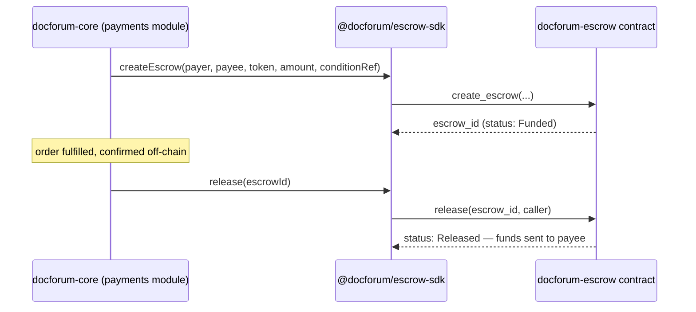

# docforum-escrow


**🔗 Live on testnet:** [`CB7WHNBNHEVPFTGDOWHFMDOWKLTA2Z4CBR3KZGYIVSSJNUT3OGWYSW2H`](https://stellar.expert/explorer/testnet/contract/CB7WHNBNHEVPFTGDOWHFMDOWKLTA2Z4CBR3KZGYIVSSJNUT3OGWYSW2H) — contract 3.0.0 from upstream main (storage reclaim for settled escrows, split payouts, vesting, split settlement, storage TTL, refund-deadline extension), verified with real create, release and refund calls. History and transaction links: [`docs/testnet-deployments.md`](docs/testnet-deployments.md).

A [Soroban](https://developers.stellar.org/docs/build/smart-contracts) (Stellar) smart contract for conditional payment escrow — lock funds, and release them to the payee only when release is authorized, or return them to the payer on refund. Paired with a TypeScript client SDK, `@docforum/escrow-sdk`.

This repo is deliberately **generic and domain-agnostic**. It has no
database, no server, and no knowledge of patients, doctors, referrals, or
any other healthcare concept — it is a reusable create/release/refund
escrow primitive, in the same category as other Stellar ecosystem escrow
projects (e.g. Trustless Work). Anything domain-specific — what condition
triggers a release, who the parties are — lives in the consuming
application, not here.

## Table of contents

- [Why this repo exists](#why-this-repo-exists-honestly)
- [Contract surface](#contract-surface)
- [How it's used](#how-its-used)
- [Trust model for integrators](#trust-model-for-integrators)
- [Repo layout](#repo-layout)
- [Getting started](#getting-started)
- [Documentation](#documentation)
- [Project status](#project-status)
- [Contributing](#contributing)
- [License](#license)

## Why this repo exists, honestly

Two reasons, stated plainly rather than blended together:

1. **Product reason.** [`docforum-core`](https://github.com/DocForum/docforum-core)'s facility-fulfillment flow needs a way to hold payment until a facility confirms it did the work, without trusting the facility's self-report alone.
2. **Ecosystem reason.** This is the one piece of the `DocForum` organization that's actually built *on* Stellar, as opposed to an application that merely accepts Stellar payments — see [`docforum-core`'s ADR 0002](https://github.com/DocForum/docforum-core/blob/main/docs/adr/0002-stellar-escrow-for-fulfillment-payout.md) for why that distinction shaped how the org is structured, and [`docs/adr/0001-generic-escrow-not-healthcare-specific.md`](docs/adr/0001-generic-escrow-not-healthcare-specific.md) for why the contract itself stays domain-blind.

## Contract surface

One generic escrow contract. A payer locks a token amount for a payee, and
the payout is settled by release (to the stored payee) or refund (to the
stored `refund_to`, which is the payer unless set otherwise at creation).
Creation options: a single releaser or an M-of-N releaser quorum, an
optional payee-acceptance gate, an optional `refund_after` timeout that
lets anyone trigger the refund, an optional `refund_to`, and an optional
release callback to a contract payee. An optional protocol fee
(`fee_recipient`/`fee_bps`, fixed at creation, at most 10 %) is taken off
the top at release and never on a refund — see
[ADR 0010](docs/adr/0010-protocol-fee-at-release.md). Funded escrows can be
topped up by the original payer, and `get_status`/`get_escrow` are
read-only (`get_escrow` is for funded escrows; a settled escrow's record is
reclaimed, so use `get_status` and the state event:
[ADR 0013](docs/adr/0013-reclaim-storage-for-settled-escrows.md)). `settle_many` releases or refunds up to 12 escrows in one
transaction with per-op results (the fast response to a leaked releaser
key, see [ADR 0012](docs/adr/0012-batch-settlement-best-effort.md)). A token
allowlist and an optional emergency-pause custodian are fixed at deploy
time; the custodian can only block **new** deposits, never touch escrowed
funds (see [Emergency pause](#emergency-pause)).

For retry-safe funding, `create_escrow_with_uniqueness` optionally indexes
`(payer, condition_ref)` on chain. A duplicate returns
`DuplicateConditionRef`; call `get_unique_escrow(payer, condition_ref)` to
recover the original id. The index is payer-scoped, retained through
settlement, and follows the escrow storage TTL. The legacy `create_escrow`
entry point does not enable uniqueness.

### Emergency pause

If a bug turns up after mainnet, the alternative to a pause is asking every
integrator to stop calling the contract. Since issue #35 there is a narrow
on-chain lever instead: one `pause_admin` address, fixed at deployment by
the contract's constructor, can flip a flag that makes every deposit path
fail with `Paused` (error code 38).

Nothing else changes. `release`, `refund`, the timeout refund, and both
`settle_many` ops (release and refund) never read the flag, so **a pause can never lock funds that are already escrowed** —
paused means "no new business", never "your money is stuck". The pause has
no timelock, no second role, and no power over existing escrows; unpausing
is the same custodian calling `unpause`. See
[ADR 0011](docs/adr/0011-emergency-pause-for-new-deposits-only.md) for the
design, the rejected alternatives (permissionless pause, auto-expiring
pause), and threat model T12 for the residual liveness risk.

For mainnet, pass a Stellar multisig account as `pause_admin` — no contract
change needed, since `require_auth` honours that account's own signer
thresholds. **Note:** this changes deployment (the constructor now takes
both the allowlist and the custodian), so the current testnet deployment
predates it and cannot pause; a redeploy is the follow-up step.
Pooled escrows — one agreement funded
by many payers, with per-payer contribution records and pull-based
pro-rata refunds — are a separate creation entry point
(`create_pooled_escrow`, see [ADR 0011](docs/adr/0011-pooled-escrow-funding.md)
and the contract surface list). A read-only `solvency(token)` view returns
the contract's balance of a token next to the total it owes across every
`Funded` escrow in that token (SDK: `client.getSolvency(token)`), so
monitors can check `balance >= liabilities` in one call — see
[threat model → Solvency monitoring](docs/threat-model.md#solvency-monitoring-issue-39).

**The full function list, signatures and rules are in
[`ARCHITECTURE_ESSENTIALS.md` → Contract surface](ARCHITECTURE_ESSENTIALS.md#contract-surface).**
It's kept in that one place so that adding or changing a contract function
is a single edit. Update that list, not this summary.

**Design rule, enforced deliberately:** the contract decides **who** may
call `release`/`refund`, never **why**. `condition_ref` is an opaque
string the contract stores but never interprets; all domain
interpretation (what counts as "fulfilled", who's authorized to attest to
it) is the consuming application's job. See
[ADR 0001](docs/adr/0001-generic-escrow-not-healthcare-specific.md).

## How it's used



`docforum-core` imports `@docforum/escrow-sdk` as a **library dependency**
— it never calls this contract as a running network service, and this
repo never crosses back into `docforum-core`'s database or domain model.

### `waitForStatus` helper for settlement confirmation

Integrators that hand settlement to another party (a relayer, an M-of-N
quorum, a payee that accepts first) need to wait until an escrow reaches a
given status, and each one otherwise writes its own `getStatus` polling loop
with its own timeout and cleanup bugs.

`client.waitForStatus(escrowId, statuses, { timeoutMs, pollIntervalMs, signal })`
polls until the status is one of `statuses` and resolves with
`{ escrowId, status }` — not a full escrow, since a settled escrow's record is
reclaimed ([ADR 0013](docs/adr/0013-reclaim-storage-for-settled-escrows.md)). It
rejects with a typed `WaitTimeoutError` on timeout, and also when the escrow
settles on a terminal status outside the target set (for example, waiting for
`Released` but it is now `Refunded`); `lastStatus` holds the last status seen.
An unknown escrow id rejects immediately with the same `NotFoundError`
`getStatus` raises, and an aborted `signal` rejects with the signal's reason
(an `AbortError` by default).

```ts
import { EscrowClient, WaitTimeoutError } from "@docforum/escrow-sdk";

const client = new EscrowClient({ contractId: "C…" });

const controller = new AbortController();
try {
  const { status } = await client.waitForStatus(escrowId, ["Released"], {
    timeoutMs: 30_000,
    pollIntervalMs: 2_000,
    signal: controller.signal,
  });
  console.log(`escrow ${escrowId} is ${status}`);
} catch (error) {
  if (error instanceof WaitTimeoutError) {
    // `undefined` when no read completed before the deadline.
    console.log(`timed out; last status: ${error.lastStatus ?? "unknown"}`);
  } else if (error instanceof DOMException && error.name === "AbortError") {
    console.log("cancelled");
  }
}
```

No timer or pending poll survives resolution, rejection or abort, so a helper
call never keeps a Node process alive. Offline tests with fake timers cover
resolution, timeout (including while a status read is in flight),
terminal-status mismatch, abort, and an unknown escrow id.

## Trust model for integrators

The contract enforces **who** may settle an escrow, not **why** — so a
status alone is not a promise about the deal. These properties are by
design. Read them before treating a `Funded` escrow as safe; the full
reasoning and threat ids are in [`docs/threat-model.md`](docs/threat-model.md).

- **`Funded` means "locked under the releaser's control", not "committed
  to the payee"** (threat model T8). The payer chooses the releaser, and
  nothing stops `releaser == payer`, in which case the payer can refund
  itself at any time. A payee should read `releasers`, `threshold`,
  `refundAfter` and `refundTo` with `getEscrow` / `client.getEscrow()`
  before relying on the escrow. A quorum still settles early if
  `threshold` releasers collude, and after `refundAfter` has passed
  anyone may refund, always to the stored `refundTo`.
- **Check the escrow's token, not just its status** (threat model T5).
  `Funded` only says funds were transferred in the escrow's stored
  `token`; it says nothing about whether that token is sound. A malicious
  or non-standard token can report a successful transfer without moving
  funds, and a clawback-enabled issuer can remove funds from the shared
  per-token balance after creation. Payees should verify `token` against
  a list they trust before relying on the escrow.
- **`condition_ref` is public on-chain forever** (threat model T9), as
  are `payer`, `payee` and `amount`. The contract does not interpret
  `condition_ref` and cannot redact it, so never put private, personal or
  otherwise sensitive data in it. Pass an opaque, meaningless id such as
  a UUID or an internal record id.
- **`contractId` is caller-supplied and unchecked** (threat model §4). A
  misconfigured or tampered id points the SDK at an arbitrary contract
  with the same function names, and `createEscrow` would send the payer's
  funds there. Pin `contractId` in your own config and check it against
  the contract ID and WASM hash recorded in the latest entry of
  [`docs/testnet-deployments.md`](docs/testnet-deployments.md) before
  using it. Pin the network passphrase too, and never take either from
  untrusted input.

## Repo layout

```
contracts/escrow/
  src/lib.rs             Contract entry: CONTRACT_VERSION, module list, re-exports
  src/*.rs               One module per area (create, pooled, release_refund, pause, …); Error enum in errors.rs
  tests/                 Integration tests (soroban-sdk testutils) — required for any contract change
  test_snapshots/        Committed Soroban snapshots (events/auth/storage) per test — issue #120
  Cargo.toml
certora/
  escrow.spec            Property list for invariants I1–I3 and the timeout rule (see docs/formal-verification.md)
sdk/
  src/index.ts           @docforum/escrow-sdk — EscrowClient + re-exports of the public modules (escrow-types, events, fees, …)
  src/generated/         Machine-generated contract bindings — never hand-edit (issue #121)
  src/signers/           SEP-43 signer types + optional Stellar Wallets Kit adapter
  typedoc.json           Generated API reference config + missing-doc lint (issue #79)
  examples/              Runnable per-flow SDK examples against testnet (issue #79)
  package.json
packages/escrow-react/   @docforum/escrow-react — React Query hooks (no UI)
sdk-go/                  Go client for the same contract (big.Int i128 amounts)
sdk-python/              Python client for the same contract (int i128 amounts)
examples/web-demo/       Vite + React demo wiring hooks, wallet and telemetry
scripts/
  check-generated-bindings.sh   CI/regeneration check for the generated bindings
  check-sdk-constants.mjs       CI check that SDK limits mirror the contract source (issue #333)
  stellar-cli-version           Pinned generator version (+ release checksum)
docs/adr/                Architecture decision records
.github/                 CI workflow, issue/PR templates
```

## Getting started

Requires the pinned Rust toolchain in [`rust-toolchain.toml`](rust-toolchain.toml), which includes `wasm32v1-none`.
For a hash-comparable release build, run `bash scripts/build-wasm.sh` from
the repository root; it normalizes source paths and the build timestamp.

```bash
git clone https://github.com/DocForum/docforum-escrow.git
cd docforum-escrow/contracts/escrow

# Run the test suite (also writes the
# committed test_snapshots/ files — see CONTRIBUTING.md)
cargo test

# Build the deployable contract
cargo build --target wasm32v1-none --release
# → target/wasm32v1-none/release/docforum_escrow.wasm
```

Already deployed to Stellar **testnet** — see
[`docs/testnet-deployments.md`](docs/testnet-deployments.md) for the
contract id, transaction links, and the exact `stellar` CLI commands to
redeploy. **Mainnet is out of scope until the Phase E4 security review is
complete — see [hard rule 4](ARCHITECTURE_ESSENTIALS.md#hard-rules).**

The SDK supports relayed release/refund calls. `authorizeRelease` and
`authorizeRefund` simulate the invocation, ask the releaser to sign only
its short-lived contract authorization entry, and return a serialized
transaction. `submitRelayed` restores that transaction and lets a separate
relayer sign the envelope and pay its fee. The auth entry is bound to the
simulated invocation and expires after ten ledgers:

```ts
const authorization = await client.authorizeRelease({ escrowId, releaser, relayer });
const { txHash } = await client.submitRelayed("release", authorization, relayer);
```

Keep the serialized authorization private until submission and do not
retry it after its expiration ledger.

### Milestone escrows

A milestone escrow pays out in fixed tranches instead of one lump sum.
The deployed contract is single-tranche, so the SDK models a schedule as a
**group of escrows** — one per tranche — created by `createMilestoneEscrow`.
No contract change is involved, and every per-escrow guarantee (releaser
auth, refund deadline, `Funded`/`Released` state) applies to each tranche:

```ts
const group = await client.createMilestoneEscrow({
  payer,
  payee,
  token,
  amount: 1_000_000n,             // must equal the sum of `milestones`
  conditionRef: "milestone-schedule",
  releaser,
  milestones: [600_000n, 400_000n],
});
group.escrowIds;    // [101n, 102n] — one single-tranche escrow per tranche

await client.releaseMilestone({ escrow: group, milestoneIndex: 0, caller: releaser }); // 600_000 to payee
await client.getMilestones(group); // [{ index: 0, … status: "released" }, { index: 1, … status: "unreleased" }]
await client.refundMilestone({ escrow: group, milestoneIndex: 1, caller: releaser });
```

The schedule is validated before the first transaction: entries must be
positive and sum exactly to `amount`, otherwise `createMilestoneEscrow`
rejects with `MilestoneScheduleError` and spends nothing. Each tranche's
`conditionRef` is tagged `<conditionRef>#m<i+1>/<n>` so a tranche stays
traceable on-chain, and a tag that would exceed the contract's 64-byte
`condition_ref` limit is rejected up front.

Two consequences of "one escrow per tranche" are worth knowing:

- A group costs one transaction per tranche, and creation is not atomic. If
  tranche *k* fails, the earlier escrows are already funded; the thrown
  `MilestoneEscrowPartialError` carries their ids so you can release or
  refund them instead of paying twice.
- Each tranche settles independently: refunding tranche 1 does not touch
  tranche 2, and released tranches are final.

### Pooled escrows

A pooled escrow funds **one agreement from many payers** (group purchase,
shared cost, crowdfunded work) while keeping every contribution on-chain
and refunding each payer exactly what they put in (issue #113,
[ADR 0011](docs/adr/0011-pooled-escrow-funding.md)). It is a distinct
creation entry point; single-payer escrows are untouched. All amounts are
raw token units.

```ts
// 1. Anyone creates the pool: target 1_000_000, funding closes at a deadline.
const { escrowId } = await client.createPooledEscrow({
  creator, payee, token,
  fundingTarget: 1_000_000n,
  conditionRef: "group-order-42",
  releaser,
  fundingDeadline: 1_760_000_000n, // unix seconds, must be in the future
});

// 2. Contributors fund it — accepted only before the deadline and only
//    while the total stays within the target (overfunding is rejected).
await client.contribute({ escrowId, payer: alice, amount: 400_000n });
await client.contribute({ escrowId, payer: bob,   amount: 350_000n });
await client.contribute({ escrowId, payer: alice, amount: 250_000n }); // accumulates: alice = 650_000

// 3a. Target reached (1_000_000): the releaser releases the pooled total.
await client.release({ escrowId, caller: releaser }); // 1_000_000 to payee

// 3b. Deadline passed below target: the round failed — release is blocked
//     (`FundingIncomplete`), late contributions are rejected, and every
//     contributor pulls back their own exact record, in any order.
await client.claimRefund({ escrowId, contributor: alice }); // 650_000 back to alice
await client.claimRefund({ escrowId, contributor: bob });   // 350_000 back to bob
// Optional release deadline (issue #288): after it, contributors can claimRefund even from a fully
// funded pool that was never released, so a lost releaser key can't lock it. Must be after fundingDeadline.
const { escrowId: guarded } = await client.createPooledEscrow({ ...poolParams, releaseDeadline: 1_760_086_400n });
(await client.getPooled(guarded)).releaseDeadline; // 1_760_086_400n, or undefined if unset

// A failed round nobody contributed to: anyone may give it its terminal Refunded status (issue #289).
// A round with contributions returns RefundNotOpen here; it closes on its last claimRefund instead.
await client.closeFailedRound(escrowId, { source: anyone });
```

Rules worth knowing before integrating:

- **Release needs the full target.** A partially funded pool can never
  be released; once the target is met, the deadline no longer matters —
  the round succeeded and the ordinary releaser rules apply.
- **The deadline is the only early exit.** Contributors cannot withdraw
  before it. After it passes with the target unmet, contributions are
  frozen forever and `claim_refund` opens to each contributor, once each
  (`AlreadyRefunded` afterwards), payable at any later time.
- **Refunds are pull-based and order-independent:** each claim pays only
  the calling contributor's recorded amount under their own signature —
  no one can claim anyone else's (`NoContribution`), and no entry point
  ever loops over contributors, so there is no contributor cap to hit.
- **Push refunds and `top_up` do not exist for pooled escrows**
  (`NotSupportedForPooled`): they would route the pool to one address or
  grow it without a per-payer record. Pooled escrows have no
  `refund_after` either — a *failed* round is the only refund window.
- **Read funding state with `getPooled`:** `getStatus` still returns
  `"Funded"` for a failed round (status describes settlement), so poll
  `getPooled()` (`fundingTarget`, `fundingDeadline`, `releaseDeadline`) plus the escrow's
  `amount` to tell open / succeeded / failed apart.
- The live testnet deployment predates these entry points; pooled
  functions work locally until the next redeploy
  ([`docs/testnet-deployments.md`](docs/testnet-deployments.md)).

### Recurring escrows

A recurring schedule funds one escrow per period from the payer's SEP-41
allowance (issue #115, [ADR 0015](docs/adr/0015-recurring-escrows-token-allowances.md); SDK
issue #468). The payer records the terms and grants the escrow contract an
allowance once. After that, any keeper funds each due period without the payer
signing again.

```ts
import { scheduleAllowanceExpirationLedger, scheduleAllowanceNeeded, scheduleState } from "@docforum/escrow-sdk";

const { scheduleId } = await client.createSchedule({
  payer, payee, token, releaser,
  amount: 250_000n, conditionRef: "sub-42",
  periodSeconds: 2_592_000n, totalPeriods: 12, firstDue: 1_900_000_000n,
  refundAfterSeconds: 86_400n, // relative: each period escrow's refundAfter = its funding time + 1 day
});

// The allowance is per payer and contract (and token), shared by all of this
// payer's schedules here, and `approve` replaces it: sum what each one needs.
const schedule = await client.getSchedule(scheduleId);
const latest = await client.getLedgerTime();
await client.approveScheduleAllowance({
  payer, token,
  amount: scheduleAllowanceNeeded(schedule), // remaining periods × amount
  expirationLedger: scheduleAllowanceExpirationLedger(schedule, latest),
});

// Keeper loop: compare against ledger time, never the local clock.
if (scheduleState(await client.getSchedule(scheduleId), (await client.getLedgerTime()).closeTime) === "due") {
  const { escrowId } = await client.fundNext(scheduleId, { source: keeper }); // one period per call
}

await client.cancelSchedule({ scheduleId, payer }); // funded periods are unaffected
```

`fundNext` funds exactly one period per call. A late keeper leaves the next
period due immediately, so check `scheduleState` again. Failures are typed:
`ScheduleTooEarlyError`, `ScheduleCompleteError`, `ScheduleCancelledError`,
`AllowanceExhaustedError` (the allowance is too small or expired, and the payer
must `approve` again) and `PausedError`, none of which the SDK retries.
`createSchedule` also runs offline the creation rules the contract only checks
at the first `fund_next`, so a misconfigured schedule fails before it is
recorded. The recorded testnet deployment predates recurring escrows.

## Verify this deployment

Contract WASM releases attach `docforum_escrow.wasm` and its
`docforum_escrow.wasm.sha256` checksum to each `contract-v*` GitHub
release. Download both files and verify the artifact with
`sha256sum -c docforum_escrow.wasm.sha256`.

To compare a fresh source build with a deployed contract, use Linux or
macOS with Rust 1.96.0, Docker, and Stellar CLI 28.1.0. The CLI archive
version and Linux x86-64 SHA-256 are recorded in
[`scripts/stellar-cli-version`](scripts/stellar-cli-version). For the
Linux x86-64 release archive, verify its checksum before extracting it:

```bash
curl -fsSLO https://github.com/stellar/stellar-cli/releases/download/v28.1.0/stellar-cli-28.1.0-x86_64-unknown-linux-gnu.tar.gz
echo 'c1680deee94301d33ada7a17f98411e642a4248c727afbd2e43050d345746462  stellar-cli-28.1.0-x86_64-unknown-linux-gnu.tar.gz' | sha256sum -c -
```

On other systems, install Stellar CLI 28.1.0 using its official
instructions and check `stellar --version` before continuing.

From the repository root, run the verifier with the contract ID. It builds
the current source and cross-checks the deployed WASM against its record:

```bash
bash scripts/verify-deployment CB7WHNBNHEVPFTGDOWHFMDOWKLTA2Z4CBR3KZGYIVSSJNUT3OGWYSW2H
```

Matching SHA-256 values mean the deployed bytes equal this source build.
A mismatch is a verification failure; confirm the contract ID, source
revision, toolchain, and build inputs match the deployment. The recorded
testnet deployment predates later contract changes, so its hash is
expected to differ from newer source. To confirm that different checkout
paths produce identical bytes, run
`bash scripts/check-wasm-reproducibility.sh`; CI runs the comparison in
the pinned `rust:1.96.0-bookworm` container. No `stellar contract optimize`
step is used.

The verifier also looks up the contract in `deployments.json` and prints the
recorded `wasmHash` next to the local build and on-chain hashes. All three
must agree; a missing record or a checkout that is not the recorded `gitSha`
is a warning, so an older deployment can still be checked. Pass
`--network testnet|futurenet|local` (or `--network=local`; testnet is the
default) and mainnet is refused until the security review. For a local
quickstart, set `LOCAL_RPC_URL` if it is not the default
`http://localhost:8000/rpc`.

Every `contract-v*` release WASM also carries a GitHub artifact attestation
(Sigstore-backed build provenance), which ties the published bytes to the
workflow run and commit that built them. After downloading the file, verify it
with the GitHub CLI:

```bash
gh attestation verify docforum_escrow.wasm -R DocForum/docforum-escrow
```

The SDK tarball attached to an `sdf-v*` release is attested the same way;
verify it with
`gh attestation verify docforum-escrow-sdk-<version>.tgz -R DocForum/docforum-escrow`.
`sha256sum -c` still detects corruption in transit;
the attestation answers where the bytes came from.

### Deploying with `scripts/deploy`

`scripts/deploy` is the one command for deploy, verify and record. From a
clean checkout it builds the WASM, checks its SHA-256 (optionally against
`--expected-wasm-hash`), uploads and deploys it with the constructor
allowlist (default: the network's native XLM contract), and confirms the
on-chain WASM matches. Then it runs a scripted live check: create,
release, refund, and three rejections (stranger release, double release,
zero amount). The record goes to `deployments.json`,
`docs/testnet-deployments.md` and the SDK's bundled deployments module.

```bash
# Against a local quickstart (writes nothing tracked):
docker run --rm -d -p 8000:8000 stellar/quickstart --local
scripts/deploy --dry-run

# Against testnet (accounts are generated and friendbot-funded unless
# DEPLOY_SOURCE_SECRET is set):
scripts/deploy
```

It refuses a dirty git tree and any network other than testnet or the local
quickstart. The SDK resolves recorded ids with `knownContractId("testnet")`
or `knownNetworkConfig("testnet")`.

An escrow created with `createQuorumEscrow` settles with M-of-N approvals;
each supplied keypair signs only the contract auth entry for that one call, and
the first pays the fee:

```ts
const { escrowId } = await client.createQuorumEscrow({
  payer, payee, token, amount, conditionRef,
  releasers: [a, b, c],
  threshold: 2,
});
await client.releaseWithApprovals({ escrowId, approvers: [a, c] });
```

### Lifecycle amendments

Top up a funded escrow, accept as the payee, or cancel as the payer before
the payee accepts. Each call reads the escrow first and throws
`EscrowPreconditionError` (with a `code` such as `"AlreadyAccepted"`) instead
of sending a transaction the contract would reject:

```ts
await client.topUp({ escrowId, payer, amount: 500_000n });

const { escrowId: gated } = await client.createEscrow({ ...params, requiresAcceptance: true });
await client.accept({ escrowId: gated, payee });   // payer can no longer cancel
await client.transferPayee({ escrowId, currentPayee: payee, newPayee }); // payee rotates wallets; newPayee must not be the payer or the contract id, and on a notifyPayee escrow must implement the callback
// before acceptance: await client.cancel({ escrowId: gated, payer });
```

When the signer and the submitter are on different machines, pass the call
between them as JSON:

```ts
// Machine A (submitter, pays the fee)
const prepared = await client.prepareLifecycleCall({
  call: { method: "top_up", escrowId, payer: payerAddress, amount: 500_000n },
  source: relayerAddress,
});
// Machine B (each address in prepared.pendingSigners)
const signed = await client.signLifecycleCall(prepared, payer);
// Machine A
await client.submitLifecycleCall(signed, relayer, "top_up");
```

### Retry-safe creation

A backend that retries "fund order X" after a timeout must not lock funds
twice. Pass `unique: true` to make creation idempotent per `(payer,
conditionRef)` (contract #47, SDK issue #469):

```ts
const result = await client.createEscrow({ ...params, conditionRef: "order-42", unique: true });
if (result.existing) {
  // A previous attempt already created it: no transaction was sent.
  console.log(`escrow ${result.escrowId} already exists (${result.status})`);
} else {
  console.log(`created escrow ${result.escrowId} in ${result.txHash}`);
}
const id = await client.getUniqueEscrow(payer, "order-42"); // bigint | undefined
```

A duplicate is detected whether it shows up at simulation or after submission,
for example when a resubmitted transaction has already landed. The existing
escrow's payee, token and amount are checked against the request, and a
mismatch throws `UniqueEscrowMismatchError` rather than reporting success.
Once the escrow settles, its record is reclaimed but the index survives, so a
retry still returns `existing: true` with the terminal `status` (the terms
can't be checked then). The index is per payer. `unique` can't be combined
with `requiresAcceptance`, `releaseNotBefore` or quorum options. Without
`unique`, `createEscrow` sends exactly what it always has.

### Fee estimation and fee-bump sponsorship

Sponsors can price a call before paying for it, and wrap a user-signed
transaction in a fee-bump with a hard cap. `estimate` simulates against
the configured RPC — nothing is signed or sent — and returns the resource
fee (with a 20% buffer over the simulated minimum, rounded up), the
inclusion fee, and their total, all in stroops:

```ts
import { Address, nativeToScVal } from "@stellar/stellar-sdk";

const estimate = await client.estimate({
  source: payer,
  method: "release",
  args: [nativeToScVal(escrowId, { type: "u64" }), new Address(releaser).toScVal()],
});
if (estimate.total > budget) throw new Error("too expensive to sponsor");
```

`guardSponsorship` decides whether a transaction is safe to sponsor: it
inspects **every** operation and every contract-address auth entry, and
rejects anything that is not an invocation of the escrow contract (a
foreign contract id, a smuggled payment, a double fee-bump). Account
auth entries — the payer's and releaser's signatures — are expected and
allowed:

```ts
const guard = client.guardSponsorship(signedXdr);
if (!guard.ok) throw new Error(guard.reasons.join("; "));
// or: client.assertSponsorable(signedXdr) — throws SponsorshipGuardError
```

`feeBump` wraps the signed envelope for the sponsor. Its fee is
`baseFee × (inner operations + 1)` (the inner fee is refunded), and it
throws `MaxFeeExceededError` before building anything if that would
exceed `maxFee` — the cap is never silently overshot:

```ts
const { xdr, fee } = client.feeBump(signedXdr, sponsor, { maxFee: 10_000n });
```

### Prepare, sign elsewhere, submit

`EscrowClient` normally signs with a key it holds. When the payer signs in a
browser wallet and a backend builds and submits, split the steps:

```ts
// 1. Backend: build + simulate for a public key. Nothing is signed.
const prepared = await client.prepareCreateEscrow({
  payer: payerPublicKey, payee, token, amount, conditionRef, releaser,
});
// { xdr, hash, validUntilLedger, source, authSigners, authValidUntilLedger }

// 2. Wallet (Freighter, Stellar Lab, the CLI, ...): sign prepared.xdr.

// 3. Backend: verify, submit and wait.
const { escrowId, txHash } = await client.submitSigned(signedXdr, {
  expectedHash: prepared.hash,        // reject a different transaction
  feeBumpSigner: sponsorKeypair,      // optional: sponsor pays the fee
  maxFee: 50_000_000n,                // hard cap on what the sponsor pays
});
```

- **Envelope signing (default).** The payer is the transaction source, so the
  wallet only signs the envelope. To have a backend account pay the fee instead,
  pass `source`; `authSigners` then lists the payer, who must sign a Soroban auth
  entry (`signAuthEntries`) before the envelope.
- **Expiry.** The transaction is valid until `validUntilLedger` (default about
  ten minutes, `validForLedgers` to change it). After that `submitSigned` throws
  `PreparedTransactionExpiredError`; prepare again.
- **Stale sequence.** If another transaction from the source account lands first,
  `submitSigned` throws `StaleSequenceError` before sending.
- **Fee-bump cap.** The cap is checked against the fee actually charged,
  including the Soroban resource fee, and the bump's base fee defaults to the
  inner transaction's fee rate.

Migration: purely additive. `createEscrow` is unchanged; existing integrations
need no changes.

### Offline signing for release and refund

Keeping the releaser key hot on a server is the risk the threat model warns about
(T1). Prepare online, sign offline, submit from anywhere:

```ts
const prepared = await client.prepareRelease({ escrowId, releaser }); // or prepareRefund
// Sign prepared.xdr on an air-gapped machine. For a classic multisig releaser,
// each signer signs their own copy; then combine them:
const merged = client.mergeSignatures([signedByA, signedByB]);
await client.submitSigned(merged, { expectedHash: prepared.hash });
```

- **Cold key or multisig as the source.** By default the releaser is the
  transaction source, so its envelope signature(s) authorize the call; no
  separate auth entries exist. `mergeSignatures` rejects copies of a different
  transaction and drops duplicates; the network checks the account's thresholds.
- **Hot fee payer, cold releaser.** Set `source` to a hot account; the releaser
  then appears in `authSigners`. Sign its auth entry first
  (`signAuthEntries(xdr, keypair, { validUntilLedger })`, window set by
  `authValidForLedgers`), then sign the envelope. The auth step changes the
  hash, so use the hash it returns.
- **Staleness.** An offline-signed transaction dies if the source account's
  sequence moves or the window passes. `submitSigned` detects both before
  sending (`StaleSequenceError`, `PreparedTransactionExpiredError`). The default
  window is about a day (`OFFLINE_PREPARED_TX_TTL_LEDGERS`).
- **Example.** `examples/offline-release/` has prepare / sign / submit scripts
  and a 2-of-3 testnet setup.

M-of-N quorum escrows settle through `releaseWithApprovals`, not this flow.

### Browser wallets (Stellar Wallets Kit)

`WalletsKitSigner` adapts the selected Stellar Wallets Kit wallet to the SDK's
SEP-43 `Signer`, so `createEscrow`/`release`/`refund` sign in the browser with
the same calls used server-side. The adapter has **no runtime import** of the
kit (it is an optional peer dependency), and lives on a subpath so server
bundles never include wallet code:

```ts
import { WalletsKitSigner } from "@docforum/escrow-sdk/signers/wallets-kit";
import { Networks, StellarWalletsKit } from "@creit.tech/stellar-wallets-kit";

StellarWalletsKit.init({ modules, network: Networks.TESTNET });
const signer = await WalletsKitSigner.connect({
  kit: StellarWalletsKit,
  networkPassphrase: Networks.TESTNET,
});
await client.release({ escrowId, caller: signer });
```

A wallet on another network throws `WalletNetworkMismatchError` before
signing. A user rejecting the prompt is returned as SEP-43
`{ signedTxXdr: "", error: { code: -4 } }` rather than a crash. Complete
example: [`examples/web-demo/src/wallet.ts`](examples/web-demo/src/wallet.ts).

### React hooks

[`@docforum/escrow-react`](packages/escrow-react) provides `useEscrow(id)`,
`useEscrowActions(signer)` and `useEscrowTimeline(escrow)` on top of TanStack
Query. Polling stops at `Released`/`Refunded`; the timeline documents ledger
time vs local time. Hooks only — no components or styling.

```tsx
<QueryClientProvider client={queryClient}>
  <EscrowProvider client={escrowClient} clientKey={contractId}>
    <EscrowView id={escrowId} />
  </EscrowProvider>
</QueryClientProvider>
```

### Ledger time for deadlines

`useEscrowTimeline` counts down to `refundAfter`, which the contract compares
to the **ledger** close time, not the local clock. Ask the chain for the
offset instead of passing one by hand:

```tsx
const offsetMs = await escrowClient.ledgerClockOffset(); // ledger time − local time
const { remainingMs, expired } = useEscrowTimeline(escrow, { ledgerTimeOffsetMs: offsetMs });
```

`client.getLedgerTime()` returns the latest ledger's `closeTime`, `sequence`
and that `offsetMs`, cached for a few seconds (`{ maxAgeMs: 0 }` forces a
fresh read). The offset is advisory: ledger close time lags real time — often
by several seconds — and the contract decides whether a deadline has passed.

### Telemetry

`EscrowClient` accepts optional instrumentation (OpenTelemetry is an optional
peer dependency, no-op when absent) with one span each for `simulate`, `sign`,
`submit` and `confirm`, plus an `onEvent` hook for integrators who don't run
OTel:

```ts
const client = new EscrowClient({
  contractId,
  instrumentation: { tracer: await otelTracer() },
  onEvent: (event) => metrics.record(event.name, event.durationMs),
});
```

Attributes are contract id, function, escrow id, transaction hash and retry
count. Account addresses are **omitted by default** and only included with
`includeAddresses: true`.

### Go client

[`sdk-go/`](sdk-go) mirrors the TypeScript surface (`CreateEscrow`,
`GetStatus`, `GetEscrow`, `Release`, `Refund`) with context-aware methods,
typed contract errors and `big.Int` i128 amounts. See
[`sdk-go/README.md`](sdk-go/README.md).

The same client also wraps payee acceptance (`accept`, `cancel`,
`transfer_payee`), pooled escrows (`create_pooled_escrow`, `contribute`,
`claim_refund`, `get_pooled`, `get_contribution`) and the chunked batch entry
points (`create_escrows`, `settle_many`, with `MaxBatchSize`/`MaxSettleOps`
mirroring the contract's measured limits) — see issues #340, #341 and #344.

The TypeScript SDK (`sdk/`) wraps the contract and is distributed as a tagged
GitHub Release tarball; see [issue #4](https://github.com/DocForum/docforum-escrow/issues/4)
and [ADR 0003](docs/adr/0003-sdk-distribution.md).

SDK errors are typed by contract error code and common RPC failure category.
See [`docs/sdk-errors.md`](docs/sdk-errors.md) for the error classes and a
consumer migration example.

### Python client

[`sdk-python/`](sdk-python) mirrors the TypeScript surface (creation, reads,
settlement and the single-party amendments) on the Stellar Python SDK,
with typed contract errors and plain `int` i128 amounts. Testnet only, not
on PyPI yet. See [`sdk-python/README.md`](sdk-python/README.md).

### Verify a deployed releaser account

Each `contract-v*` GitHub release publishes `docforum_releaser_account.wasm`
and `docforum_releaser_account.wasm.sha256`. Download both from the
[repository's Releases](https://github.com/DocForum/docforum-escrow/releases)
and verify the downloaded file:

```bash
sha256sum -c docforum_releaser_account.wasm.sha256
```

A deployed releaser account has a contract address distinct from the escrow
contract it is configured to authorize. Fetch the WASM for the deployed
account and compare its SHA-256 with the release asset:

```bash
stellar contract fetch --id "$RELEASER_ACCOUNT_ID" \
  --rpc-url https://soroban-testnet.stellar.org \
  --network-passphrase 'Test SDF Network ; September 2015' \
  --out-file deployed_releaser_account.wasm
sha256sum deployed_releaser_account.wasm docforum_releaser_account.wasm
```

The checksum file verifies the bytes downloaded from GitHub; the fetched
on-chain WASM hash identifies the code used by that deployed account. They
should match when that account was deployed from the published artifact. Then
inspect its immutable escrow target and current quorum/policy settings with the
read-only views `escrow`, `threshold`, `signer_count`, and `policy`. For
example, with a Stellar CLI source alias configured for your testnet:

```bash
stellar contract invoke --send=no --id "$RELEASER_ACCOUNT_ID" \
  --source "$SOURCE_ACCOUNT" --rpc-url https://soroban-testnet.stellar.org \
  --network-passphrase 'Test SDF Network ; September 2015' -- escrow
stellar contract invoke --send=no --id "$RELEASER_ACCOUNT_ID" \
  --source "$SOURCE_ACCOUNT" --rpc-url https://soroban-testnet.stellar.org \
  --network-passphrase 'Test SDF Network ; September 2015' -- threshold
stellar contract invoke --send=no --id "$RELEASER_ACCOUNT_ID" \
  --source "$SOURCE_ACCOUNT" --rpc-url https://soroban-testnet.stellar.org \
  --network-passphrase 'Test SDF Network ; September 2015' -- signer_count
stellar contract invoke --send=no --id "$RELEASER_ACCOUNT_ID" \
  --source "$SOURCE_ACCOUNT" --rpc-url https://soroban-testnet.stellar.org \
  --network-passphrase 'Test SDF Network ; September 2015' -- policy
```

Compare those values with the deployment's independently recorded
configuration. The contract exposes a signer count but no signer-list view, so
verify the signer set against the deployment configuration and its
key-management records.

## Documentation

| Doc | Purpose |
|---|---|
| [`ARCHITECTURE_ESSENTIALS.md`](ARCHITECTURE_ESSENTIALS.md) | Stack, contract surface, hard rules (no PHI ever, tests required for contract changes, testnet-only until security review). |
| [`ROADMAP.md`](ROADMAP.md) | Phase breakdown and current status. |
| [`AGENTS.md`](AGENTS.md) / [`CLAUDE.md`](CLAUDE.md) | Rules for coding agents working in this repo — read `README.md` + `ARCHITECTURE_ESSENTIALS.md` first; you should rarely need `docforum-core`'s docs to work here. |
| [`docs/formal-verification.md`](docs/formal-verification.md) | Formal-verification spike for invariants I1–I3: what `certora/escrow.spec` covers, the assumptions it relies on, and its current status (specified, not yet machine-checked). |
| [`docs/adr/0001-generic-escrow-not-healthcare-specific.md`](docs/adr/0001-generic-escrow-not-healthcare-specific.md) | Why the contract stays domain-blind. |
| [`sdk/examples/`](sdk/examples/) | Runnable, secret-free SDK examples — one per major flow, against testnet. |
| SDK API reference | Generated by TypeDoc from `sdk/` (`npm run docs`); published to GitHub Pages. |
| [`docs/runbooks/emergency-pause.md`](docs/runbooks/emergency-pause.md) | Operational runbook for activating, verifying, and lifting the deposit-only emergency pause. |
| [`docs/runbooks/redeploy-cutover.md`](docs/runbooks/redeploy-cutover.md) | Step-by-step checklist and procedure for deploying new contract instances and migrating integrators. |
| [`docs/guides/creation-matrix.md`](docs/guides/creation-matrix.md) | Matrix of escrow creation entry points, supported options, and SDK mapping. |

## Project status

**Phase E1 (contract skeleton): done.** `create_escrow` and `get_status`
are implemented, tested, and deployed live on testnet — not just locally
tested. Phases E2 (release/refund), E3 (TypeScript SDK), and E4 (security
review, blocking for any mainnet use) are tracked as open issues. Phase E5
now also includes an optional in-contract M-of-N releaser quorum
([ADR 0007](docs/adr/0007-in-contract-m-of-n-releaser-quorum.md)) and a
documented decision **not** to adopt OpenZeppelin's pause/upgradeable/access
modules ([ADR 0006](docs/adr/0006-openzeppelin-stellar-library-evaluation.md));
both are implemented, tested, and deployed on testnet (see
[`docs/testnet-deployments.md`](docs/testnet-deployments.md)). Phase E7 adds
committed contract test snapshots (issue #120) and a CI check that the
generated SDK bindings match the contract WASM (issue #121):

| Issue | Phase | Complexity |
|---|---|---|
| ~~#1 Deploy to testnet~~ — done, see above | E1 | Trivial |
| [#2 Implement `release()`](https://github.com/DocForum/docforum-escrow/issues/2) | E2 | High |
| [#3 Implement `refund()`](https://github.com/DocForum/docforum-escrow/issues/3) | E2 | High |
| [#4 SDK: wrap `create_escrow`/`get_status`](https://github.com/DocForum/docforum-escrow/issues/4) | E3 | Medium |
| [#5 ADR: npm vs GitHub Packages](https://github.com/DocForum/docforum-escrow/issues/5) | E3 | Trivial |
| [#6 Threat model + external security review](https://github.com/DocForum/docforum-escrow/issues/6) | E4 | High |

Full breakdown: [`ROADMAP.md`](ROADMAP.md).

### SDK/contract compatibility

The `SDK/contract compatibility` workflow builds each `sdk-v*` contract tag,
deploys the artifacts to a local network, and exercises current-SDK reads and
settlement against those deployments. It also checks the last two SDK releases
against the current contract. Missing results fail the job, while
known-incompatible ABI pairs are listed explicitly.

| SDK release | Contract deployment | Result |
| --- | --- | --- |
| `sdk-v0.1.0` | `sdk-v0.1.0` | verified read/settle |
| `sdk-v0.1.0` | `sdk-v0.2.0` | verified read/settle |
| `sdk-v0.1.0` | `main` | known-incompatible: legacy create ABI |
| `sdk-v0.2.0` | `sdk-v0.1.0` | verified read/settle |
| `sdk-v0.2.0` | `sdk-v0.2.0` | verified read/settle |
| `sdk-v0.2.0` | `main` | known-incompatible: legacy create ABI |
| `main` | `sdk-v0.1.0` | verified read/settle |
| `main` | `sdk-v0.2.0` | verified read/settle |
| `main` | `main` | verified read/settle |

## Contributing

Issues are scoped as small, independent units with a stated complexity
(Trivial/Medium/High) — see the
[good-first-issue template](.github/ISSUE_TEMPLATE/good-first-issue.md).
Any contract logic change **must** include tests in `contracts/escrow/tests/`
in the same PR — see `AGENTS.md` hard rules. This repo targets the Stellar
ecosystem's [Drips Wave](https://docs.drips.network/wave/) program; see
`docforum-core`'s
[ADR 0002](https://github.com/DocForum/docforum-core/blob/main/docs/adr/0002-stellar-escrow-for-fulfillment-payout.md)
for the readiness plan.

Questions, or want to talk through an issue before picking it up? Join the
DocForum contributor chat on [Telegram](https://t.me/+J9eZoFker_E4Y2M8).

## License

[Apache License 2.0](LICENSE)

The SDK exports an in-memory `FakeEscrowClient` from `@docforum/escrow-sdk/testing` for consumer tests. It accepts a controllable clock for deterministic deadline and race scenarios.
