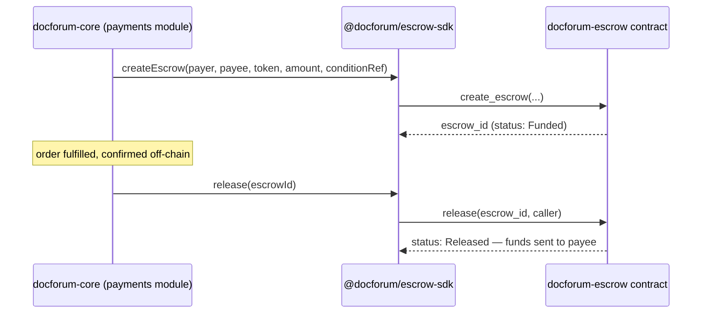

# docforum-escrow


**🔗 Live on testnet:** [`CAHQ4J3T23WSIBBG6SI6EAYR5Q2HIPKG5YMC4SMZBOTYA6MYK2VADEV5`](https://stellar.expert/explorer/testnet/contract/CAHQ4J3T23WSIBBG6SI6EAYR5Q2HIPKG5YMC4SMZBOTYA6MYK2VADEV5) — current deployment (Phase E4: adds the `refund_after` timeout refund), verified with real calls, not just uploaded. History and details: [`docs/testnet-deployments.md`](docs/testnet-deployments.md).

A [Soroban](https://developers.stellar.org/docs/build/smart-contracts) (Stellar) smart contract for conditional payment escrow — lock funds, and release them to the payee only when release is authorized, or return them to the payer on refund. Paired with a TypeScript client SDK, `@docforum/escrow-sdk`.

This repo is deliberately **generic and domain-agnostic**. It has no
database, no server, and no knowledge of patients, doctors, referrals, or
any other healthcare concept — it is a reusable create/release/refund
escrow primitive, in the same category as other Stellar ecosystem escrow
projects (e.g. Trustless Work). Anything domain-specific — what condition
triggers a release, who the parties are — lives in the consuming
application, not here.

## Table of contents

- [Why this repo exists](#why-this-repo-exists-honestly)
- [Contract surface](#contract-surface)
- [How it's used](#how-its-used)
- [Repo layout](#repo-layout)
- [Getting started](#getting-started)
- [Documentation](#documentation)
- [Project status](#project-status)
- [Contributing](#contributing)
- [License](#license)

## Why this repo exists, honestly

Two reasons, stated plainly rather than blended together:

1. **Product reason.** [`docforum-core`](https://github.com/DocForum/docforum-core)'s facility-fulfillment flow needs a way to hold payment until a facility confirms it did the work, without trusting the facility's self-report alone.
2. **Ecosystem reason.** This is the one piece of the `DocForum` organization that's actually built *on* Stellar, as opposed to an application that merely accepts Stellar payments — see [`docforum-core`'s ADR 0002](https://github.com/DocForum/docforum-core/blob/main/docs/adr/0002-stellar-escrow-for-fulfillment-payout.md) for why that distinction shaped how the org is structured, and [`docs/adr/0001-generic-escrow-not-healthcare-specific.md`](docs/adr/0001-generic-escrow-not-healthcare-specific.md) for why the contract itself stays domain-blind.

## Contract surface

One generic escrow contract. A payer locks a token amount for a payee, and
the payout is settled by release (to the stored payee) or refund (to the
stored `refund_to`, which is the payer unless set otherwise at creation).
Creation options: a single releaser or an M-of-N releaser quorum, an
optional payee-acceptance gate, an optional `refund_after` timeout that
lets anyone trigger the refund, an optional `refund_to`, and an optional
release callback to a contract payee. Funded escrows can be topped up by
the original payer, and `get_status`/`get_escrow` are read-only. A token
allowlist is fixed at deploy time.

**The full function list, signatures and rules are in
[`ARCHITECTURE_ESSENTIALS.md` → Contract surface](ARCHITECTURE_ESSENTIALS.md#contract-surface).**
It's kept in that one place so that adding or changing a contract function
is a single edit. Update that list, not this summary.

**Design rule, enforced deliberately:** the contract decides **who** may
call `release`/`refund`, never **why**. `condition_ref` is an opaque
string the contract stores but never interprets; all domain
interpretation (what counts as "fulfilled", who's authorized to attest to
it) is the consuming application's job. See
[ADR 0001](docs/adr/0001-generic-escrow-not-healthcare-specific.md).

## How it's used



`docforum-core` imports `@docforum/escrow-sdk` as a **library dependency**
— it never calls this contract as a running network service, and this
repo never crosses back into `docforum-core`'s database or domain model.

## Repo layout

```
contracts/escrow/
  src/lib.rs             Contract implementation
  tests/                 Integration tests (soroban-sdk testutils) — required for any contract change
  test_snapshots/        Committed Soroban snapshots (events/auth/storage) per test — issue #120
  Cargo.toml
sdk/
  src/index.ts           @docforum/escrow-sdk — hand-written public surface
  src/generated/         Machine-generated contract bindings — never hand-edit (issue #121)
  package.json
scripts/
  check-generated-bindings.sh   CI/regeneration check for the generated bindings
  stellar-cli-version           Pinned generator version (+ release checksum)
docs/adr/                Architecture decision records
.github/                 CI workflow, issue/PR templates
```

## Getting started

Requires a Rust toolchain with the `wasm32v1-none` target.

```bash
git clone https://github.com/DocForum/docforum-escrow.git
cd docforum-escrow/contracts/escrow

# Run the test suite (also writes the
# committed test_snapshots/ files — see CONTRIBUTING.md)
cargo test

# Build the deployable contract
cargo build --target wasm32v1-none --release
# → target/wasm32v1-none/release/docforum_escrow.wasm
```

Already deployed to Stellar **testnet** — see
[`docs/testnet-deployments.md`](docs/testnet-deployments.md) for the
contract id, transaction links, and the exact `stellar` CLI commands to
redeploy. **Mainnet is out of scope until the Phase E4 security review is
complete — see [hard rule 4](ARCHITECTURE_ESSENTIALS.md#hard-rules).**

The SDK supports relayed release/refund calls. `authorizeRelease` and
`authorizeRefund` simulate the invocation, ask the releaser to sign only
its short-lived contract authorization entry, and return a serialized
transaction. `submitRelayed` restores that transaction and lets a separate
relayer sign the envelope and pay its fee. The auth entry is bound to the
simulated invocation and expires after ten ledgers:

```ts
const authorization = await client.authorizeRelease({ escrowId, releaser, relayer });
const { txHash } = await client.submitRelayed("release", authorization, relayer);
```

Keep the serialized authorization private until submission and do not
retry it after its expiration ledger.

An escrow created with `createQuorumEscrow` settles with M-of-N approvals;
each supplied keypair signs only the contract auth entry for that one call, and
the first pays the fee:

```ts
const { escrowId } = await client.createQuorumEscrow({
  payer, payee, token, amount, conditionRef,
  releasers: [a, b, c],
  threshold: 2,
});
await client.releaseWithApprovals({ escrowId, approvers: [a, c] });
```

### Fee estimation and fee-bump sponsorship

Sponsors can price a call before paying for it, and wrap a user-signed
transaction in a fee-bump with a hard cap. `estimate` simulates against
the configured RPC — nothing is signed or sent — and returns the resource
fee (with a 20% buffer over the simulated minimum, rounded up), the
inclusion fee, and their total, all in stroops:

```ts
import { Address, nativeToScVal } from "@stellar/stellar-sdk";

const estimate = await client.estimate({
  source: payer,
  method: "release",
  args: [nativeToScVal(escrowId, { type: "u64" }), new Address(releaser).toScVal()],
});
if (estimate.total > budget) throw new Error("too expensive to sponsor");
```

`guardSponsorship` decides whether a transaction is safe to sponsor: it
inspects **every** operation and every contract-address auth entry, and
rejects anything that is not an invocation of the escrow contract (a
foreign contract id, a smuggled payment, a double fee-bump). Account
auth entries — the payer's and releaser's signatures — are expected and
allowed:

```ts
const guard = client.guardSponsorship(signedXdr);
if (!guard.ok) throw new Error(guard.reasons.join("; "));
// or: client.assertSponsorable(signedXdr) — throws SponsorshipGuardError
```

`feeBump` wraps the signed envelope for the sponsor. Its fee is
`baseFee × (inner operations + 1)` (the inner fee is refunded), and it
throws `MaxFeeExceededError` before building anything if that would
exceed `maxFee` — the cap is never silently overshot:

```ts
const { xdr, fee } = client.feeBump(signedXdr, sponsor, { maxFee: 10_000n });
```

## Documentation

| Doc | Purpose |
|---|---|
| [`ARCHITECTURE_ESSENTIALS.md`](ARCHITECTURE_ESSENTIALS.md) | Stack, contract surface, hard rules (no PHI ever, tests required for contract changes, testnet-only until security review). |
| [`ROADMAP.md`](ROADMAP.md) | Phase breakdown and current status. |
| [`AGENTS.md`](AGENTS.md) / [`CLAUDE.md`](CLAUDE.md) | Rules for coding agents working in this repo — read `README.md` + `ARCHITECTURE_ESSENTIALS.md` first; you should rarely need `docforum-core`'s docs to work here. |
| [`docs/adr/0001-generic-escrow-not-healthcare-specific.md`](docs/adr/0001-generic-escrow-not-healthcare-specific.md) | Why the contract stays domain-blind. |

## Project status

**Phase E1 (contract skeleton): done.** `create_escrow` and `get_status`
are implemented, tested, and deployed live on testnet — not just locally
tested. Phases E2 (release/refund), E3 (TypeScript SDK), and E4 (security
review, blocking for any mainnet use) are tracked as open issues. Phase E5
now also includes an optional in-contract M-of-N releaser quorum
([ADR 0007](docs/adr/0007-in-contract-m-of-n-releaser-quorum.md)) and a
documented decision **not** to adopt OpenZeppelin's pause/upgradeable/access
modules ([ADR 0006](docs/adr/0006-openzeppelin-stellar-library-evaluation.md));
both are implemented and tested but **not yet redeployed to testnet** (see
[`docs/testnet-deployments.md`](docs/testnet-deployments.md)). Phase E7 adds
committed contract test snapshots (issue #120) and a CI check that the
generated SDK bindings match the contract WASM (issue #121):

| Issue | Phase | Complexity |
|---|---|---|
| ~~#1 Deploy to testnet~~ — done, see above | E1 | Trivial |
| [#2 Implement `release()`](https://github.com/DocForum/docforum-escrow/issues/2) | E2 | High |
| [#3 Implement `refund()`](https://github.com/DocForum/docforum-escrow/issues/3) | E2 | High |
| [#4 SDK: wrap `create_escrow`/`get_status`](https://github.com/DocForum/docforum-escrow/issues/4) | E3 | Medium |
| [#5 ADR: npm vs GitHub Packages](https://github.com/DocForum/docforum-escrow/issues/5) | E3 | Trivial |
| [#6 Threat model + external security review](https://github.com/DocForum/docforum-escrow/issues/6) | E4 | High |

Full breakdown: [`ROADMAP.md`](ROADMAP.md).

## Contributing

Issues are scoped as small, independent units with a stated complexity
(Trivial/Medium/High) — see the
[good-first-issue template](.github/ISSUE_TEMPLATE/good-first-issue.md).
Any contract logic change **must** include tests in `contracts/escrow/tests/`
in the same PR — see `AGENTS.md` hard rules. This repo targets the Stellar
ecosystem's [Drips Wave](https://docs.drips.network/wave/) program; see
`docforum-core`'s
[ADR 0002](https://github.com/DocForum/docforum-core/blob/main/docs/adr/0002-stellar-escrow-for-fulfillment-payout.md)
for the readiness plan.

Questions, or want to talk through an issue before picking it up? Join the
DocForum contributor chat on [Telegram](https://t.me/+J9eZoFker_E4Y2M8).

## License

[Apache License 2.0](LICENSE)

The SDK exports an in-memory `FakeEscrowClient` from `@docforum/escrow-sdk/testing` for consumer tests. It accepts a controllable clock for deterministic deadline and race scenarios.
