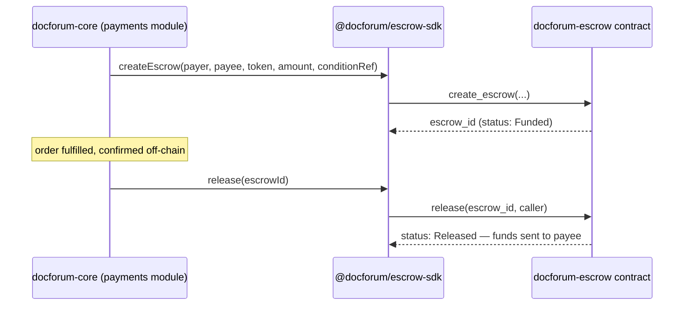

 feat/issue-39-phase-e5-per-token-liability-accounting-and-an
IyBkb2Nmb3J1bS1lc2Nyb3cKCiFbTGljZW5zZV0oaHR0cHM6Ly9pbWcu c2hpZWxkcy5pby9iYWRnZS9saWNlbnNlLUFwYWNoZS0tMi4wLWJsdWUuc3Zn KQohW1N0YXR1c10oaHR0cHM6Ly9pbWcuc2hpZWxkcy5pby9iYWRnZS9zdGF0 dXMtUGhhc2UlMjBFNSUyMGRvbmUtYnJpZ2h0Z3JlZW4uc3ZnKQohW1N0YWNr XShodHRwczovL2ltZy5zaGllbGRzLmlvL2JhZGdlL2NvbnRyYWN0LVJ1c3Ql MjAlMkYlMjBTb3JvYmFuLW9yYW5nZS5zdmcpCiFbTmV0d29ya10oaHR0cHM6 Ly9pbWcuc2hpZWxkcy5pby9iYWRnZS9uZXR3b3JrLXRlc3RuZXQlMjBvbmx5 LWltcG9ydGFudC5zdmcpCgoqqvCflJcgTGl2ZSBvbiB0ZXN0bmV0OioqIFtgQ0FI UTRKM1QyM1dTSUJCRzZTSDZFQVlSNVEySElQS0c1WU1DNFNNWkJPVFlBNk1Z SzJWQURFVjVgXShodHRwczovL3N0ZWxsYXIuZXhwZXJ0L2V4cGxvcmVyL3Rl c3RuZXQvY29udHJhY3QvQ0FIUTRKM1QyM1dTSUJCRzZTSDZFQVlSNVEySElQ S0c1WU1DNFNNWkJPVFlBNk1ZSzJWQURFVjUpIC0tIGN1cnJlbnQgZGVwbG95 bWVudCAoUGhhc2UgRTQ6IGFkZHMgdGhlIGByZWZ1bmRfYWZ0ZXJgIHRpbWVv dXQgcmVmdW5kKSwgdmVyaWZpZWQgd2l0aCByZWFsIGNhbGxzLCBub3QganVz dCB1cGxvYWRlZC4gSGlzdG9yeSBhbmQgZGV0YWlsczogW2Bkb2NzL3Rlc3Ru ZXQtZGVwbG95bWVudHMubWRgXShkb2NzL3Rlc3RuZXQtZGVwbG95bWVudHMu bWQpLgoKQSBbU29yb2Jhbl0oaHR0cHM6Ly9kZXZlbG9wZXJzLnN0ZWxsYXIu b3JnL2RvY3MvYnVpbGQvc21hcnQtY29udHJhY3RzKSAoU3RlbGxhcikgc21h cnQgY29udHJhY3QgZm9yIGNvbmRpdGlvbmFsIHBheW1lbnQgZXNjcm93IC0t IGxvY2sgZnVuZHMsIGFuZCByZWxlYXNlIHRoZW0gdG8gdGhlIHBheWVlIG9u bHkgd2hlbiByZWxlYXNlIGlzIGF1dGhvcml6ZWQsIG9yIHJldHVybiB0aGVt IHRvIHRoZSBwYXllciBvbiByZWZ1bmQuIFBhaXJlZCB3aXRoIGEgVHlwZVNj cmlwdCBjbGllbnQgU0RLLCBgQGRvY2ZvcnVtL2VzY3Jvdy1zZGtgLgoKVGhp cyByZXBvIGlzIGRlbGliZXJhdGVseSAqKmdlbmVyaWMgYW5kIGRvbWFpbi1h Z25vc3RpYyoqLiBJdCBoYXMgbm8KZGF0YWJhc2UsIG5vIHNlcnZlciwgYW5k IG5vIGtub3dsZWRnZSBvZiBwYXRpZW50cywgZG9jdG9ycywgcmVmZXJyYWxzLCBv cgphbnkgb3RoZXIgaGVhbHRoY2FyZSBjb25jZXB0IC0tIGl0IGlzIGEgcmV1 c2FibGUgY3JlYXRlL3JlbGVhc2UvcmVmdW5kCmVzY3JvdyBwcmltaXRpdmUs IGluIHRoZSBzYW1lIGNhdGVnb3J5IGFzIG90aGVyIFN0ZWxsYXIgZWNvc3lz dGVtIGVzY3Jvdwpwcm9qZWN0cyAoZS5nLiBUcnVzdGxlc3MgV29yaykuIEFu eXRoaW5nIGRvbWFpbi1zcGVjaWZpYyAtLSB3aGF0IGNvbmRpdGlvbgp0cmln Z2VycyBhIHJlbGVhc2UsIHdobyB0aGUgcGFydGllcyBhcmUgLS0gbGl2ZXMgaW4g dGhlIGNvbnN1bWluZwphcHBsaWNhdGlvbiwgbm90IGhlcmUuCgojIyBUYWJs ZSBvZiBjb250ZW50cwoKLSBbV2h5IHRoaXMgcmVwbyBleGlzdHNdKCN3aHkt dGhpcy1yZXBvLWV4aXN0cy1ob25lc3RseSkKLSBbQ29udHJhY3Qgc3VyZmFj ZV0oI2NvbnRyYWN0LXN1cmZhY2UpCi0gW0hvdyBpdCdzIHVzZWRdKCNob3ct aXRzLXVzZWQpCi0gW1JlcG8gbGF5b3V0XShgcmVwby1sYXlvdXQpCi0gW0dl dHRpbmcgc3RhcnRlZF0oI2dldHRpbmctc3RhcnRlZCkKLSBbRG9jdW1lbnRhdGlv bl0oI2RvY3VtZW50YXRpb24pCi0gW1Byb2plY3Qgc3RhdHVzXSgjcHJvamVj dC1zdGF0dXMpCi0gW0NvbnRyaWJ1dGluZ10oI2NvbnRyaWJ1dGluZykKLSBb TGljZW5zZV0oI2xpY2Vuc2UpCgojIyBXaHkgdGhpcyByZXBvIGV4aXN0cywgaG9u ZXN0bHkKClR3byByZWFzb25zLCBzdGF0ZWQgcGxhaW5seSByYXRoZXIgdGhhbiBi bGVuZGVkIHRvZ2V0aGVyOgoKMS4gKipQcm9kdWN0IHJlYXNvbi4qKiBbYGRvY2Zv cnVtLWNvcmVgXShodHRwczovL2dpdGh1Yi5jb20vRG9jRm9ydW0vZG9jZm9ydW0t Y29yZSkncyBmYWNpbGl0eS1mdWxmaWxsbWVudCBmbG93IG5lZWRzIGEgd2F5 IHRvIGhvbGQgcGF5bWVudCB1bnRpbCBhIGZhY2lsaXR5IGNvbmZpcm1zIGl0 IGRpZCB0aGUgd29yaywgd2l0aG91dCB0cnVzdGluZyB0aGUgZmFjaWxpdHkn cyBzZWxmLXJlcG9ydCBhbG9uZS4KMi4gKipFY29zeXN0ZW0gcmVhc29uLioqIFRo aXMgaXMgdGhlIG9uZSBwaWVjZSBvZiB0aGUgYERvY0ZvcnVtYCBvcmdhbml6 YXRpb24gdGhhdCdzIGFjdHVhbGx5IGJ1aWx0ICpvbipTdGVsbGFyLCBhcyBv cHBvc2VkIHRvIGFuIGFwcGxpY2F0aW9uIHRoYXQgbWVyZWx5IGFjY2VwdHMg U3RlbGxhciBwYXltZW50cyAtLSBzZWUgW2Bkb2Nmb3J1bS1jb3JlYCdzIEFE UiAwMDAyXShodHRwczovL2dpdGh1Yi5jb20vRG9jRm9ydW0vZG9jZm9ydW0t Y29yZS9ibG9iL21haW4vZG9jcy9hZHIvMDAwMi1zdGVsbGFyLWVzY3Jvdy1m b3ItZnVsZmlsbG1lbnQtcGF5b3V0Lm1kKSBmb3Igd2h5IHRoYXQgZGlzdGlu Y3Rpb24gc2hhcGVkIGhvdyB0aGUgb3JnIGlzIHN0cnVjdHVyZWQsIGFuZCBb YGRvY3MvYWRyLzAwMDEtZ2VuZXJpYy1lc2Nyb3ctbm90LWhlYWx0aGNhcmUt c3BlY2lmaWMubWRgXShkb2NzL2Fkci8wMDAxLWdlbmVyaWMtZXNjcm93LW5v dC1oZWFsdGhjYXJlLXNwZWNpZmljLm1kKSBmb3Igd2h5IHRoZSBjb250cmFj dCBpdHNlbGYgc3RheXMgZG9tYWluLWJsaW5kLgoKIyMgQ29udHJhY3Qgc3Vy ZmFjZQoKfCBGdW5jdGlvbiB8IFN0YXR1cyB8IERlc2NyaXB0aW9uIHwKfC0t LS18LS0tLXwtLS0tLS0tLS0tLS18CnwgYGNyZWF0ZV9lc2Nyb3cocGF5ZXIsIHBh eWVlLCB0b2tlbiwgYW1vdW50LCBjb25kaXRpb25fcmVmLCByZWxlYXNlciwg cmVmdW5kX2FmdGVyKSAtPiBlc2Nyb3dfaWRgIHwg4pyFIEltcGxlbWVudGVk IHwgUHVsbHMgYGFtb3VudGAgb2YgYHRva2VuYCBmcm9tIGBwYXllcmAgKHJlcXVp cmVzIGBwYXllcmAgYXV0aCksIHN0b3JlcyBhbiBvcGFxdWUgYGNvbmRpdGlv bl9yZWZgLCBzZXRzIHN0YXR1cyBgRnVuZGVkYCwgYW5kIGluY3JlbWVudHMg YGxpYWJpbGl0aWVzW3Rva2VuXWAuIFJlamVjdHMgbm9uLXBvc2l0aXZlIGFt b3VudHMsIGFuZCBhbnkgYHJlZnVuZF9hZnRlcmAgdGhhdCBpc24ndCBzdHJp Y3RseSBpbiB0aGUgZnV0dXJlLiB8CnwgYGdldF9zdGF0dXMoZXNjcm93X2lk KSAtPiBFc2Nyb3dTdGF0dXNgIHwg4pyFIEltcGxlbWVudGVkIHwgUmVhZC1v bmx5LiBFcnJvcnMgb24gYW4gdW5rbm93biBpZC4gfAp8IGBnZXRfZXNjcm93 KGVzY3Jvd19pZCkgLT4gRXNjcm93RGF0YWAgfCDinIUgSW1wbGVtZW50ZWQg fCBSZWFkLW9ubHk6IGV2ZXJ5dGhpbmcgc3RvcmVkIGFib3V0IHRoZSBlc2Ny b3csIGluY2x1ZGluZyBgcmVsZWFzZXJgIGFuZCBgcmVmdW5kX2FmdGVyYCwg c28gcGF5ZWVzIGNhbiBjaGVjayB0aGUgZGVhbCBiZWZvcmUgcmVseWluZyBv biBpdC4gfAp8IGBzb2x2ZW5jeSh0b2tlbikgLT4gKGJhbGFuY2UsIGxpYWJp bGl0aWVzKWAgfCDinIUgSW1wbGVtZW50ZWQgfCBSZWFkLW9ubHk6IHRoZSBj b250cmFjdCdzIGN1cnJlbnQgdG9rZW4gYmFsYW5jZSBhbmQgdG90YWwgb3V0 c3RhbmRpbmcgbGlhYmlsaXR5IGZvciBgdG9rZW5gLiBBIG1vbml0b3IgY2Fu IGFuc3dlciAiZG9lcyB0aGUgY29udHJhY3QgaG9sZCBhdCBsZWFzdCBhcyBt dWNoIGFzIGl0IG93ZXM/IiBpbiBvbmUgY2FsbC4gfAp8IGByZWxlYXNlKGVz Y3Jvd19pZCwgY2FsbGVyKSAtPiBSZXN1bHQ8KCk+YCB8IOKchSBJbXBsZW1l bnRlZCB8IFJlc3RyaWN0ZWQgdG8gdGhlIGVzY3JvdydzIGRlc2lnbmF0ZWQg YHJlbGVhc2VyYDsgbW92ZXMgZnVuZHMgdG8gYHBheWVlYCBhbmQgZGVjcmVt ZW50cyBgbGlhYmlsaXRpZXNbdG9rZW5dYC4gTmV2ZXIgZ2F0ZWQgYnkgYHJl ZnVuZF9hZnRlcmAuIHwKfCBgcmVmdW5kKGVzY3Jvd19pZCwgY2FsbGVyKSAt PiBSZXN1bHQ8KCk+YCB8IOKchSBJbXBsZW1lbnRlZCB8IFJldHVybnMgZnVu ZHMgdG8gYHBheWVyYCBhbmQgZGVjcmVtZW50cyBgbGlhYmlsaXRpZXNbdG9r ZW5dYC4gVGhlIGByZWxlYXNlcmAgbWF5IGFsd2F5cyBjYWxsIGl0OyBvbmNl IGByZWZ1bmRfYWZ0ZXJgIGhhcyBwYXNzZWQsIGFueW9uZSBtYXkgLS0gc3Rp bGwgb25seSBiYWNrIHRvIGBwYXllcmAgKHNlZSBbQURSyIDAwMDRdKGRvY3Mv YWRyLzAwMDQtdGltZW91dC1yZWZ1bmQtcGF0aC5tZCkpLiB8CgpgYGAKRXNj cm93U3RhdHVzID0gRnVuZGVkIHwgUmVsZWFzZWQgfCBSZWZ1bmRlZApgYGAK CmByZWZ1bmRfYWZ0ZXJgIGlzIG9wdGlvbmFsOiBhbiBlc2Nyb3cgY3JlYXRl ZCB3aXRob3V0IG9uZSBiZWhhdmVzIGV4YWN0bHkKYXMgZGlkIGJlZm9yZSB0 aGUgdGltZW91dCBleGlzdGVkIC0tIHJlbGVhc2VyLW9ubHkgcmVmdW5kcywg Zm9yZXZlci4KVGhhdCdzIHRoZSBhbnN3ZXIgdG8gIndoYXQgaWYgdGhlIHJlbGVh c2VyJ3Mga2V5IGlzIGxvc3Q/IiAodGhyZWF0IG1vZGVsClQyKTogaW5zdGVh ZCBvZiBsb2NraW5nIGZ1bmRzIHBlcm1hbmVudGx5LCBhIGRlYWRsaW5lIGxl dHMgYW55b25lIHJldHVybgp0aGVtIHRvIHRoZSBwYXllci4gU2VlIFtBRFIg MDAwNF0oZG9jcy9hZHIvMDAwNC10aW1lb3V0LXJlZnVuZC1wYXRoLm1kKQpm b3IgdGhlIGRlY2lzaW9uIGFuZCB3aGF0IGl0IG1lYW5zIGZvciBwYXllZXMuCgoqKkRlc2lnbiBydWxlLCBlbmZvcmNlZCBkZWxpYmVyYXRlbHk6KiogdGhlIGNvbnRy YWN0IGRlY2lkZXMgKip3aG8qKiBtYXkKY2FsbCBgcmVsZWFzZWAvYHJlZnVuZGAs IG5ldmVyICoqIHdoeSoqLiBgY29uZGl0aW9uX3JlZmAgaXMgYW4gb3BhcXVlCnN0 cmluZyB0aGUgY29udHJhY3Qgc3RvcmVzIGJ1dCBuZXZlciBpbnRlcnByZXRz IC0tIGFsbCBkb21haW4KaW50ZXJwcmV0YXRpb24gKHdoYXQgY291bnRzIGFzICJm dWxmaWxsZWQsIiB3aG8ncyBhdXRob3JpemVkIHRvIGF0dGVzdCB0bwppdCkgaXMgdGhlIGNvbnN1bWluZyBhcHBsaWNhdGlvbidzIGpvYi4gU2VlCltBRFIgMDAwMV0oZG9jcy9hZHIvMDAwMS1nZW5lcmljLWVzY3Jvdy1ub3QtaGVh bHRoY2FyZS1zcGVjaWZpYy5tZCkuCgojIyBPbi1jaGFpbiBzb2x2ZW5jeQoKVGhlIGNvbnRyYWN0IG1haW50YWlucyBgbGlhYmlsaXRpZXNbdG9rZW5dYCwgdGhlIHRvdGFs IG91dHN0YW5kaW5nIGFtb3VudCBvZgpgdG9rZW5gIG93ZWQgdG8gZXNjcm93IHBhcnRpZXMuIEl0IGlzIGluY3JlbWVudGVkIGluIHRoZSBzYW1lCmludm9jYXRpb24gYXMgYGNyZWF0ZV9lc2Nyb3dgLCBhbmQgZGVjcmVtZW50ZWQgaW4gdGhlIHNhbWUgaW52 b2NhdGlvbiBhcwpgcmVsZWFzZWAvYHJlZnVuZGAsIHNvIGl0IGNhbiBuZXZlciBkcmlmdCBmcm9tIHRoZSBzdW0gb2YgYWN0aXZlIGVz Y3Jvd3MuClRoZSBjb3VudGVyIGVudHJ5IGlzIGdpdmVuIGEgVFRMIGFuZCByZW5ld2Vk IG9uIGV2ZXJ5IHdyaXRlLCBjb25zaXN0ZW50IHdpdGgKI1xuMTAuCgpgc29s dmVuY3kodG9rZW4pIC0+IChiYWxhbmNlLCBsaWFiaWxpdGllcylgIGlzIGEgcmVh ZC1vbmx5IHZpZXcgdGhhdCByZXR1cm5zIHRoZQpjb250cmFjdCdzIGN1cnJlbnQg dG9rZW4gYmFsYW5jZSBhbG9uZ3NpZGUgdGhlIHRvdGFsIGxpYWJpbGl0eSwgc28g YQptb25pdG9yIG9yIGF1ZGl0b3IgY2FuIGFuc3dlciAiZG9lcyB0aGUgY29udHJh Y3QgaG9sZCBhdCBsZWFzdCBhcyBtdWNoIG9mIHRva2VuClggYXMgaXQgb3dlcz8i IHdpdGhvdXQgc3VtbWluZyBldmVyeSBlc2Nyb3cgb2ZmLWNoYWluLiBTZWUKW2Bkb2NzL3RocmVhdC1tb2RlbC5tZGBdKGRvY3MvdGhyZWF0LW1vZGVsLm1kKSBmb3IgbW9uaXRvcmluZyBn dWlkYW5jZS4KCiMjIEhvdyBpdCdzIHVzZWQKCmBgYG1lcm1haWQKc2VxdWVuY2VEaWFncmFtCiAgICBwYXJ0aWNpcGFudCBDb3JlIGFzIGRvY2ZvcnVtLWNvcmUgKHBheW1lbnRz IG1vZHVsZSkKICAgIHBhcnRpY2lwYW50IFNESyBhcyBAZG9jZm9ydW0vZXNjcm93 LXNkawogICAgcGFydGljaXBhbnQgQ29udHJhY3QgYXMgZG9jZm9ydW0tZXNjcm93 IGNvbnRyYWN0CgogICAgQ29yZS0+PlNESzogY3JlYXRlRXNjcm93KHBheWVyLCBw YXllZSwgdG9rZW4sIGFtb3VudCwgY29uZGl0aW9uUmVmKQogICAgU0RLLT4+ Q29udHJhY3Q6IGNyZWF0ZV9lc2Nyb3coLi4uKQogICAgQ29udHJhY3QtLT4+ U0RLOiBlc2Nyb3dfaWQgKHN0YXR1czogRnVuZGVkKQogICAgTm90ZSBvdmVy IENvcmU6IG9yZGVyIGZ1bGZpbGxlZCwgY29uZmlybWVkIG9mZi1jaGFpbgog ICAgQ29yZS0+PlNESzogcmVsZWFzZShlc2Nyb3dJZCkKICAgIFNESy0+PkNvbnRy YWN0OiByZWxlYXNlKGVzY3Jvd19pZCwgY2FsbGVyKQogICAgQ29udHJhY3Qt LT4+U0RLOiBzdGF0dXM6IFJlbGVhc2VkIC0tIGZ1bmRzIHNlbnQgdG8gcGF5ZWUK YGBgCgpgZG9jZm9ydW0tY29yZWAgaW1wb3J0cyBgQGRvY2ZvcnVtL2VzY3Jvdy1zZGtg IGFzIGEgKipsaWJyYXJ5IGRlcGVuZGVuY3kqKgpgLS0gaXQgbmV2ZXIgY2FsbHMgdGhpcyBjb250cmFjdCBhcyBhIHJ1bm5pbmcgbmV0d29yayBzZXJ2aWNlLCBhbmQgdGhp cwpyZXBvIG5ldmVyIGNyb3NzZXMgYmFjayBpbnRvIGBkb2Nmb3J1bS1jb3JlYCdz IGRhdGFiYXNlIG9yIGRvbWFpbiBtb2RlbC4KCiMjIFJlcG8gbGF5b3V0CgpgYGAKY29udHJhY3RzL2VzY3Jvdy8KICBzcmMvbGliLnJzICAgICAgICBDb250cmFjdCBpbXBsZW1lbnRhdGlvbgogIHRlc3RzLyAgICAgICAgICAgIEludGVncmF0aW9uIHRlc3RzIChzb3JvYmFuLXNkayB0ZXN0dXRpbHMpIC0tIHJlcXVpcmVk IGZvciBhbnkgY29udHJhY3QgY2hhbmdlCiAgQ2FyZ28udG9tbApzZGsvCiAgc3JjL2luZGV4LnRzICAgICAgQGRvY2ZvcnVtL2VzY3Jvdy1zZGsgLS0gVHlwZVNjcmlwdCBjbGllbnQgKG5vdCB5ZXQgaW1wbGVtZW50ZWQsIHNlZSBpc3N1ZSAjNCkKICBwYWNrYWdlLmpzb24KZG9jcy9hZHIvICAgICAgICAgICBBcmNoaXRlY3R1cmUgZGVjaXNpb24gcmVjb3JkcwouZ2l0aHViLyAgICAgICAgICAgIENJIHdvcmtmbG93LCBpc3N1ZS9QUiB0ZW1wbGF0ZXMKYGBgCgojIyBHZXR0aW5nIHN0YXJ0ZWQKClJlcXVpcmVzIGEgUnVzdCB0b29sY2hhaW4gd2l0aCB0aGUgYHdhc20zMnYxLW5vbmVgIHRhcmdldC4KCmBgYGJhc2gKZ2l0IGNsb25lIGh0dHBzOi8vZ2l0aHViLmNvbS9Eb2NGb3J1bS9kb2Nmb3J1bS1lc2Nyb3cuZ2l0CmNkIGRvY2ZvcnVtLWVzY3Jvdy9jb250cmFjdHMvZXNjcm93CgojIFJ1biB0aGUgdGVzdCBzdWl0ZSAoMzEgdGVzdHMsIGFsbCBwYXNzaW5nIHRvZGF5KQpjYXJnbyB0ZXN0CgojIEJ1aWxkIHRoZSBkZXBsb3lhYmxlIGNvbnRyYWN0CmNhcmdvIGJ1aWxkIC0tdGFyZ2V0IHdhc20zMnYxLW5vbmUgLS1yZWxlYXNlCiMg4oaSIHRhcmdldC93YXNtMzJ2MS1ub25lL3JlbGVhc2UvZG9jZm9ydW1fZXNjcm93Lndhc20KYGBgCgpBbHJlYWR5IGRlcGxveWVkIHRvIFN0ZWxsYXIgKip0ZXN0bmV0KiogLS0gc2VlCltgZG9jcy90ZXN0bmV0LWRlcGxveW1lbnRzLm1kYF0oZG9jcy90ZXN0bmV0LWRlcGxveW1lbnRzLm1kKSBmb3IgdGhlCmNvbnRyYWN0IGlkLCB0cmFuc2FjdGlvbiBsaW5rcywgYW5kIHRoZSBleGFjdCBgc3RlbGxhcmAgQ0xJIGNvbW1hbmRzIHRvCnJlZGVwbG95LiAqKk1haW5uZXQgaXMgb3V0IG9mIHNjb3BlIHVudGlsIHRoZSBQaGFzZSBFNCBzZWN1cml0eSByZXZpZXcgaXMK Y29tcGxldGUgLS0gc2VlIFtoYXJkIHJ1bGUgNF0oQVJDSElURUNUVVJFX0VTU0VOVElBTFMubWQj aGFyZC1ydWxlcykuKioKClRoZSBUeXBlU2NyaXB0IFNESyAoYHNkay9gKSBpcyBzdGlsbCBh IHBsaWNlaG9sZGVyIC0tIHNlZQpbaXNzdWUgIzRdKGh0dHBzOi8vZ2l0aHViLmNvbS9Eb2NG b3J1bS9kb2Nmb3J1bS1lc2Nyb3cvaXNzdWVzLzQpLgoKIyMgRG9jdW1lbnRhdGlvbgoKfCBEb2MgfCBQdXJwb3NlIHwKfC0tLS18LS0tLS0tLS0tfAp8IFtgQVJDSElURUNUVVJFX0VTU0VOVElBTFMubWRgXShBUkNISVRFQ1RVUkVfRVNTRU5USUFMUy5tZCkgfCBTdGFjaywgY29udHJhY3Qgc3VyZmFjZSwgaGFyZC BydWxlcyAobm8gUEhJIGV2ZXIsIHRlc3RzIHJlcXVpcmVkIGZvciBjb250cmFjdCBjaGFuZ2VzLCB0ZXN0bmV0LW9ubHkgdW50aWwgc2VjdXJpdHkgcmV2aWV3KS4gfAp8IFtgUk9BRE1BUC5tZGBdKFJPQURNQVAubWQpIHwgUGhhc2UgRTHigJNFNSBicmVha2Rvd24gYW5kIGN1cnJlbnQgc3RhdHVzLiB8CnwgW2Bkb2NzL3RocmVhdC1tb2RlbC5tZGBdKGRvY3MvdGhyZWF0LW1vZGVsLm1kKSB8IFRocmVhdCBtb2RlbCwgaW5jbHVkaW5nIG1vbml0b3JpbmcgZ3VpZGFuY2UgZm9yIHRoZSBvbi1jaGFpbiBzb2x2ZW5jeSB2aWV3LiB8CnwgW2BBR0VOVFMubWRgXShBR0VOVFMubWQpIC8gW2BDTEFVREUubWRgXShDTEFVREUubWQpIHwgUnVsZXMgZm9yIGNvZGluZyBhZ2VudHMgd29ya2luZyBpbiB0aGlzIHJlcG8gLS0gcmVhZCBgUkVBRE1FLm1kYCArIGBBUkNISVRFQ1RVUkVfRVNTRU5USUFMUy5tZGAgZmlyc3Q7IHlvdSBzaG91bGQgcmFyZWx5IG5lZWQgYGRvY2ZvcnVtLWNvcmVgJ3MgZG9jcyB0byB3b3JrIGhlcmUuIHwKfCBbYGRvY3MvYWRyLzAwMDEtZ2VuZXJpYy1lc2Nyb3ctbm90LWhlYWx0aGNhcmUtc3BlY2lmaWMubWRgXShkb2NzL2Fkci8wMDAxLWdlbmVyaWMtZXNjcm93LW5vdC1oZWFsdGhjYXJlLXNwZWNpZmljLm1kKSB8IFdoeSB0aGUgY29udHJhY3Qgc3RheXMgZG9tYWluLWJsaW5kLiB8CgojIyBQcm9qZWN0IHN0YXR1cwoKKipQaGFzZSBFMSAoY29udHJhY3Qgc2tlbGV0b24pOiBkb25lLioqIGBjcmVhdGVfZXNjcm93YCBhbmQgYGdldF9zdGF0dXNgCmFyZSBpbXBsZW1lbnRlZCwgdGVzdGVkLCBhbmQgZGVwbG95ZWQgbGl2ZSBvbiB0ZXN0bmV0IC0tIG5vdCBqdXN0IGxvY2FsbHkKdGVzdGVkLiBQaGFzZXMgRTIgKHJlbGVhc2UvcmVmdW5kKSwgRTMgKFR5cGVTY3JpcHQgU0RLKSwgRTQgKHNlY3VyaXR5CnJldmlldywgYmxvY2tpbmcgZm9yIGFueSBtYWlubmV0IHVzZSksIGFuZCBFNSAoY29udHJhY3QgZmVhdHVyZXMpIGFyZQp0cmFja2VkIGFzIG9wZW4gaXNzdWVzOgoKfCBJc3N1ZSB8IFBoYXNlIHwgQ29tcGxleGl0eSB8CnwtLS0tLS18LS0tLS0tLXwtLS0tLS0tLS0tLS18Cnwgfn4jMSBEZXBsb3kgdG8gdGVzdG5ldH5+IC0tIGRvbmUsIHNlZSBhYm92ZSB8IEUxIHwgVHJpdmlhbCB8CnwgWyMyIEltcGxlbWVudCBgcmVsZWFzZSgpYF0oaHR0cHM6Ly9naXRodWIuY29tL0RvY0ZvcnVtL2RvY2ZvcnVtLWVzY3Jvdy9pc3N1ZXMvMikgfCBFMiB8IEhpZ2ggfAp8IFsjMyBJbXBsZW1lbnQgYHJlZnVuZCgpYF0oaHR0cHM6Ly9naXRodWIuY29tL0RvY0ZvcnVtL2RvY2ZvcnVtLWVzY3Jvdy9pc3N1ZXMvMykgfCBFMiB8IEhpZ2ggfAp8IFsjNCBTREs6IHdyYXAgYGNyZWF0ZV9lc2Nyb3dgL2BnZXRfc3RhdHVzYF0oaHR0cHM6Ly9naXRodWIuY29tL0RvY0ZvcnVtL2RvY2ZvcnVtLWVzY3Jvdy9pc3N1ZXMvNCkgfCBFMyB8IE1lZGl1bSB8CnwgWyM1IEFEUjogbnBtIHZzIEdpdEh1YiBQYWNrYWdlc10oaHR0cHM6Ly9naXRodWIuY29tL0RvY0ZvcnVtL2RvY2ZvcnVtLWVzY3Jvdy9pc3N1ZXMvNSkgfCBFMyB8IFRyaXZpYWwgfAp8IFsjNiBUaHJlYXQgbW9kZWwgKyBleHRlcm5hbCBzZWN1cml0eSByZXZpZXddKGh0dHBzOi8vZ2l0aHViLmNvbS9Eb2NGb3J1bS9kb2Nmb3J1bS1lc2Nyb3cvaXNzdWVzLzYpIHwgRTQgfCBIaWdoIHwKfCBQZXItdG9rZW4gbGlhYmlsaXR5IGFjY291bnRpbmcgKyBvbi1jaGFpbiBzb2x2ZW5jeSB2aWV3IHwgRTUgfCBIaWdoIHwKCkZ1bGwgYnJlYWtkb3duOiBbYFJPQURNQVAubWRgXShST0FETUFQLm1kKS4KCiMjIENvbnRyaWJ1dGluZwoKSXNzdWVzIGFyZSBzY29wZWQgYXMgc21hbGwsIGluZGVwZW5kZW50IHVuaXRzIHdpdGggYSBzdGF0ZWQgY29tcGxleGl0eQooVHJpdmlhbC9NZWRpdW0vSGlnaCkgLS0gc2VlIHRoZQpbZ29vZC1maXJzdC1pc3N1ZSB0ZW1wbGF0ZV0oLmdpdGh1Yi9JU1NVRV9URU1QTEFURS9nb29kLWZpcnN0LWlzc3VlLm1kKS5BbnkgY29udHJhY3QgbG9naWMgY2hhbmdlICoqbXVzdCoqIGluY2x1ZGUgdGVzdHMgaW4gYGNvbnRyYWN0cy9lc2Nyb3cvdGVzdHMvYAppbiB0aGUgc2FtZSBQUiAtLSBzZWUgYEFHRU5UUy5tZGAgaGFyZCBydWxlcy4gVGhpcyByZXBvIHRhcmdldHMgdGhlIFN0ZWxsYXIKZWNvc3lzdGVtJ3MgW0RyaXBzIFdhdmVdKGh0dHBzOi8vZG9jcy5kcmlwcy5uZXR3b3JrL3dhdmUvKSBwcm9ncmFtOyBzZWUKYGRvY2ZvcnVtLWNvcmVgJ3MKW0FEUiAwMDAyXShodHRwczovL2dpdGh1Yi5jb20vRG9jRm9ydW0vZG9jZm9ydW0tY29yZS9ibG9iL21haW4vZG9jcy9hZHIvMDAwMi1zdGVsbGFyLWVzY3Jvdy1mb3ItZnVsZmlsbG1lbnQtcGF5b3V0Lm1kKQpmb3IgdGhlIHJlYWRpbmVzcyBwbGFuLgoKUXVlc3Rpb25zLCBvciB3YW50IHRvIHRhbGsgdGhyb3VnaCBhbiBpc3N1ZSBiZWZvcmUgcGlja2luZyBpdCB1cD8gSm9pbiB0aGUKRG9jRm9ydW0gY29udHJpYnV0b3IgY2hhdCBvbiBbVGVsZWdyYW1dKGh0dHBzOi8vdC5tZS8rSjllWm9Ga2VyX0U0WTJNOCkuCgojIyBMaWNlbnNlCgpbQXBhY2hlIExpY2Vuc2UgMi4wXShMSUNFTlNFKQo=

# docforum-escrow


**🔗 Live on testnet:** [`CAHQ4J3T23WSIBBG6SI6EAYR5Q2HIPKG5YMC4SMZBOTYA6MYK2VADEV5`](https://stellar.expert/explorer/testnet/contract/CAHQ4J3T23WSIBBG6SI6EAYR5Q2HIPKG5YMC4SMZBOTYA6MYK2VADEV5) — current deployment (Phase E4: adds the `refund_after` timeout refund), verified with real calls, not just uploaded. History and details: [`docs/testnet-deployments.md`](docs/testnet-deployments.md).

A [Soroban](https://developers.stellar.org/docs/build/smart-contracts) (Stellar) smart contract for conditional payment escrow — lock funds, and release them to the payee only when release is authorized, or return them to the payer on refund. Paired with a TypeScript client SDK, `@docforum/escrow-sdk`.

This repo is deliberately **generic and domain-agnostic**. It has no
database, no server, and no knowledge of patients, doctors, referrals, or
any other healthcare concept — it is a reusable create/release/refund
escrow primitive, in the same category as other Stellar ecosystem escrow
projects (e.g. Trustless Work). Anything domain-specific — what condition
triggers a release, who the parties are — lives in the consuming
application, not here.

## Table of contents

- [Why this repo exists](#why-this-repo-exists-honestly)
- [Contract surface](#contract-surface)
- [How it's used](#how-its-used)
- [Repo layout](#repo-layout)
- [Getting started](#getting-started)
- [Documentation](#documentation)
- [Project status](#project-status)
- [Contributing](#contributing)
- [License](#license)

## Why this repo exists, honestly

Two reasons, stated plainly rather than blended together:

1. **Product reason.** [`docforum-core`](https://github.com/DocForum/docforum-core)'s facility-fulfillment flow needs a way to hold payment until a facility confirms it did the work, without trusting the facility's self-report alone.
2. **Ecosystem reason.** This is the one piece of the `DocForum` organization that's actually built *on* Stellar, as opposed to an application that merely accepts Stellar payments — see [`docforum-core`'s ADR 0002](https://github.com/DocForum/docforum-core/blob/main/docs/adr/0002-stellar-escrow-for-fulfillment-payout.md) for why that distinction shaped how the org is structured, and [`docs/adr/0001-generic-escrow-not-healthcare-specific.md`](docs/adr/0001-generic-escrow-not-healthcare-specific.md) for why the contract itself stays domain-blind.

## Contract surface

The deploy-time `__constructor(allowed_tokens)` stores an immutable token
allowlist. Pass the token addresses the deployment accepts; an empty list
keeps the legacy open-token behavior. This policy cannot be changed after
deployment, so choosing an empty list deliberately disables the protection.

| Function | Status | Description |
|---|---|---|
| `__constructor(allowed_tokens)` | ✅ Implemented | Stores the immutable deploy-time token allowlist; an empty list allows all tokens. |
| `create_escrow(payer, payee, token, amount, condition_ref, releaser, refund_after, notify_payee) -> escrow_id` | ✅ Implemented locally (callback not deployed) | Pulls funds from `payer`, stores a bounded `condition_ref`, and stores the single `releaser` as a one-address set with threshold 1. Requires payer auth; when `notify_payee` is true, also requires payee auth and calls `on_escrow_released` on release. |
| `create_escrow_with_releasers(payer, payee, token, amount, condition_ref, releasers, threshold, refund_after, notify_payee) -> escrow_id` | ✅ Implemented | Same, but settles by M-of-N: 1–10 distinct `releasers` (`MAX_RELEASERS`), `1 <= threshold <= releasers.len()`. Callback opt-in has the same payee-authorization requirement. See [ADR 0007](docs/adr/0007-in-contract-m-of-n-releaser-quorum.md). |
| `get_status(escrow_id) -> EscrowStatus` | ✅ Implemented | Read-only. Errors on an unknown id. |
| `get_escrow(escrow_id) -> EscrowData` | ✅ Implemented | Read-only: everything stored about the escrow, including `releasers`, `threshold` and `refund_after`, so payees can check the deal before relying on it. |
| `release(escrow_id, caller) -> Result<()>` | ✅ Implemented | Restricted to the escrow's designated `releaser` when the threshold is 1; moves funds to `payee`. Never gated by `refund_after`. |
| `release_with_approvals(escrow_id, approvers) -> Result<()>` | ✅ Implemented | M-of-N release: at least `threshold` distinct releasers, each authorizing this exact invocation. Approvals are not stored, so nothing can be replayed. Only while `Funded`. |
| `refund(escrow_id, caller) -> Result<()>` | ✅ Implemented | Returns funds to `payer`. The `releaser` may always call it (threshold 1); once `refund_after` has passed, anyone may — still only back to `payer` (see [ADR 0004](docs/adr/0004-timeout-refund-path.md)). |
| `refund_with_approvals(escrow_id, approvers) -> Result<()>` | ✅ Implemented | M-of-N refund with the same approval rules; the timeout path above needs no approvals. |
| `top_up(escrow_id, payer, amount) -> Result<()>` | ✅ Implemented | Adds funds to a `Funded` escrow; original payer only. Emits a `top_up` event. |

```
EscrowStatus = Funded | Released | Refunded
```

`refund_after` is optional: an escrow created without one behaves exactly
as it did before the timeout existed — releaser-only refunds, forever.
That's the answer to "what if the releaser's key is lost?" (threat model
T2): instead of locking funds permanently, a deadline lets anyone return
them to the payer. See [ADR 0004](docs/adr/0004-timeout-refund-path.md)
for the decision and what it means for payees.

Single-releaser escrows are unchanged by the M-of-N option: `create_escrow`
stores the one address with `threshold = 1`, `release`/`refund` behave exactly
as before, and the approval entry points simply accept that one address too.
No new admin, owner, pause or upgrade role exists — `releasers` is escrow data
chosen by the payer, not authority over the contract (see
[ADR 0006](docs/adr/0006-openzeppelin-stellar-library-evaluation.md) for why
OpenZeppelin's pause/upgradeable/access modules are deliberately **not**
adopted).

**Design rule, enforced deliberately:** the contract decides **who** may
call `release`/`refund`, never **why**. `condition_ref` is an opaque
string the contract stores but never interprets — all domain
interpretation (what counts as "fulfilled," who's authorized to attest to
it) is the consuming application's job. The contract bounds `condition_ref`
to 64 bytes at creation (error 7, `ConditionRefTooLong`) to keep storage
and event costs predictable (threat model T10, Phase E5); the SDK
validates the same bound client-side via `MAX_CONDITION_REF_LENGTH`.
See
[ADR 0001](docs/adr/0001-generic-escrow-not-healthcare-specific.md).

## How it's used



`docforum-core` imports `@docforum/escrow-sdk` as a **library dependency**
— it never calls this contract as a running network service, and this
repo never crosses back into `docforum-core`'s database or domain model.

## Repo layout

```
contracts/escrow/
  src/lib.rs             Contract implementation
  tests/                 Integration tests (soroban-sdk testutils) — required for any contract change
  test_snapshots/        Committed Soroban snapshots (events/auth/storage) per test — issue #120
  Cargo.toml
sdk/
  src/index.ts           @docforum/escrow-sdk — hand-written public surface
  src/generated/         Machine-generated contract bindings — never hand-edit (issue #121)
  package.json
scripts/
  check-generated-bindings.sh   CI/regeneration check for the generated bindings
  stellar-cli-version           Pinned generator version (+ release checksum)
docs/adr/                Architecture decision records
.github/                 CI workflow, issue/PR templates
```

## Getting started

Requires a Rust toolchain with the `wasm32v1-none` target.

```bash
git clone https://github.com/DocForum/docforum-escrow.git
cd docforum-escrow/contracts/escrow

# Run the test suite (57 tests, all passing today; also writes the
# committed test_snapshots/ files — see CONTRIBUTING.md)
cargo test

# Build the deployable contract
cargo build --target wasm32v1-none --release
# → target/wasm32v1-none/release/docforum_escrow.wasm
```

Already deployed to Stellar **testnet** — see
[`docs/testnet-deployments.md`](docs/testnet-deployments.md) for the
contract id, transaction links, and the exact `stellar` CLI commands to
redeploy. **Mainnet is out of scope until the Phase E4 security review is
complete — see [hard rule 4](ARCHITECTURE_ESSENTIALS.md#hard-rules).**

The SDK supports relayed release/refund calls. `authorizeRelease` and
`authorizeRefund` simulate the invocation, ask the releaser to sign only
its short-lived contract authorization entry, and return a serialized
transaction. `submitRelayed` restores that transaction and lets a separate
relayer sign the envelope and pay its fee. The auth entry is bound to the
simulated invocation and expires after ten ledgers:

```ts
const authorization = await client.authorizeRelease({ escrowId, releaser, relayer });
const { txHash } = await client.submitRelayed("release", authorization, relayer);
```

Keep the serialized authorization private until submission and do not
retry it after its expiration ledger.

An escrow created with `createQuorumEscrow` settles with M-of-N approvals;
each supplied keypair signs only the contract auth entry for that one call, and
the first pays the fee:

```ts
const { escrowId } = await client.createQuorumEscrow({
  payer, payee, token, amount, conditionRef,
  releasers: [a, b, c],
  threshold: 2,
});
await client.releaseWithApprovals({ escrowId, approvers: [a, c] });
```

## Documentation

| Doc | Purpose |
|---|---|
| [`ARCHITECTURE_ESSENTIALS.md`](ARCHITECTURE_ESSENTIALS.md) | Stack, contract surface, hard rules (no PHI ever, tests required for contract changes, testnet-only until security review). |
| [`ROADMAP.md`](ROADMAP.md) | Phase breakdown and current status. |
| [`AGENTS.md`](AGENTS.md) / [`CLAUDE.md`](CLAUDE.md) | Rules for coding agents working in this repo — read `README.md` + `ARCHITECTURE_ESSENTIALS.md` first; you should rarely need `docforum-core`'s docs to work here. |
| [`docs/adr/0001-generic-escrow-not-healthcare-specific.md`](docs/adr/0001-generic-escrow-not-healthcare-specific.md) | Why the contract stays domain-blind. |

## Project status

**Phase E1 (contract skeleton): done.** `create_escrow` and `get_status`
are implemented, tested, and deployed live on testnet — not just locally
tested. Phases E2 (release/refund), E3 (TypeScript SDK), and E4 (security
review, blocking for any mainnet use) are tracked as open issues. Phase E5
now also includes an optional in-contract M-of-N releaser quorum
([ADR 0007](docs/adr/0007-in-contract-m-of-n-releaser-quorum.md)) and a
documented decision **not** to adopt OpenZeppelin's pause/upgradeable/access
modules ([ADR 0006](docs/adr/0006-openzeppelin-stellar-library-evaluation.md));
both are implemented and tested but **not yet redeployed to testnet** (see
[`docs/testnet-deployments.md`](docs/testnet-deployments.md)). Phase E7 adds
committed contract test snapshots (issue #120) and a CI check that the
generated SDK bindings match the contract WASM (issue #121):

| Issue | Phase | Complexity |
|---|---|---|
| ~~#1 Deploy to testnet~~ — done, see above | E1 | Trivial |
| [#2 Implement `release()`](https://github.com/DocForum/docforum-escrow/issues/2) | E2 | High |
| [#3 Implement `refund()`](https://github.com/DocForum/docforum-escrow/issues/3) | E2 | High |
| [#4 SDK: wrap `create_escrow`/`get_status`](https://github.com/DocForum/docforum-escrow/issues/4) | E3 | Medium |
| [#5 ADR: npm vs GitHub Packages](https://github.com/DocForum/docforum-escrow/issues/5) | E3 | Trivial |
| [#6 Threat model + external security review](https://github.com/DocForum/docforum-escrow/issues/6) | E4 | High |

Full breakdown: [`ROADMAP.md`](ROADMAP.md).

## Contributing

Issues are scoped as small, independent units with a stated complexity
(Trivial/Medium/High) — see the
[good-first-issue template](.github/ISSUE_TEMPLATE/good-first-issue.md).
Any contract logic change **must** include tests in `contracts/escrow/tests/`
in the same PR — see `AGENTS.md` hard rules. This repo targets the Stellar
ecosystem's [Drips Wave](https://docs.drips.network/wave/) program; see
`docforum-core`'s
[ADR 0002](https://github.com/DocForum/docforum-core/blob/main/docs/adr/0002-stellar-escrow-for-fulfillment-payout.md)
for the readiness plan.

Questions, or want to talk through an issue before picking it up? Join the
DocForum contributor chat on [Telegram](https://t.me/+J9eZoFker_E4Y2M8).

## License

[Apache License 2.0](LICENSE)
main
