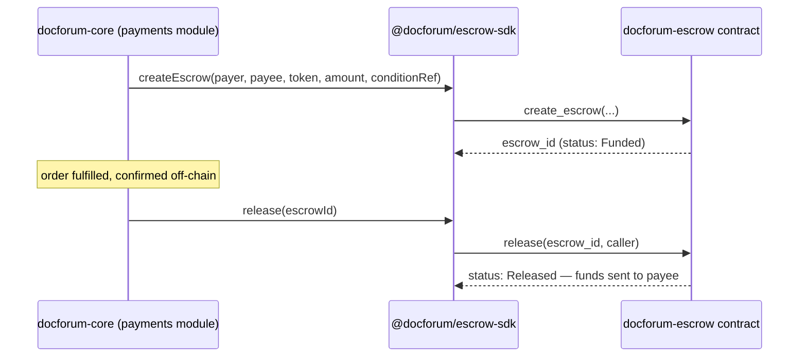

feat/issue-29-phase-e5-batch-release-and-refund-for-fast
IyBkb2Nmb3J1bS1lc2Nyb3cKCiFbTGljZW5zZV0oaHR0cHM6Ly9pbWcu c2hpZWxkcy5pby9iYWRnZS9saWNlbnNlLUFwYWNoZS0tMi4wLWJsdWUuc3Zn KQohW1N0YXR1c10oaHR0cHM6Ly9pbWcuc2hpZWxkcy5pby9iYWRnZS9zdGF0 dXMtUGhhc2UlMjBFNSUyMGRvbmUtYnJpZ2h0Z3JlZW4uc3ZnKQohW1N0 YWNrXShodHRwczovL2ltZy5zaGllbGRzLmlvL2JhZGdlL2NvbnRyYWN0 LVJ1c3QlMjAlMkYlMjBTb3JvYmFuLW9yYW5nZS5zdmcpCiFbTmV0d29y a10oaHR0cHM6Ly9pbWcuc2hpZWxkcy5pby9iYWRnZS9uZXR3b3JrLXRlc3Ru ZXQlMjBvbmx5LWltcG9ydGFudC5zdmcpCgoqKvCflJcgaGl2ZSBvbiB0ZXN0 bmV0OioqIFtgQ0FIUTRKM1QyM1dTSUJCRzZTSDZFQVlSNVEySElQS0c1WU1D NFNNWkJPVFlBNk1ZS1YyQURFVjVgXShodHRwczovL3N0ZWxsYXIuZXhwZXJ0 L2V4cGxvcmVyL3Rlc3RuZXQvY29udHJhY3QvQ0FIUTRKM1QyM1dTSUJCRzZT SDZFQVlSNVEySElQS0c1WU1DNFNNWkJPVFlBNk1ZS1YyQURFVjUpIOKAlCBj dXJyZW50IGRlcGxveW1lbnQgKFBhc2UgRTU6IGFkZHMgYHNldHRsZV9tYW55 YCBmb3IgYmF0Y2ggcmVsZWFzZS9yZWZ1bmQpLCB2ZXJpZmllZCB3aXRoIHJl YWwgY2FsbHMsIG5vdCBqdXN0IHVwbG9hZGVkLiBIaXN0b3J5IGFuZCBkZXRh aWxzOiBbYGRvY3MvdGVzdG5ldC1kZXBsb3ltZW50cy5tZGBdKGRvY3MvdGVz dG5ldC1kZXBsb3ltZW50cy5tZCkuCgpBIFtTb3JvYmFuXShodHRwczovL2Rl dmVsb3BlcnMuc3RlbGxhci5vcmcvZG9jcy9idWlsZC9zbWFydC1jb250cmFj dHMpIChTdGVsbGFyKSBzbWFydCBjb250cmFjdCBmb3IgY29uZGl0aW9uYWwg cGF5bWVudCBlc2Nyb3cg4oCUIGxvY2sgZnVuZHMsIGFuZCByZWxlYXNlIHRo ZW0gdG8gdGhlIHBheWVlIG9ubHkgd2hlbiByZWxlYXNlIGlzIGF1dGhvcml6 ZWQsIG9yIHJldHVybiB0aGVtIHRvIHRoZSBwYXllciBvbiByZWZ1bmQuIFBh aXJlZCB3aXRoIGEgVHlwZVNjcmlwdCBjbGllbnQgU0RLLCBgQGRvY2ZvcnVt L2VzY3Jvdy1zZGtgLgoKVGhpcyByZXBvIGlzIGRlbGliZXJhdGVseSAqKmdl bmVyaWMgYW5kIGRvbWFpbi1hZ25vc3RpYyoqLiBJdCBoYXMgbm8KZGF0YWJh c2UsIG5vIHNlcnZlciwgYW5kIG5vIGtub3dsZWRnZSBvZiBwYXRpZW50cywg ZG9jdG9ycywgcmVmZXJyYWxzLCBvcgphbnkgb3RoZXIgaGVhbHRoY2FyZSBj b25jZXB0IOKAlCBpdCBpcyBhIHJldXNhYmxlIGNyZWF0ZS9yZWxlYXNlL3Jl ZnVuZAplc2Nyb3cgcHJpbWl0aXZlLCBpbiB0aGUgc2FtZSBjYXRlZ29yeSBh cyBvdGhlciBTdGVsbGFyIGVjb3N5c3RlbSBlc2Nyb3cKcHJvamVjdHMgKGUu Zy4gVHJ1c3RsZXNzIFdvcmspLiBBbnl0aGluZyBkb21haW4tc3BlY2lmaWMg 4oCUIHdoYXQgY29uZGl0aW9uCnRyaWdnZXJzIGEgcmVsZWFzZSwgd2hvIHRo ZSBwYXJ0aWVzIGFyZSDigJQgbGl2ZXMgaW4gdGhlIGNvbnN1bWluZwphcHBs aWNhdGlvbiwgbm90IGhlcmUuCgojIyBUYWJsZSBvZiBjb250ZW50cwoKLSBbV2h5 IHRoaXMgcmVwbyBleGlzdHNdKCN3aHktdGhpcy1yZXBvLWV4aXN0cy1ob25l c3RseSkKLSBbQ29udHJhY3Qgc3VyZmFjZV0oI2NvbnRyYWN0LXN1cmZhY2Up Ci0gW0hvdyBpdCdzIHVzZWRdKCNob3ctaXRzLXVzZWQpCi0gW1JlcG8gbGF5 b3V0XShgcmVwby1sYXlvdXRgKQotIFtHZXR0aW5nIHN0YXJ0ZWRdKCNnZXR0 aW5nLXN0YXJ0ZWQpCi0gW0RvY3VtZW50YXRpb25dKCNkb2N1bWVudGF0aW9u KQotIFtQcm9qZWN0IHN0YXR1c10oI3Byb2plY3Qtc3RhdHVzKQotIFtDb250 cmli dXRpbmddKCNjb250cmlidXRpbmcpCi0gW0xpY2Vuc2VdKCNsaWNlbnNl KQoKIyMgV2h5IHRoaXMgcmVwbyBleGlzdHMsIGhvbmVzdGx5CgpUd28gcmVh c29ucywgc3RhdGVkIHBsYWlubHkgcmF0aGVyIHRoYW4gYmxlbmRlZCB0b2dl dGhlcjoKCjEuICoqUHJvZHVjdCByZWFzb24uKiogW2Bkb2Nmb3J1bS1jb3Jl YF0oaHR0cHM6Ly9naXRodWIuY29tL0RvY0ZvcnVtL2RvY2ZvcnVtLWNvcmUp J3MgZmFjaWxpdHktZnVsZmlsbG1lbnQgZmxvdyBuZWVkcyBhIHdheSB0byBo b2xkIHBheW1lbnQgdW50aWwgYSBmYWNpbGl0eSBjb25maXJtcyBpdCBkaWQg dGhlIHdvcmssIHdpdGhvdXQgdHJ1c3RpbmcgdGhlIGZhY2lsaXR5J3Mgc2Vs Zi1yZXBvcnQgYWxvbmUuCjIuICoqRWNvc3lzdGVtIHJlYXNvbi4qKiBUaGlz IGlzIHRoZSBvbmUgcGllY2Ugb2YgdGhlIGBEb2NGb3J1bWAgb3JnYW5pemF0 aW9uIHRoYXQncyBhY3R1YWxseSBidWlsdCAqb24qIFN0ZWxsYXIsIGFzIG9w cG9zZWQgdG8gYW4gYXBwbGljYXRpb24gdGhhdCBtZXJlbHkgYWNjZXB0cyBT dGVsbGFyIHBheW1lbnRzIOKAlCBzZWUgW2Bkb2Nmb3J1bS1jb3JlYCdzIEFE UiAwMDAyXShodHRwczovL2dpdGh1Yi5jb20vRG9jRm9ydW0vZG9jZm9ydW0t Y29yZS9ibG9iL21haW4vZG9jcy9hZHIvMDAwMi1zdGVsbGFyLWVzY3Jvdy1m b3ItZnVsZmlsbG1lbnQtcGF5b3V0Lm1kKSBmb3Igd2h5IHRoYXQgZGlzdGlu Y3Rpb24gc2hhcGVkIGhvdyB0aGUgb3JnIGlzIHN0cnVjdHVyZWQsIGFuZCBb YGRvY3MvYWRyLzAwMDEtZ2VuZXJpYy1lc2Nyb3ctbm90LWhlYWx0aGNhcmUt c3BlY2lmaWMubWRgXShkb2NzL2Fkci8wMDAxLWdlbmVyaWMtZXNjcm93LW5v dC1oZWFsdGhjYXJlLXNwZWNpZmljLm1kKSBmb3Igd2h5IHRoZSBjb250cmFj dCBpdHNlbGYgc3RheXMgZG9tYWluLWJsaW5kLgoKIyMgQ29udHJhY3Qgc3Vy ZmFjZQoKfCBGdW5jdGlvbiB8IFN0YXR1cyB8IERlc2NyaXB0aW9uIHwKfC0t LS18LS0tLXwtLS0tLS0tLS0tLS18CnwgYGNyZWF0ZV9lc2Nyb3cocGF5ZXIs IHBheWVlLCB0b2tlbiwgYW1vdW50LCBjb25kaXRpb25fcmVmLCByZWxlYXNl ciwgcmVmdW5kX2FmdGVyKSAtPiBlc2Nyb3dfaWRgIHwg4pyFIEltcGxlbWVu dGVkIHwgUHVsbHMgYGFtb3VudGAgb2YgYHRva2VuYCBmcm9tIGBwYXllcmAg KHJlcXVpcmVzIGBwYXllcmAgYXV0aCksIHN0b3JlcyBhbiBvcGFxdWUgYGNv bmRpdGlvbl9yZWZgLCBzZXRzIHN0YXR1cyBgRnVuZGVkYC4gUmVqZWN0cyBu b24tcG9zaXRpdmUgYW1vdW50cywgYW5kIGFueSBgcmVmdW5kX2FmdGVyYCB0 aGF0IGlzbid0IHN0cmljdGx5IGluIHRoZSBmdXR1cmUuIHwKfCBgZ2V0X3N0 YXR1cyhlc2Nyb3dfaWQpIC0+IEVzY3Jvd1N0YXR1c2AgfCDinIUgSW1wbGVt ZW50ZWQgfCBSZWFkLW9ubHkuIEVycm9ycyBvbiBhbiB1bmtub3duIGlkLiB8 CnwgYGdldF9lc2Nyb3coZXNjcm93X2lkKSAtPiBFc2Nyb3dEYXRhYCB8IOKc hSBJbXBsZW1lbnRlZCB8IFJlYWQtb25seTogZXZlcnl0aGluZyBzdG9yZWQg YWJvdXQgdGhlIGVzY3JvdywgaW5jbHVkaW5nIGByZWxlYXNlcmAgYW5kIGBy ZWZ1bmRfYWZ0ZXJgLCBzbyBwYXllZXMgY2FuIGNoZWNrIHRoZSBkZWFsIGJl Zm9yZSByZWx5aW5nIG9uIGl0LiB8CnwgYHJlbGVhc2UoZXNjcm93X2lkLCBj YWxsZXIpIC0+IFJlc3VsdDwoKT5gIHwg4pyFIEltcGxlbWVudGVkIHwgUmVz dHJpY3RlZCB0byB0aGUgZXNjcm93J3MgZGVzaWduYXRlZCBgcmVsZWFzZXJg OyBtb3ZlcyBmdW5kcyB0byBgcGF5ZWVgLiBOZXZlciBnYXRlZCBieSBgcmVm dW5kX2FmdGVyYC4gfAp8IGByZWZ1bmQoZXNjcm93X2lkLCBjYWxsZXIpIC0+ IFJlc3VsdDwoKT5gIHwg4pyFIEltcGxlbWVudGVkIHwgUmV0dXJucyBmdW5k cyB0byBgcGF5ZXJgLiBUaGUgYHJlbGVhc2VyYCBtYXkgYWx3YXlzIGNhbGwgaXQ7 IG9uY2UgYHJlZnVuZF9hZnRlcmAgaGFzIHBhc3NlZCwgYW55b25lIG1heSDi gJQgc3RpbGwgb25seSBiYWNrIHRvIGBwYXllcmAgKHNlZSBbQURSyIDAwMDRd KGRvY3MvYWRyLzAwMDQtdGltZW91dC1yZWZ1bmQtcGF0aC5tZCkpLiB8Cnwg YHNldHRsZV9tYW55KGNhbGxlciwgb3BzOiBWZWM8KGVzY3Jvd19pZCwgUmVs ZWFzZXxSZWZ1bmQpPikgLT4gVmVjPFNldHRsZVJlc3VsdD5gIHwg4pyFIElt cGxlbWVudGVkIHwgQmF0Y2ggcmVsZWFzZS9yZWZ1bmQ6IGFwcGxpZXMgZWFj aCBvcCB3aXRoIHRoZSBzYW1lIHBlci1vcCBhdXRoIGFuZCBzdGF0ZSBjaGVj a3MgYXMgdGhlIHNpbmdsZS1vcCBmdW5jdGlvbnMsIHJldHVybmluZyBhIHBl ci1vcCByZXN1bHQgc28gY2FsbGVycyBrbm93IGV4YWN0bHkgd2hpY2ggZXNj cm93cyBzZXR0bGVkLiBCZXN0LWVmZm9ydCwgbm90IGF0b21pYyDigJQgc2Vl IFtBRFIgMDAwNV0oZG9jcy9hZHIvMDAwNS1iYXRjaC1zZXR0bGVtZW50LWJz c3QtZWZmb3J0Lm1kKS4gQm91bmRlZCBieSBgTUFYX0JBVENIX1NJWkVgLiB8 CgpgYGAKRXNjcm93U3RhdHVzID0gRnVuZGVkIHwgUmVsZWFzZWQgfCBSZWZ1 bmRlZAoKU2V0dGxlUmVzdWx0ID0gT2sIHwgRXJyb3IoU2V0dGxlRXJyb3Ip CmBgYAoKYHJlZnVuZF9hZnRlcmAgaXMgb3B0aW9uYWw6IGFuIGVzY3JvdyBj cmVhdGVkIHdpdGhvdXQgb25lIGJlaGF2ZXMgZXhhY3RseQphcyBpdCBkaWQg YmVmb3JlIHRoZSB0aW1lb3V0IGV4aXN0ZWQg4oCUIHJlbGVhc2VyLW9ubHkg cmVmdW5kcywgZm9yZXZlci4KVGhhdCdzIHRoZSBhbnN3ZXIgdG8gIndoYXQgaWYg dGhlIHJlbGVhc2VyJ3Mga2V5IGlzIGxvc3Q/IiAodGhyZWF0IG1vZGVsClQyKTogaW5zdGVhZCBvZiBsb2NraW5nIGZ1bmRzIHBlcm1hbmVudGx5LCBhIGRlYWRsaW5l IGxldHMgYW55b25lIHJldHVybgp0aGVtIHRvIHRoZSBwYXllci4gU2VlIFtBRFIg MDAwNF0oZG9jcy9hZHIvMDAwNC10aW1lb3V0LXJlZnVuZC1wYXRoLm1kKQpm b3IgdGhlIGRlY2lzaW9uIGFuZCB3aGF0IGl0IG1lYW5zIGZvciBwYXllZXMuCgpC YXRjaCBzZXR0bGVtZW50IGV4aXN0cyBmb3IgdGhyZWF0IG1vZGVsIFQxIChs ZWFrZWQgcmVsZWFzZXIga2V5KTogdGhlIG9ubHkKcmVzcG9uc2UgaXMgdG8g cmFjZSB0aGUgYXR0YWNrZXIgYW5kIHNldHRsZSBldmVyeSBvcGVuIGVzY3Jv dyBjb3JyZWN0bHkgZmlyc3QsIGFuZCBvbmUKdHJhbnNhY3Rpb24gcGVyIGVzY3Jv dyBtYWtlcyB0aGF0IHJhY2Ugc2xvdy4gYHNldHRsZV9tYW55YCBsZXRzIGEg cmVsZWFzZXIgc2V0dGxlIG1hbnkKZXNjcm93cyBwZXIgdHJhbnNhY3Rpb24uIFNl ZSBbYGRvY3MvdGhyZWF0LW1vZGVsLm1kYF0oZG9jcy90aHJlYXQtbW9kZWwu bWQpIGZvciB0aGUKdXBkYXRlZCBUMSByZXNwb25zZSBndWlkYW5jZS4KCioq RGVzaWduIHJ1bGUsIGVuZm9yY2VkIGRlbGliZXJhdGVseToqKiB0aGUgY29u dHJhY3QgZGVjaWRlcyAqKndobyoqIG1heQpjYWxsIGByZWxlYXNlYC9gcmVm dW5kYCwgbmV2ZXIgKip3aHkqKi4gYGNvbmRpdGlvbl9yZWZgIGlzIGFuIG9w YXF1ZQpzdHJpbmcgdGhlIGNvbnRyYWN0IHN0b3JlcyBidXQgbmV2ZXIgaW50 ZXJwcmV0cyDigJQgYWxsIGRvbWFpbgppbnRlcnByZXRhdGlvbiAod2hhdCBj b3VudHMgYXMgImZ1bGZpbGxlZCwiIHdobyBpcyBhdXRob3JpemVkIHRvIGF0 dGVzdCB0bwppdCkgaXMgdGhlIGNvbnN1bWluZyBhcHBsaWNhdGlvbidzIGpv Yi4gU2VlCltBRFIgMDAwMV0oZG9jcy9hZHIvMDAwMS1nZW5lcmljLWVzY3Jv dy1ub3QtaGVhbHRoY2FyZS1zcGVjaWZpYy5tZCkuCgojIyBIb3cgaXQncyB1 c2VkCgpgYGBtZXJtYWlkCnNlcXVlbmNlRGlhZ3JhbQogICAgcGFydGljaXBh bnQgQ29yZSBhcyBkb2Nmb3J1bS1jb3JlIChwYXltZW50cyBtb2R1bGUpCiAg ICBwYXJ0aWNpcGFudCBTREsgYXMgQGRvY2ZvcnVtL2VzY3Jvdy1zZGsKICAg IHBhcnRpY2lwYW50IENvbnRyYWN0IGFzIGRvY2ZvcnVtLWVzY3JvdyBjb250 cmFjdAoKICAgIENvcmUtPj5TREs6IGNyZWF0ZUVzY3JvdyhwYXllciwgcGF5 ZWUsIHRva2VuLCBhbW91bnQsIGNvbmRpdGlvblJlZikKICAgIFNESy0+PkNv bnRyYWN0OiBjcmVhdGVfZXNjcm93KC4uLikKICAgIENvbnRyYWN0LS0+PlNE SzogZXNjcm93X2lkIChzdGF0dXM6IEZ1bmRlZCkKICAgIE5vdGUgb3ZlciBD b3JlOiBvcmRlciBmdWxmaWxsZWQsIGNvbmZpcm1lZCBvZmYtY2hhaW4KICAg IENvcmUtPj5TREs6IHJlbGVhc2UoZXNjcm93SWQpCiAgICBTREstPj5Db250 cmFjdDogcmVsZWFzZShlc2Nyb3dfaWQsIGNhbGxlcikKICAgIENvbnRyYWN0 LS0+PlNESzogc3RhdHVzOiBSZWxlYXNlZCDigJQgZnVuZHMgc2VudCB0byBw YXllZQpgYGAKCmBgYG1lcm1haWQKc2VxdWVuY2VEaWFncmFtCiAgICBwYXJ0 aWNpcGFudCBPcHMgYXMgT3BlcmF0b3IgKHJlbGVhc2VyIGtleSkKICAgIHBh cnRpY2lwYW50IFNESyBhcyBAZG9jZm9ydW0vZXNjcm93LXNkawogICAgcGFy dGljaXBhbnQgQ29udHJhY3QgYXMgZG9jZm9ydW0tZXNjcm93IGNvbnRyYWN0 CgogICAgT3BzLT4+U0RLOiBzZXR0bGVNYW55KFsKICAgIFNESy0+PkNvbnRy YWN0OiBzZXR0bGVfbWFueShjYWxsZXIsIG9wcykKICAgIENvbnRyYWN0LS0+ PlNESzogVmVjPFNldHRsZVJlc3VsdD4g4oCUIG9uZSBlbnRyeSBwZXIgb3AK YGBgCgpgZG9jZm9ydW0tY29yZWAgaW1wb3J0cyBgQGRvY2ZvcnVtL2VzY3Jv dy1zZGtgIGFzIGEgKipsaWJyYXJ5IGRlcGVuZGVuY3kqKgrigJQgaXQgbmV2 ZXIgY2FsbHMgdGhpcyBjb250cmFjdCBhcyBhIHJ1bm5pbmcgbmV0d29yayBz ZXJ2aWNlLCBhbmQgdGhpcwpyZXBvIG5ldmVyIGNyb3NzZXMgYmFjayBpbnRv IGBkb2Nmb3J1bS1jb3JlYCdzIGRhdGFiYXNlIG9yIGRvbWFpbiBtb2RlbC4KCiMj IFJlcG8gbGF5b3V0CgpgYGAKY29udHJhY3RzL2VzY3Jvdy8KICBzcmMvbGli LnJzICAgICAgICBDb250cmFjdCBpbXBsZW1lbnRhdGlvbgogIHRlc3RzLyAg ICAgICAgICAgSW50ZWdyYXRpb24gdGVzdHMgKHNvcm9iYW4tc2RrIHRlc3R1 dGlscykg4oCUIHJlcXVpcmVkIGZvciBhbnkgY29udHJhY3QgY2hhbmdlCiAg Q2FyZ28udG9tbApzZGsvCiAgc3JjL2luZGV4LnRzICAgICAgQGRvY2ZvcnVt L2VzY3Jvdy1zZGsg4oCUIFR5cGVTY3JpcHQgY2xpZW50IChub3QgeWV0IGlt cGxlbWVudGVkLCBzZWUgaXNzdWUgIzQpCiAgcGFja2FnZS5qc29uCmRvY3Mv YWRyLyAgICAgICAgICAgQXJjaGl0ZWN0dXJlIGRlY2lzaW9uIHJlY29yZHMK LmdpdGh1Yi8gICAgICAgICAgICBDSSB3b3JrZmxvdywgaXNzdWUvUFIgdGVt cGxhdGVzCmBgYAoKIyMgR2V0dGluZyBzdGFydGVkCgpSZXF1aXJlcyBhIFJ1 c3QgdG9vbGNoYWluIHdpdGggdGhlIGB3YXNtMzJ2MS1ub25lYCB0YXJnZXQu CgpgYGBiYXNoCmdpdCBjbG9uZSBodHRwczovL2dpdGh1Yi5jb20vRG9jRm9y dW0vZG9jZm9ydW0tZXNjcm93LmdpdApjZCBkb2Nmb3J1bS1lc2Nyb3cvY29u dHJhY3RzL2VzY3JvdwoKIyBSdW4gdGhlIHRlc3Qgc3VpdGUgKDM2IHRlc3Rz LCBhbGwgcGFzc2luZyB0b2RheSkKY2FyZ28gdGVzdAoKIyBCdWlsZCB0aGUg ZGVwbG95YWJsZSBjb250cmFjdApjYXJnbyBidWlsZCAtLXRhcmdldCB3YXNt MzJ2MS1ub25lIC0tcmVsZWFzZQojIOKGkiB0YXJnZXQvd2FzbTMydjEtbm9u ZS9yZWxlYXNlL2RvY2ZvcnVtX2VzY3Jvdy53YXNtCmBgYAoKQWxyZWFkeSBk ZXBsb3llZCB0byBTdGVsbGFyICoqdGVzdG5ldCoqIOKAlCBzZWUKW2Bkb2Nz L3Rlc3RuZXQtZGVwbG95bWVudHMubWRgXShkb2NzL3Rlc3RuZXQtZGVwbG95 bWVudHMubWQpIGZvciB0aGUKY29udHJhY3QgaWQsIHRyYW5zYWN0aW9uIGxp bmtzLCBhbmQgdGhlIGV4YWN0IGBzdGVsbGFyYCBDTEkgY29tbWFuZHMgdG8K cmVkZXBsb3kuICoqTWFpbm5ldCBpcyBvdXQgb2Ygc2NvcGUgdW50aWwgdGhl IFBoYXNlIEU0IHNlY3VyaXR5IHJldmlldyBpcwpjb21wbGV0ZSDigJQgc2Vl IFtoYXJkIHJ1bGUgNF0oQVJDSElURUNUVVJFX0VTU0VOVElBTFMubWQjaGFy ZC1ydWxlcykuKioKClRoZSBUeXBlU2NyaXB0IFNESyAoYHNkay9gKSBpcyBz dGlsbCBhIHBsYWNlaG9sZGVyIOKAlCBzZWUKW2lzc3VlICM0XShodHRwczov L2dpdGh1Yi5jb20vRG9jRm9ydW0vZG9jZm9ydW0tZXNjcm93L2lzc3Vlcy80 KS4KCiMjIERvY3VtZW50YXRpb24KCnwgRG9jIHwgUHVycG9zZSB8CnwtLS18LS0t fAp8IFtgQVJDSElURUNUVVJFX0VTU0VOVElBTFMubWRgXShBUkNISVRFQ1RV UkVfRVNTRU5USUFMUy5tZCkgfCBTdGFjaywgY29udHJhY3Qgc3VyZmFjZSwg aGFyZCBydWxlcyAobm8gUEhJIGV2ZXIsIHRlc3RzIHJlcXVpcmVkIGZvciBj b250cmFjdCBjaGFuZ2VzLCB0ZXN0bmV0LW9ubHkgdW50aWwgc2VjdXJpdHkg cmV2aWV3KS4gfAp8IFtgUk9BRE1BUC5tZGBdKFJPQURNQVAubWQpIHwgUGhh c2UgRTHigJNFNSBicmVha2Rvd24gYW5kIGN1cnJlbnQgc3RhdHVzLiB8Cnwg W2BBR0VOVFMubWRgXShBR0VOVFMubWQpIC8gW2BDTEFVREUubWRgXShDTEFV REUubWQpIHwgUnVsZXMgZm9yIGNvZGluZyBhZ2VudHMgd29ya2luZyBpbiB0 aGlzIHJlcG8g4oCUIHJlYWQgYFJFQURNRS5tZGAgKyBgQVJDSElURUNUVVJF X0VTU0VOVElBTFMubWRgIGZpcnN0OyB5b3Ugc2hvdWxkIHJhcmVseSBuZWVk IGBkb2Nmb3J1bS1jb3JlYCdzIGRvY3MgdG8gd29yayBoZXJlLiB8CnwgW2Bk b2NzL2Fkci8wMDAxLWdlbmVyaWMtZXNjcm93LW5vdC1oZWFsdGhjYXJlLXNw ZWNpZmljLm1kYF0oZG9jcy9hZHIvMDAwMS1nZW5lcmljLWVzY3Jvdy1ub3Qt aGVhbHRoY2FyZS1zcGVjaWZpYy5tZCkgfCBXaHkgdGhlIGNvbnRyYWN0IHN0 YXlzIGRvbWFpbi1ibGluZC4gfAp8IFtgZG9jcy9hZHIvMDAwNS1iYXRjaC1z ZXR0bGVtZW50LWJlc3QtZWZmb3J0Lm1kYF0oZG9jcy9hZHIvMDAwNS1iYXRj aC1zZXR0bGVtZW50LWJlc3QtZWZmb3J0Lm1kKSB8IFdoeSBgc2V0dGxlX21h bnlgIGlzIGJlc3QtZWZmb3J0IHJhdGhlciB0aGFuIGF0b21pYy4gfAp8IFtg ZG9jcy90aHJlYXQtbW9kZWwubWRgXShkb2NzL3RocmVhdC1tb2RlbC5tZCkg fCBUaHJlYXQgbW9kZWwgYW5kIFQxIHJlc3BvbnNlIGd1aWRhbmNlIChub3cg YmF0Y2gtYXdhcmUpLiB8CgojIyBQcm9qZWN0IHN0YXR1cwoKKipQaGFzZSBF NSAoYmF0Y2ggc2V0dGxlbWVudCk6IGRvbmUuKiogYHNldHRsZV9tYW55YCBp cyBpbXBsZW1lbnRlZCwgdGVzdGVkLCBhbmQgZGVwbG95ZWQgbGl2ZSBvbiB0 ZXN0bmV0IOKAlCBub3QganVzdCBsb2NhbGx5IHRlc3RlZC4gUGhhc2VzIEUx IChjb250cmFjdCBza2VsZXRvbiksIEUyIChyZWxlYXNlL3JlZnVuZCksIEUz IChUeXBlU2NyaXB0IFNESyksIGFuZCBhbnkgbWFpbm5ldCB1c2UgKEU0IHNl Y3VyaXR5IHJldmlldywgYmxvY2tpbmcpIGFyZSB0cmFja2VkIGFzIG9wZW4g aXNzdWVzOgoKfCBJc3N1ZSB8IFBoYXNlIHwgQ29tcGxleGl0eSB8CnwtLS18 LS0tfC0tLXwKfCB+fiMxIERlcGxveSB0byB0ZXN0bmV0fn4g4oCUIGRvbmUs IHNlZSBhYm92ZSB8IEUxIHwgVHJpdmlhbCB8CnwgWyMyIEltcGxlbWVudCBg cmVsZWFzZSgpYF0oaHR0cHM6Ly9naXRodWIuY29tL0RvY0ZvcnVtL2RvY2Zv cnVtLWVzY3Jvdy9pc3N1ZXMvMikgfCBFMiB8IEhpZ2ggfAp8IFsjMyBJbXBs ZW1lbnQgYHJlZnVuZCgpYF0oaHR0cHM6Ly9naXRodWIuY29tL0RvY0ZvcnVt L2RvY2ZvcnVtLWVzY3Jvdy9pc3N1ZXMvMykgfCBFMiB8IEhpZ2ggfAp8IFsj NCBTREs6IHdyYXAgYGNyZWF0ZV9lc2Nyb3dgL2BnZXRfc3RhdHVzYF0oaHR0 cHM6Ly9naXRodWIuY29tL0RvY0ZvcnVtL2RvY2ZvcnVtLWVzY3Jvdy9pc3N1 ZXMvNCkgfCBFMyB8IE1lZGl1bSB8CnwgWyM1IEFEUjogbnBtIHZzIEdpdEh1 YiBQYWNrYWdlc10oaHR0cHM6Ly9naXRodWIuY29tL0RvY0ZvcnVtL2RvY2Zv cnVtLWVzY3Jvdy9pc3N1ZXMvNSkgfCBFMyB8IFRyaXZpYWwgfAp8IFsjNiBU aHJlYXQgbW9kZWwgKyBleHRlcm5hbCBzZWN1cml0eSByZXZpZXddKGh0dHBz Oi8vZ2l0aHViLmNvbS9Eb2NGb3J1bS9kb2Nmb3J1bS1lc2Nyb3cvaXNz dWVzLzYpIHwgRTQgfCBIaWdoIHwKfCB+fiM3IEJhdGNoIHJlbGVhc2UgYW5k IHJlZnVuZCBmb3IgZmFzdCBzZXR0bGVtZW50fn4g4oCUIGRvbmUsIHNlZSBh Ym92ZSB8IEU1IHwgSGlnaCB8CgpGdWxsIGJyZWFrZG93bjogW2BST0FETUFQ Lm1kYF0oUk9BRE1BUC5tZCkuCgojIyBDb250cmlidXRpbmcKCklzc3VlcyBh cmUgc2NvcGVkIGFzIHNtYWxsLCBpbmRlcGVuZGVudCB1bml0cyB3aXRoIGEg c3RhdGVkIGNvbXBsZXhpdHkKKFRyaXZpYWwvTWVkaXVtL0hpZ2gpIOKAlCBz ZWUgdGhlCltnb29kLWZpcnN0LWlzc3VlIHRlbXBsYXRlXSguZ2l0aHViL0lT U1VFX1RFTVBMQVRFL2dvb2QtZmlyc3QtaXNzdWUubWQpLgpBbnkgY29udHJh Y3QgbG9naWMgY2hhbmdlICoqbXVzdCoqIGluY2x1ZGUgdGVzdHMgaW4gYGNv bnRyYWN0cy9lc2Nyb3cvdGVzdHMvYAppbiB0aGUgc2FtZSBQUiDigJQgc2Vl IGBBR0VOVFMubWRgIGhhcmQgcnVsZXMuIFRoaXMgcmVwbyB0YXJnZXRzIHRo ZSBTdGVsbGFyCmVjb3N5c3RlbSdzIFtEcmlwcyBXYXZlXShodHRwczovL2Rv Y3MuZHJpcHMubmV0d29yay93YXZlLykgcHJvZ3JhbTsgc2VlCmBkb2Nmb3J1 bS1jb3JlYCdzCltBRFIgMDAwMl0oaHR0cHM6Ly9naXRodWIuY29tL0RvY0Zv cnVtL2RvY2ZvcnVtLWNvcmUvYmxvYi9tYWluL2RvY3MvYWRyLzAwMDItc3Rl bGxhci1lc2Nyb3ctZm9yLWZ1bGZpbGxtZW50LXBheW91dC5tZCkKZm9yIHRo ZSByZWFkaW5lc3MgcGxhbi4KCFF1ZXN0aW9ucywgb3Igd2FudCB0byB0YWxr IHRocm91Z2ggYW4gaXNzdWUgYmVmb3JlIHBpY2tpbmcgaXQgdXA/IEpvaW4g dGhlCkRvY0ZvcnVtIGNvbnRyaWJ1dG9yIGNoYXQgb24gW1RlbGVncmFtXShodHRw czovL3QubWUvK0o5ZVpvRmtlcl9FNFkyTTgpLgoKIyMgTGljZW5zZQoKW0Fw YWNoZSBMaWNlbnNlIDIuMF0oTElDRU5TRSkK

# docforum-escrow


**🔗 Live on testnet:** [`CAHQ4J3T23WSIBBG6SI6EAYR5Q2HIPKG5YMC4SMZBOTYA6MYK2VADEV5`](https://stellar.expert/explorer/testnet/contract/CAHQ4J3T23WSIBBG6SI6EAYR5Q2HIPKG5YMC4SMZBOTYA6MYK2VADEV5) — current deployment (Phase E4: adds the `refund_after` timeout refund), verified with real calls, not just uploaded. History and details: [`docs/testnet-deployments.md`](docs/testnet-deployments.md).

A [Soroban](https://developers.stellar.org/docs/build/smart-contracts) (Stellar) smart contract for conditional payment escrow — lock funds, and release them to the payee only when release is authorized, or return them to the payer on refund. Paired with a TypeScript client SDK, `@docforum/escrow-sdk`.

This repo is deliberately **generic and domain-agnostic**. It has no
database, no server, and no knowledge of patients, doctors, referrals, or
any other healthcare concept — it is a reusable create/release/refund
escrow primitive, in the same category as other Stellar ecosystem escrow
projects (e.g. Trustless Work). Anything domain-specific — what condition
triggers a release, who the parties are — lives in the consuming
application, not here.

## Table of contents

- [Why this repo exists](#why-this-repo-exists-honestly)
- [Contract surface](#contract-surface)
- [How it's used](#how-its-used)
- [Repo layout](#repo-layout)
- [Getting started](#getting-started)
- [Documentation](#documentation)
- [Project status](#project-status)
- [Contributing](#contributing)
- [License](#license)

## Why this repo exists, honestly

Two reasons, stated plainly rather than blended together:

1. **Product reason.** [`docforum-core`](https://github.com/DocForum/docforum-core)'s facility-fulfillment flow needs a way to hold payment until a facility confirms it did the work, without trusting the facility's self-report alone.
2. **Ecosystem reason.** This is the one piece of the `DocForum` organization that's actually built *on* Stellar, as opposed to an application that merely accepts Stellar payments — see [`docforum-core`'s ADR 0002](https://github.com/DocForum/docforum-core/blob/main/docs/adr/0002-stellar-escrow-for-fulfillment-payout.md) for why that distinction shaped how the org is structured, and [`docs/adr/0001-generic-escrow-not-healthcare-specific.md`](docs/adr/0001-generic-escrow-not-healthcare-specific.md) for why the contract itself stays domain-blind.

## Contract surface

The deploy-time `__constructor(allowed_tokens)` stores an immutable token
allowlist. Pass the token addresses the deployment accepts; an empty list
keeps the legacy open-token behavior. This policy cannot be changed after
deployment, so choosing an empty list deliberately disables the protection.

| Function | Status | Description |
|---|---|---|
| `__constructor(allowed_tokens)` | ✅ Implemented | Stores the immutable deploy-time token allowlist; an empty list allows all tokens. |
| `create_escrow(payer, payee, token, amount, condition_ref, releaser, refund_after) -> escrow_id` | ✅ Implemented | Pulls `amount` of `token` from `payer` (requires `payer` auth), stores an opaque `condition_ref`, sets status `Funded`. Rejects non-positive amounts, and any `refund_after` that isn't strictly in the future. |
| `get_status(escrow_id) -> EscrowStatus` | ✅ Implemented | Read-only. Errors on an unknown id. |
| `get_escrow(escrow_id) -> EscrowData` | ✅ Implemented | Read-only: everything stored about the escrow, including `releaser` and `refund_after`, so payees can check the deal before relying on it. |
| `release(escrow_id, caller) -> Result<()>` | ✅ Implemented | Restricted to the escrow's designated `releaser`; moves funds to `payee`. Never gated by `refund_after`. |
| `refund(escrow_id, caller) -> Result<()>` | ✅ Implemented | Returns funds to `payer`. The `releaser` may always call it; once `refund_after` has passed, anyone may — still only back to `payer` (see [ADR 0004](docs/adr/0004-timeout-refund-path.md)). |

```
EscrowStatus = Funded | Released | Refunded
```

`refund_after` is optional: an escrow created without one behaves exactly
as it did before the timeout existed — releaser-only refunds, forever.
That's the answer to "what if the releaser's key is lost?" (threat model
T2): instead of locking funds permanently, a deadline lets anyone return
them to the payer. See [ADR 0004](docs/adr/0004-timeout-refund-path.md)
for the decision and what it means for payees.

**Design rule, enforced deliberately:** the contract decides **who** may
call `release`/`refund`, never **why**. `condition_ref` is an opaque
string the contract stores but never interprets — all domain
interpretation (what counts as "fulfilled," who's authorized to attest to
it) is the consuming application's job. See
[ADR 0001](docs/adr/0001-generic-escrow-not-healthcare-specific.md).

## How it's used



`docforum-core` imports `@docforum/escrow-sdk` as a **library dependency**
— it never calls this contract as a running network service, and this
repo never crosses back into `docforum-core`'s database or domain model.

## Repo layout

```
contracts/escrow/
  src/lib.rs        Contract implementation
  tests/            Integration tests (soroban-sdk testutils) — required for any contract change
  Cargo.toml
sdk/
  src/index.ts      @docforum/escrow-sdk — TypeScript client (not yet implemented, see issue #4)
  package.json
docs/adr/           Architecture decision records
.github/            CI workflow, issue/PR templates
```

## Getting started

Requires a Rust toolchain with the `wasm32v1-none` target.

```bash
git clone https://github.com/DocForum/docforum-escrow.git
cd docforum-escrow/contracts/escrow

# Run the test suite (28 tests, all passing today)
cargo test

# Build the deployable contract
cargo build --target wasm32v1-none --release
# → target/wasm32v1-none/release/docforum_escrow.wasm
```

Already deployed to Stellar **testnet** — see
[`docs/testnet-deployments.md`](docs/testnet-deployments.md) for the
contract id, transaction links, and the exact `stellar` CLI commands to
redeploy. **Mainnet is out of scope until the Phase E4 security review is
complete — see [hard rule 4](ARCHITECTURE_ESSENTIALS.md#hard-rules).**

The SDK supports relayed release/refund calls. `authorizeRelease` and
`authorizeRefund` simulate the invocation, ask the releaser to sign only
its short-lived contract authorization entry, and return a serialized
transaction. `submitRelayed` restores that transaction and lets a separate
relayer sign the envelope and pay its fee. The auth entry is bound to the
simulated invocation and expires after ten ledgers:

```ts
const authorization = await client.authorizeRelease({ escrowId, releaser, relayer });
const { txHash } = await client.submitRelayed("release", authorization, relayer);
```

Keep the serialized authorization private until submission and do not
retry it after its expiration ledger.

## Documentation

| Doc | Purpose |
|---|---|
| [`ARCHITECTURE_ESSENTIALS.md`](ARCHITECTURE_ESSENTIALS.md) | Stack, contract surface, hard rules (no PHI ever, tests required for contract changes, testnet-only until security review). |
| [`ROADMAP.md`](ROADMAP.md) | Phase breakdown and current status. |
| [`AGENTS.md`](AGENTS.md) / [`CLAUDE.md`](CLAUDE.md) | Rules for coding agents working in this repo — read `README.md` + `ARCHITECTURE_ESSENTIALS.md` first; you should rarely need `docforum-core`'s docs to work here. |
| [`docs/adr/0001-generic-escrow-not-healthcare-specific.md`](docs/adr/0001-generic-escrow-not-healthcare-specific.md) | Why the contract stays domain-blind. |

## Project status

**Phase E1 (contract skeleton): done.** `create_escrow` and `get_status`
are implemented, tested, and deployed live on testnet — not just locally
tested. Phases E2 (release/refund), E3 (TypeScript SDK), and E4 (security
review, blocking for any mainnet use) are tracked as open issues:

| Issue | Phase | Complexity |
|---|---|---|
| ~~#1 Deploy to testnet~~ — done, see above | E1 | Trivial |
| [#2 Implement `release()`](https://github.com/DocForum/docforum-escrow/issues/2) | E2 | High |
| [#3 Implement `refund()`](https://github.com/DocForum/docforum-escrow/issues/3) | E2 | High |
| [#4 SDK: wrap `create_escrow`/`get_status`](https://github.com/DocForum/docforum-escrow/issues/4) | E3 | Medium |
| [#5 ADR: npm vs GitHub Packages](https://github.com/DocForum/docforum-escrow/issues/5) | E3 | Trivial |
| [#6 Threat model + external security review](https://github.com/DocForum/docforum-escrow/issues/6) | E4 | High |

Full breakdown: [`ROADMAP.md`](ROADMAP.md).

## Contributing

Issues are scoped as small, independent units with a stated complexity
(Trivial/Medium/High) — see the
[good-first-issue template](.github/ISSUE_TEMPLATE/good-first-issue.md).
Any contract logic change **must** include tests in `contracts/escrow/tests/`
in the same PR — see `AGENTS.md` hard rules. This repo targets the Stellar
ecosystem's [Drips Wave](https://docs.drips.network/wave/) program; see
`docforum-core`'s
[ADR 0002](https://github.com/DocForum/docforum-core/blob/main/docs/adr/0002-stellar-escrow-for-fulfillment-payout.md)
for the readiness plan.

Questions, or want to talk through an issue before picking it up? Join the
DocForum contributor chat on [Telegram](https://t.me/+J9eZoFker_E4Y2M8).

## License

[Apache License 2.0](LICENSE)
 main
