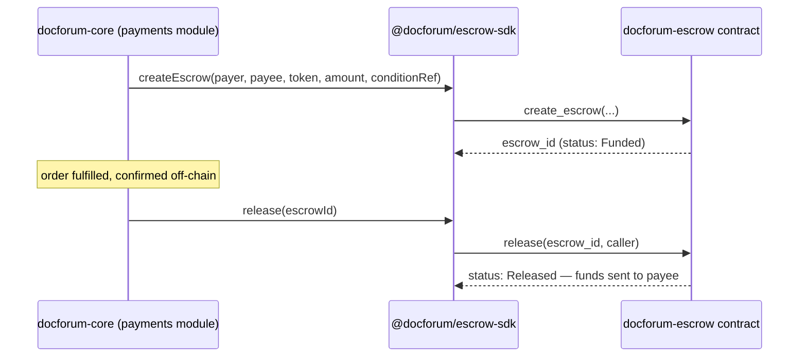

# docforum-escrow


**🔗 Live on testnet:** [`CAHQ4J3T23WSIBBG6SI6EAYR5Q2HIPKG5YMC4SMZBOTYA6MYK2VADEV5`](https://stellar.expert/explorer/testnet/contract/CAHQ4J3T23WSIBBG6SI6EAYR5Q2HIPKG5YMC4SMZBOTYA6MYK2VADEV5) — current deployment (Phase E4: adds the `refund_after` timeout refund), verified with real calls, not just uploaded. History and details: [`docs/testnet-deployments.md`](docs/testnet-deployments.md).

A [Soroban](https://developers.stellar.org/docs/build/smart-contracts) (Stellar) smart contract for conditional payment escrow — lock funds, and release them to the payee only when release is authorized, or return them to the payer on refund. Paired with a TypeScript client SDK, `@docforum/escrow-sdk`.

This repo is deliberately **generic and domain-agnostic**. It has no
database, no server, and no knowledge of patients, doctors, referrals, or
any other healthcare concept — it is a reusable create/release/refund
escrow primitive, in the same category as other Stellar ecosystem escrow
projects (e.g. Trustless Work). Anything domain-specific — what condition
triggers a release, who the parties are — lives in the consuming
application, not here.

## Table of contents

- [Why this repo exists](#why-this-repo-exists-honestly)
- [Contract surface](#contract-surface)
- [How it's used](#how-its-used)
- [Repo layout](#repo-layout)
- [Getting started](#getting-started)
- [Documentation](#documentation)
- [Project status](#project-status)
- [Contributing](#contributing)
- [License](#license)

## Why this repo exists, honestly

Two reasons, stated plainly rather than blended together:

1. **Product reason.** [`docforum-core`](https://github.com/DocForum/docforum-core)'s facility-fulfillment flow needs a way to hold payment until a facility confirms it did the work, without trusting the facility's self-report alone.
2. **Ecosystem reason.** This is the one piece of the `DocForum` organization that's actually built *on* Stellar, as opposed to an application that merely accepts Stellar payments — see [`docforum-core`'s ADR 0002](https://github.com/DocForum/docforum-core/blob/main/docs/adr/0002-stellar-escrow-for-fulfillment-payout.md) for why that distinction shaped how the org is structured, and [`docs/adr/0001-generic-escrow-not-healthcare-specific.md`](docs/adr/0001-generic-escrow-not-healthcare-specific.md) for why the contract itself stays domain-blind.

## Contract surface

| Function | Status | Description |
|---|---|---|
| `create_escrow(payer, payee, token, amount, condition_ref, releaser, refund_after) -> escrow_id` | ✅ Implemented | Pulls `amount` of `token` from `payer` (requires `payer` auth), stores an opaque `condition_ref`, sets status `Funded`. Rejects non-positive amounts, and any `refund_after` that isn't strictly in the future. |
| `get_status(escrow_id) -> EscrowStatus` | ✅ Implemented | Read-only. Errors on an unknown id. |
| `get_escrow(escrow_id) -> EscrowData` | ✅ Implemented | Read-only: everything stored about the escrow, including `releaser` and `refund_after`, so payees can check the deal before relying on it. |
| `release(escrow_id, caller) -> Result<()>` | ✅ Implemented | Restricted to the escrow's designated `releaser`; moves funds to `payee`. Never gated by `refund_after`. |
| `refund(escrow_id, caller) -> Result<()>` | ✅ Implemented | Returns funds to `payer`. The `releaser` may always call it; once `refund_after` has passed, anyone may — still only back to `payer` (see [ADR 0004](docs/adr/0004-timeout-refund-path.md)). |

```
EscrowStatus = Funded | Released | Refunded
```

`refund_after` is optional: an escrow created without one behaves exactly
as it did before the timeout existed — releaser-only refunds, forever.
That's the answer to "what if the releaser's key is lost?" (threat model
T2): instead of locking funds permanently, a deadline lets anyone return
them to the payer. See [ADR 0004](docs/adr/0004-timeout-refund-path.md)
for the decision and what it means for payees.

**Design rule, enforced deliberately:** the contract decides **who** may
call `release`/`refund`, never **why**. `condition_ref` is an opaque
string the contract stores but never interprets — all domain
interpretation (what counts as "fulfilled," who's authorized to attest to
it) is the consuming application's job. See
[ADR 0001](docs/adr/0001-generic-escrow-not-healthcare-specific.md).

## How it's used



`docforum-core` imports `@docforum/escrow-sdk` as a **library dependency**
— it never calls this contract as a running network service, and this
repo never crosses back into `docforum-core`'s database or domain model.

### Monitoring escrow events

The SDK exposes Soroban event history and polling helpers for monitoring
and reconciliation. Event history is available only after a contract
deployment emits the lifecycle events (tracked by issue #9); the current
testnet deployment does not emit them.

```ts
const page = await client.getEvents({ fromLedger: 12_345 });
for (const event of page.events) {
  console.log(event.type, event.escrowId, event.ledger);
}

// Persist each handled event's cursor alongside your monitoring checkpoint.
let cursor = page.nextCursor;
const stop = client.subscribe(async (event) => {
  await recordEvent(event);
  cursor = event.cursor;
}, { cursor, pollIntervalMs: 3_000, onError: reportMonitoringError });
// Call stop() when the monitoring process shuts down.
```

Handlers run one at a time; polling waits for each handler to finish. Pass
the last handled event cursor when restarting. RPCs can prune old history;
the SDK reports an expired cursor with `EventCursorExpiredError`. Events
with unrecognized topics are returned as `type: "unknown"` with their
decoded topics and payload so a newer event schema does not stop monitoring.

## Repo layout

```
contracts/escrow/
  src/lib.rs        Contract implementation
  tests/            Integration tests (soroban-sdk testutils) — required for any contract change
  Cargo.toml
sdk/
  src/index.ts      @docforum/escrow-sdk — TypeScript client (not yet implemented, see issue #4)
  package.json
docs/adr/           Architecture decision records
.github/            CI workflow, issue/PR templates
```

## Getting started

Requires a Rust toolchain with the `wasm32v1-none` target.

```bash
git clone https://github.com/DocForum/docforum-escrow.git
cd docforum-escrow/contracts/escrow

# Run the test suite (28 tests, all passing today)
cargo test

# Build the deployable contract
cargo build --target wasm32v1-none --release
# → target/wasm32v1-none/release/docforum_escrow.wasm
```

Already deployed to Stellar **testnet** — see
[`docs/testnet-deployments.md`](docs/testnet-deployments.md) for the
contract id, transaction links, and the exact `stellar` CLI commands to
redeploy. **Mainnet is out of scope until the Phase E4 security review is
complete — see [hard rule 4](ARCHITECTURE_ESSENTIALS.md#hard-rules).**

The TypeScript SDK (`sdk/`) wraps the contract and provides event history
and subscription helpers. The SDK helpers are versioned 0.4.0; lifecycle
event monitoring becomes active after issue #9 adds contract events.

The SDK runtime matrix is checked in CI against Node.js 20, 22, and 24,
Bun, Deno 2, and Chromium via Playwright. Node.js 20 is a compatibility
probe; supported Node.js versions start at 22 because the current
`@stellar/stellar-sdk` dependency requires Node.js 22 or newer. The runtime
and browser smoke checks use local fixtures and make no testnet calls or
require secrets.

## Documentation

| Doc | Purpose |
|---|---|
| [`ARCHITECTURE_ESSENTIALS.md`](ARCHITECTURE_ESSENTIALS.md) | Stack, contract surface, hard rules (no PHI ever, tests required for contract changes, testnet-only until security review). |
| [`ROADMAP.md`](ROADMAP.md) | Phase E1–E6 breakdown and current status. |
| [`AGENTS.md`](AGENTS.md) / [`CLAUDE.md`](CLAUDE.md) | Rules for coding agents working in this repo — read `README.md` + `ARCHITECTURE_ESSENTIALS.md` first; you should rarely need `docforum-core`'s docs to work here. |
| [`docs/adr/0001-generic-escrow-not-healthcare-specific.md`](docs/adr/0001-generic-escrow-not-healthcare-specific.md) | Why the contract stays domain-blind. |

## Project status

**Phase E1 (contract skeleton): done.** `create_escrow` and `get_status`
are implemented, tested, and deployed live on testnet — not just locally
tested. Phases E2 (release/refund), E3 (TypeScript SDK), and E4 (security
review, blocking for any mainnet use) are tracked as open issues:

| Issue | Phase | Complexity |
|---|---|---|
| ~~#1 Deploy to testnet~~ — done, see above | E1 | Trivial |
| [#2 Implement `release()`](https://github.com/DocForum/docforum-escrow/issues/2) | E2 | High |
| [#3 Implement `refund()`](https://github.com/DocForum/docforum-escrow/issues/3) | E2 | High |
| [#4 SDK: wrap `create_escrow`/`get_status`](https://github.com/DocForum/docforum-escrow/issues/4) | E3 | Medium |
| [#5 ADR: npm vs GitHub Packages](https://github.com/DocForum/docforum-escrow/issues/5) | E3 | Trivial |
| [#6 Threat model + external security review](https://github.com/DocForum/docforum-escrow/issues/6) | E4 | High |

Full breakdown: [`ROADMAP.md`](ROADMAP.md).

## Contributing

Issues are scoped as small, independent units with a stated complexity
(Trivial/Medium/High) — see the
[good-first-issue template](.github/ISSUE_TEMPLATE/good-first-issue.md).
Any contract logic change **must** include tests in `contracts/escrow/tests/`
in the same PR — see `AGENTS.md` hard rules. This repo targets the Stellar
ecosystem's [Drips Wave](https://docs.drips.network/wave/) program; see
`docforum-core`'s
[ADR 0002](https://github.com/DocForum/docforum-core/blob/main/docs/adr/0002-stellar-escrow-for-fulfillment-payout.md)
for the readiness plan.

Questions, or want to talk through an issue before picking it up? Join the
DocForum contributor chat on [Telegram](https://t.me/+J9eZoFker_E4Y2M8).

## License

[Apache License 2.0](LICENSE)
IyBkb2Nmb3J1bS1lc2Nyb3cKCiFbTGljZW5zZV0oaHR0cHM6Ly9pbWcu c2hpZWxkcy5pby9iYWRnZS9saWNlbnNl LUFwYWNoZS0tMi4wLWJsdWUuc3Zn KQohW1N0YXR1c10oaHR0cHM6Ly9pbWcu c2hpZWxkcy5pby9iYWRnZS9zdGF0 dXMtUGhhc2UlMjBFNiUyMGRvbmUt YnJpZ2h0Z3JlZW4uc3ZnKQohW1N0 YWNrXShodHRwczovL2ltZy5zaGll bGRzLmlvL2JhZGdlL2NvbnRyYWN0 LVJ1c3QlMjAlMkYlMjBTb3JvYmFu LW9yYW5nZS5zdmcpCiFbTmV0d29y a10oaHR0cHM6Ly9pbWcuc2hpZWxk cy5pby9iYWRnZS9uZXR3b3JrLXRlc3 RuZXQlMjBvbmx5LWltcG9ydGFudC5z dmcpCgoqqvCflJcgTGl2ZSBvbiB0 ZXN0bmV0OioqIFtgQ0FIUDRKM1Qy M1dTSUJCRzZTSzZFQVlSNVEySElQ S0c1WU1DNFNNWkJPVFlBNk1ZS1Yy VkRFVjVgXShodHRwczovL3N0ZWxs YXIuZXhwZXJ0L2V4cGxvcmVyL3Rl c3RuZXQvY29udHJhY3QvQ0FIUDRK M1QyM1dTSUJCRzZTSzZFQVlSNVEy SElQS0c1WU1DNFNNWkJPVFlBNk1Z S1YyVkRFVjUpIOKAlCBjdXJyZW50 IGRlcGxveW1lbnQgKFBoYXNlIEU0 OiBhZGRzIHRoZSBgcmVmdW5kX2Fm dGVyYCB0aW1lb3V0IHJlZnVuZCks IHZlcmlmaWVkIHdpdGggcmVhbCBj YWxscywgbm90IGp1c3QgdXBsb2Fk ZWQuIEhpc3RvcnkgYW5kIGRldGFp bHM6IFtgZG9jcy90ZXN0bmV0LWRl cGxveW1lbnRzLm1kYF0oZG9jcy90 ZXN0bmV0LWRlcGxveW1lbnRzLm1k KS4KCkEgW1Nvcm9iYW5dKGh0dHBz Oi8vZGV2ZWxvcGVycy5zdGVsbGFy Lm9yZy9kb2NzL2J1aWxkL3NtYXJ0 LWNvbnRyYWN0cykgKFN0ZWxsYXIp IHNtYXJ0IGNvbnRyYWN0IGZvciBj b25kaXRpb25hbCBwYXltZW50IGVz Y3JvdyDigJQgbG9jayBmdW5kcywg YW5kIHJlbGVhc2UgdGhlbSB0byB0 aGUgcGF5ZWUgb25seSB3aGVuIHJl bGVhc2UgaXMgYXV0aG9yaXplZCwg b3IgcmV0dXJuIHRoZW0gdG8gdGhl IHBheWVyIG9uIHJlZnVuZC4gUGFp cmVkIHdpdGggYSBUeXBlU2NyaXB0 IGNsaWVudCBTREssIGBAZG9jZm9y dW0vZXNjcm93LXNka2AuCgpUaGlz IHJlcG8gaXMgZGVsaWJlcmF0ZWx5 ICoqZ2VuZXJpYyBhbmQgZG9tYWlu LWFnbm9zdGljKiouIEl0IGhhcyBubyBk YXRhYmFzZSwgbm8gc2VydmVyLCBh bmQgbm8ga25vd2xlZGdlIG9mIHBh dGllbnRzLCBkb2N0b3JzLCByZWZl cnJhbHMsIG9yIGFueSBvdGhlciBo ZWFsdGhjYXJlIGNvbmNlcHQg4oCU IGl0IGlzIGEgcmV1c2FibGUgY3Jl YXRlL3JlbGVhc2UvcmVmdW5kIGVz Y3JvdyBwcmltaXRpdmUsIGluIHRo ZSBzYW1lIGNhdGVnb3J5IGFzIG90 aGVyIFN0ZWxsYXIgZWNvc3lzdGVt IGVzY3JvdyBwcm9qZWN0cyAoZS5n LiBUcnVzdGxlc3MgV29yaykuIEFu eXRoaW5nIGRvbWFpbi1zcGVjaWZp YyDigJQgd2hhdCBjb25kaXRpb24g dHJpZ2dlcnMgYSByZWxlYXNlLCB3 aG8gdGhlIHBhcnRpZXMgYXJlIOKA lCBsaXZlcyBpbiB0aGUgY29uc3Vt aW5nIGFwcGxpY2F0aW9uLCBub3Qg aGVyZS4KCiMjIFRhYmxlIG9mIGNv bnRlbnRzCgotIFtXaHkgdGhpcyBy ZXBvIGV4aXN0cyAoIyB3aHktdGhp cy1yZXBvLWV4aXN0cy1ob25lc3Rs eSkKIy0gW0NvbnRyYWN0IHN1cmZh Y2VdKCNjb250cmFjdC1zdXJm YWNlKQotIFtIb3cgaXQncyB1c2Vk XSgjaG93LWl0cy11c2VkKQotIFtS ZXBvIGxheW91dF0oI3JlcG8tbGF5 b3V0KQotIFtHZXR0aW5nIHN0YXJ0 ZWRdKCNnZXR0aW5nLXN0YXJ0ZWQp Ci0gW0RvY3VtZW50YXRpb25dKCNk b2N1bWVudGF0aW9uKQotIFtQcm9q ZWN0IHN0YXR1c10oI3Byb2plY3Qt c3RhdHVzKQotIFtDb250cmlidXRp bmddKCNjb250cmlidXRpbmcpCi0g W0xpY2Vuc2VdKCNsaWNlbnNlKQoK IyMgV2h5IHRoaXMgcmVwbyBleGlz dHMsIGhvbmVzdGx5CgpUd28gcmVh c29ucywgc3RhdGVkIHBsYWlubHkg cmF0aGVyIHRoYW4gYmxlbmRlZCB0 b2dldGhlcjoKCjEuICoqUHJvZHVj dCByZWFzb24uKiogW2Bkb2Nmb3J1 bS1jb3JlYF0oaHR0cHM6Ly9naXRo dWIuY29tL0RvY0ZvcnVtL2RvY2Zv cnVtLWNvcmUpJ3MgZmFjaWxpdHkt ZnVsZmlsbG1lbnQgZmxvdyBuZWVk cyBhIHdheSB0byBob2xkIHBheW1l bnQgdW50aWwgYSBmYWNpbGl0eSBj b25maXJtcyBpdCBkaWQgdGhlIHdv cmssIHdpdGhvdXQgdHJ1c3Rp bmcgdGhlIGZhY2lsaXR5J3Mgc2Vs Zi1yZXBvcnQgYWxvbmUuCjIuICoq RWNvc3lzdGVtIHJlYXNvbi4qKiBU aGlzIGlzIHRoZSBvbmUgcGllY2Ug b2YgdGhlIGBEb2NGb3J1bWAgb3Jn YW5pemF0aW9uIHRoYXQncyBhY3R1 YWxseSBidWlsdCAqb24qIFN0ZWxs YXIsIGFzIG9wcG9zZWQgdG8gYW4g YXBwbGljYXRpb24gdGhhdCBtZXJl bHkgYWNjZXB0cyBTdGVsbGFyIHBh eW1lbnRzIOKAlCBzZWUgW2Bkb2Nm b3J1bS1jb3JlYCdzIEFEUiAwMDAy XShodHRwczovL2dpdGh1Yi5jb20v RG9jRm9ydW0vZG9jZm9ydW0tY29y ZS9ibG9iL21haW4vZG9jcy9hZHIv MDAwMi1zdGVsbGFyLWVzY3Jvdy1m b3ItZnVsZmlsbG1lbnQtcGF5b3V0 Lm1kKSBmb3Igd2h5IHRoYXQgZGlz dGluY3Rpb24gc2hhcGVkIGhvdyB0 aGUgb3JnIGlzIHN0cnVjdHVyZWQs IGFuZCBbYGRvY3MvYWRyLzAwMDEt Z2VuZXJpYy1lc2Nyb3ctbm90LWhl YWx0aGNhcmUtc3BlY2lmaWMubWRg XShkb2NzL2Fkci8wMDAxLWdlbmVy aWMtZXNjcm93LW5vdC1oZWFsdGhj YXJlLXNwZWNpZmljLm1kKSBmb3Ig d2h5IHRoZSBjb250cmFjdCBpdHNl bGYgc3RheXMgZG9tYWluLWJsaW5k LgoKIyMgQ29udHJhY3Qgc3VyZmFj ZQoKfCBGdW5jdGlvbiB8IFN0YXR1 cyB8IERlc2NyaXB0aW9uIHwKfC0t LXwtLS18LS0tfAp8IGBjcmVhdGVf ZXNjcm93KHBheWVyLCBwYXllZSwg dG9rZW4sIGFtb3VudCwgY29uZGl0 aW9uX3JlZiwgcmVsZWFzZXIsIHJl ZnVuZF9hZnRlcikgLT4gZXNjcm93 X2lkYCB8IOKchSBJbXBsZW1lbnRl ZCB8IFB1bGxzIGBhbW91bnRgIG9m IGB0b2tlbmAgZnJvbSBgcGF5ZXJg IChyZXF1aXJlcyBgcGF5ZXJgIGF1 dGgpLCBzdG9yZXMgYW4gb3BhcXVl IGBjb25kaXRpb25fcmVmYCwgc2V0 cyBzdGF0dXMgYEZ1bmRlZGAuIFJl amVjdHMgbm9uLXBvc2l0aXZlIGFt b3VudHMsIGFuZCBhbnkgYHJlZnVu ZF9hZnRlcmAgdGhhdCBpc24ndCBz dHJpY3RseSBpbiB0aGUgZnV0dXJl LiB8CnwgYGdldF9zdGF0dXMoZXNj cm93X2lkKSAtPiBFc2Nyb3dTdGF0 dXNgIHwg4pyFIEltcGxlbWVudGVk IHwgUmVhZC1vbmx5LiBFcnJvcnMgb24g YW4gdW5rbm93biBpZC4gfAp8IGBn ZXRfZXNjcm93KGVzY3Jvd19pZCkg LT4gRXNjcm93RGF0YWAgfCDinIUg SW1wbGVtZW50ZWQgfCBSZWFk LW9ubHk6IGV2ZXJ5dGhpbmcgc3Rv cmVkIGFib3V0IHRoZSBlc2Nyb3cs IGluY2x1ZGluZyBgcmVsZWFzZXJg IGFuZCBgcmVmdW5kX2FmdGVyYCwgc28g cGF5ZWVzIGNhbiBjaGVjayB0aGUg ZGVhbCBiZWZvcmUgcmVseWluZyBv biBpdC4gfAp8IGByZWxlYXNlKGVz Y3Jvd19pZCwgY2FsbGVyKSAtPiBS ZXN1bHQ8KCk+YCB8IOKchSBJbXBs ZW1lbnRlZCB8IFJlc3RyaWN0ZWQg dG8gdGhlIGVzY3JvdydzIGRlc2ln bmF0ZWQgYHJlbGVhc2VyYDsgbW92 ZXMgZnVuZHMgdG8gYHBheWVlYC4g TmV2ZXIgZ2F0ZWQgYnkgYHJlZnVu ZF9hZnRlcmAuIHwKfCBgcmVmdW5k KGVzY3Jvd19pZCwgY2FsbGVyKSAt PiBSZXN1bHQ8KCk+YCB8IOKchSBJ bXBsZW1lbnRlZCB8IFJldHVybnMg ZnVuZHMgdG8gYHBheWVyYC4gVGhl IGRyZWxlYXNlcmAgbWF5IGFsd2F5 cyBjYWxsIGl0OyBvbmNlIGByZWZ1 bmRfYWZ0ZXJgIGhhcyBwYXNzZWQs IGFueW9uZSBtYXkg4oCUIHN0aWxs IG9ubHkgYmFjayB0byBgcGF5ZXJg IChzZWUgW0FEUiAwMDA0XShkb2Nz L2Fkci8wMDA0LXRpbWVvdXQtcmVmdW5k LXBhdGgubWQpKS4gfAoKYGBg CkVzY3Jvd1N0YXR1cyA9IEZ1bmRl ZCB8IFJlbGVhc2VkIHwgUmVmdW5k ZWQKYGBgCgpgcmVmdW5kX2FmdGVy YCBpcyBvcHRpb25hbDogYW4gZXNj cm93IGNyZWF0ZWQgd2l0aG91dCBv bmUgYmVoYXZlcyBleGFjdGx5CmFz IGl0IGRpZCBiZWZvcmUgdGhlIHRp bWVvdXQgZXhpc3RlZCDigJQgcmVs ZWFzZXItb25seSByZWZ1bmRzLCBm b3JldmVyLgpUaGF0J3MgdGhlIGFu c3dlciB0byAid2hhdCBpZiB0aGUg cmVsZWFzZXIncyBrZXkgaXMgbG9z dD8iICh0aHJlYXQgbW9kZWwKVDIp OiBpbnN0ZWFkIG9mIGxvY2tpbmcg ZnVuZHMgcGVybWFuZW50bHksIGEg ZGVhZGxpbmUgbGV0cyBhbnlvbmUgcmV0 dXJuCnRoZW0gdG8gdGhlIHBheWVy LiBTZWUgW0FEUiAwMDA0XShkb2Nz L2Fkci8wMDA0LXRpbWVvdXQtcmVmdW5k LXBhdGgubWQpCmZvciB0aGUgZGVj aXNpb24gYW5kIHdoYXQgaXQgbWVh bnMgZm9yIHBheWVlcy4KCioqRGVz aWduIHJ1bGUsIGVuZm9yY2VkIGRl bGliZXJhdGVseToqKiB0aGUgY29u dHJhY3QgZGVjaWRlcyAqKndobyoq IG1heQpjYWxsIGByZWxlYXNlYC9gcmVm dW5kYCwgbmV2ZXIgKip3aHkqKi4g YGNvbmRpdGlvbl9yZWZgIGlzIGFu IG9wYXF1ZQpzdHJpbmcgdGhlIGNvbn RyYWN0IHN0b3JlcyBidXQgbmV2ZXIg aW50ZXJwcmV0cyDigJQgYWxsIGRv bWFpbgppbnRlcnByZXRhdGlvbiAo d2hhdCBjb3VudHMgYXMgImZ1bGZp bGxlZCwiIHdobyBpcyBhdXRob3Jp emVkIHRvIGF0dGVzdCB0bwppdCkg aXMgdGhlIGNvbnN1bWluZyBhcHBs aWNhdGlvbidzIGpvYi4gU2Vl CltBRFIgMDAwMV0oZG9jcy9hZHIv MDAwMS1nZW5lcmljLWVzY3Jvdy1u b3QtaGVhbHRoY2FyZS1zcGVjaWZp Yy5tZCkuCgojIyBIb3cgaXQncyB1 c2VkCgpgYGBtZXJtYWlkCnNlcXVl bmNlRGlhZ3JhbQogICAgcGFydGlj aXBhbnQgQ29yZSBhcyBkb2Nmb3J1 bS1jb3JlIChwYXltZW50cyBtb2R1 bGUpCiAgICBwYXJ0aWNpcGFudCBT REsgYXMgQGRvY2ZvcnVtL2VzY3Jv dy1zZGsKICAgIHBhcnRpY2lwYW50 IENvbnRyYWN0IGFzIGRvY2ZvcnVt LWVzY3JvdyBjb250cmFjdAoKICAg IENvcmUuPj5TREs6IGNyZWF0ZUVz Y3JvdyhwYXllciwgcGF5ZWUsIHRv a2VuLCBhbW91bnQsIGNvbmRpdGlv blJlZikKICAgIFNESy0+PkNvbnRy YWN0OiBjcmVhdGVfZXNjcm93KC4u LikKICAgIENvbnRyYWN0LS0+PlNESzog ZXNjcm93X2lkIChzdGF0dXM6IEZ1 bmRlZCkKICAgIE5vdGUgb3ZlciBD b3JlOiBvcmRlciBmdWxmaWxsZWQs IGNvbmZpcm1lZCBvZmYtY2hhaW4K ICAgIENvcmUuPj5TREs6IHJlbGVh c2UoZXNjcm93SWQpCiAgICBTREst Pj5Db250cmFjdDogcmVsZWFzZShl c2Nyb3dfaWQsIGNhbGxlcikKICAg IENvbnRyYWN0LS0+PlNESzogc3Rh dHVzOiBSZWxlYXNlZCDigJQgZnVu ZHMgc2VudCB0byBwYXllZQpgYGAK CmBkb2Nmb3J1bS1jb3JlYCBpbXBv cnRzIGBAZG9jZm9ydW0vZXNjcm93 LXNka2AgYXMgYSAqKmxpYnJhcnkg ZGVwZW5kZW5jeSoqCuKAlCBpdCBu ZXZlciBjYWxscyB0aGlzIGNvbnRy YWN0IGFzIGEgcnVubmluZyBuZXR3 b3JrIHNlcnZpY2UsIGFuZCB0aGlz CnJlcG8gbmV2ZXIgY3Jvc3NlcyBi YWNrIGludG8gYGRvY2ZvcnVtLWNv cmVgJ3MgZGF0YWJhc2Ugb3IgZG9t YWluIG1vZGVsLgoKIyMgUmVwbyBs YXlvdXQKCmBgYApjb250cmFjdHMv ZXNjcm93LwogIHNyYy9saWIucnMg ICAgICAgIENvbnRyYWN0IGltcGxlbWVu dGF0aW9uCiAgdGVzdHMvICAgICAg ICAgICAgSW50ZWdyYXRpb24gdGVz dHMgKHNvcm9iYW4tc2RrIHRlc3R1 dGlscykg4oCUIHJlcXVpcmVkIGZv ciBhbnkgY29udHJhY3QgY2hhbmdl CiAgQ2FyZ28udG9tbApzZGsvCiAg c3JjL2luZGV4LnRzICAgICAgQGRv Y2ZvcnVtL2VzY3Jvdy1zZGsg4oCU IFR5cGVTY3JpcHQgY2xpZW50CiAg cGFja2FnZS5qc29uCmRvY3MvYWRy LSAgICAgICAgICAgQXJjaGl0ZWN0dXJl IGRlY2lzaW9uIHJlY29yZHMKLmdp dGh1Yi8gICAgICAgICAgICBDSSB3 b3JrZmxvdywgaXNzdWUvUFIgdGVt cGxhdGVzCmBgYAoKIyMgR2V0dGlu ZyBzdGFydGVkCgpSZXF1aXJlcyBh IFJ1c3QgdG9vbGNoYWluIHdpdGgg dGhlIGB3YXNtMzJ2MS1ub25lYCB0 YXJnZXQuCgpgYGBiYXNoCmdpdCBj bG9uZSBodHRwczovL2dpdGh1Yi5j b20vRG9jRm9ydW0vZG9jZm9ydW0t ZXNjcm93LmdpdApjZCBkb2Nmb3J1 bS1lc2Nyb3cvY29udHJhY3RzL2Vz Y3JvdwoKIyBSdW4gdGhlIHRlc3Qg c3VpdGUgKDI4IHRlc3RzLCBhbGwg cGFzc2luZyB0b2RheSkKY2FyZ28g dGVzdAoKIyBCdWlsZCB0aGUgZGVw bG95YWJsZSBjb250cmFjdApjYXJn byBidWlsZCAtLXRhcmdldCB3YXNt MzJ2MS1ub25lIC0tcmVsZWFzZQoj IOKGkiB0YXJnZXQvd2FzbTMy djEtbm9uZS9yZWxlYXNlL2RvY2Zv cnVtX2VzY3Jvdy53YXNtCmBgYAoK QWxyZWFkeSBkZXBsb3llZCB0byBT dGVsbGFyICoqdGVzdG5ldCoqIOKA lCBzZWUKW2Bkb2NzL3Rlc3RuZXQtZGVw bG95bWVudHMubWRgXShkb2NzL3Rl c3RuZXQtZGVwbG95bWVudHMubWQp IGZvciB0aGUKY29udHJhY3QgaWQsIHRy YW5zYWN0aW9uIGxpbmtzLCBhbmQg dGhlIGV4YWN0IGBzdGVsbGFyYCBD TEkgY29tbWFuZHMgdG8KcmVkZXBs b3kuICoqTWFpbm5ldCBpcyBvdXQg b2Ygc2NvcGUgdW50aWwgdGhlIFBo YXNlIEU0IHNlY3VyaXR5IHJldmlldyBp cwpjb21wbGV0ZSDigJQgc2VlIFto YXJkIHJ1bGUgNF0oQVJDSElURUNU VVJFX0VTU0VOVElBTFMubWQjaGFy ZC1ydWxlcykuKioKClRoZSBUeXBl U2NyaXB0IFNESyBpcyBwdWJsaXNo ZWQgdG8gbnBtIGFzIGBAZG9jZm9y dW0vZXNjcm93LXNka2AgYW5kIGlu c3RhbGxhYmxlIHRoZSBub3JtYWwg d2F5OgoKYGBgYmFzaAojIFB1Ymxp Y2F0aW9uIGlzIGF1dG9tYXRlZCB2 aWEgdGhlIHJlbGVhc2Ugd29ya2Zs b3cgLS0gc2VlIC5naXRodWIv d29ya2Zsb3dzL3JlbGVhc2UteW1s Cm5wbSBpbnN0YWxsIEBkb2Nmb3J1 bS9lc2Nyb3ctc2RrCmBgYAoKUmVs ZWFzZXMgYXJlIGN1dCBieSBwdXNo aW5nIGFuIGBzZGs tdipgIHRhZyAoZS5n LiBgc2RrLXYwLjQuMGApOyB0aGUg d29ya2Zsb3cgYnVpbGRzLCB0ZXN0 cywgYHB1Ymxpc2hlc2Agd2l0aCBu cG0gcHJvdmVuYW5jZSwgYW5kIGF0 dGFjaGVzIHRoZSB0YXJiYWxsIHRv IHRoZSBHaXRodWIgUmVsZWFzZS4g VGhlIG9uZS10aW1lIGh1bWFuIHNl dHVwIHN0ZXBzIChucG0gb3JnLCB0 cnVzdGVkIHB1Ymxpc2hpbmcpIGFy ZSBkb2N1bWVudGVkIGluIFtDT05U UklCVVRJTkcu bWRdKENPTlRSSUJV VElORy5tZCkgYW5kIFtBRFIgMDAw NV0oZG9jcy9hZHIvMDAwNS1ucG0t cHVibGlzaGluZy13aXRoLXByb3Zl bmFuY2UubWQpLgoKIyMgRG9jdW1l bnRhdGlvbgoKfCBEb2MgfCBQ dXJwb3NlIHwKfC0tLXwtLS18Cnwg W2BBUkNISVRFQ1RVUkVfRVNTRU5U SUFMUy5tZGBdKEFSQ0hJVEVDVFVS RV9FU1NFTlRJQUxTLm1kKSB8IFN0 YWNrLCBjb250cmFjdCBzdXJmYWNl LCBoYXJkIHJ1bGVzIChubyBQSEkg ZXZlciwgdGVzdHMgcmVxdWlyZWQg Zm9yIGNvbnRyYWN0IGNoYW5nZXMs IHRlc3RuZXQtb25seSB1bnRpbCBz ZWN1cml0eSByZXZpZXcpLiB8Cnwg W2BST0FETUFQLm1kYF0oUk9BRE1B UC5tZCkgfCBQaGFzZSBFMS1FNiBi cmVha2Rvd24gYW5kIGN1cnJlbnQg c3RhdHVzLiB8CnwgW2BBR0VOVFMu bWRgXShBR0VOVFMubWQpIC8gW2BD TGFVREUubWRgXShDTEFVREUubWQp IHwgUnVsZXMgZm9yIGNvZGluZyBh Z2VudHMgd29ya2luZyBpbiB0aGlz IHJlcG8g4oCUIHJlYWQgYFJFQURN RS5tZGAgKyBgQVJDSElURUNUVVJF X0VTU0VOVElBTFMubWRgIGZpcnN0 OyB5b3Ugc2hvdWxkIHJhcmVseSBu ZWVkIGBkb2Nmb3J1bS1jb3JlYCdz IGRvY3MgdG8gd29yayBoZXJlLiB8 CnwgW2Bkb2NzL2Fkci8wMDAx LWdlbmVyaWMtZXNjcm93LW5vdC1o ZWFsdGhjYXJlLXNwZWNpZmljLm1k YF0oZG9jcy9hZHIvMDAwMS1n ZW5lcmljLWVzY3Jvdy1ub3QtaGVh bHRoY2FyZS1zcGVjaWZpYy5tZCkg fCBXaHkgdGhlIGNvbnRyYWN0IHN0 YXlzIGRvbWFpbi1ibGluZC4gfAp8 IFtgZG9jcy9hZHIvMDAwNS1ucG0t cHVibGlzaGluZy13aXRoLXByb3Zl bmFuY2UubWRgXShkb2NzL2Fkci8w MDA1LW5wbS1wdWJsaXNoaW5nLXdp dGgtcHJvdmVuYW5jZS5tZCkgfCBT dXBlcnNlZGVzIEFEUiAwMDAzOiBu cG0gcmVnaXN0cnkgcHVibGlzaGlu ZyB3aXRoIHByb3ZlbmFuY2UgaXMg bm93IHRoZSBwcmltYXJ5IGRpc3Ry aWJ1dGlvbiBjaGFubmVsLiB8Cgoj IyBQcm9qZWN0IHN0YXR1cwoKKipQ aGFzZSBFMSAoY29udHJhY3Qgc2tl bGV0b24pOiBkb25lLioqIGBjcmVh dGVfZXNjcm93YCBhbmQgYGdldF9z dGF0dXNgCmFyZSBpbXBsZW1lbnRl ZCwgdGVzdGVkLCBhbmQgZGVwbG95 ZWQgbGl2ZSBvbiB0ZXN0bmV0IOKA lCBub3QganVzdCBsb2NhbGx5CnRlc3RlZC4gUGhhc2VzIEUyIChyZWxl YXNlL3JlZnVuZCksIEUzIChUeXBl U2NyaXB0IFNESyksIEU0IChzZWN1 cml0eQpyZXZpZXcsIGJsb2NraW5n IGZvciBhbnkgbWFpbm5ldCB1c2Up LCBhbmQgRTYgKGF1dG9tYXRlZCBu cG0gcmVsZWFzZSkKYXJlIHRyYWNr ZWQgYXMgb3BlbiBpc3N1ZXM6Cgp8 IElzc3VlIHwgUGhhc2UgfCBDb21w bGV4aXR5IHwKfC0tLXwtLS18LS0tfAp8 IH5+IyMgRGVwbG95IHRvIHRlc3Ru ZXR+fiDigJQgZG9uZSwgc2VlIGFi b3ZlIHwgRTEgfCBUcml2aWFsIHwK fCB+fiMyIEltcGxlbWVudCBgcmVs ZWFzZSgpYH5+IHwgRTIgfCBIaWdo IHwKfCB+fiMzIEltcGxlbWVudCBg cmVmdW5kKClgfH4gfCBFMiB8IEhp Z2ggfAp8IH5+IyM0IFNESzogd3Jh cCBgY3JlYXRlX2VzY3Jvd2AvYGdl dF9zdGF0dXNgfn4gfCBFMyB8 IE1lZGl1bSB8Cnwgfn4jNSBBRFI6 IG5wbSB2cyBHaXRIdWIgUGFja2Fn ZXN+fiB8IEUzIHwgVHJpdmlhbCB8 CnwgW34jNiBUaHJlYXQgbW9kZWwg KyBleHRlcm5hbCBzZWN1cml0eSBy ZXZpZXd+XShodHRwczovL2dpdGh1 Yi5jb20vRG9jRm9ydW0vZG9jZm9y dW0tZXNjcm93L2lzc3Vlcy82KSB8 IEU0IHwgSGlnaCB8CnwgW1BoYXNl IEU2OiBucG0gcHVibGlzaGluZyB3 aXRoIHByb3ZlbmFuY2V+XShodHRw czovL2dpdGh1Yi5jb20vRG9jRm9y dW0vZG9jZm9ydW0tZXNjcm93L2lz c3VlcykgfCBFNiB8IEhpZ2ggfAoK RnVsbCBicmVha2Rvd246IFtgUk9B RE1BUC5tZGBdKFJPQUR NQVAubWQp LgoKIyMgQ29udHJpYnV0aW5nCgpJ c3N1ZXMgYXJlIHNjb3BlZCBhcyBz bWFsbCwgaW5kZXBlbmRlbnQgdW5p dHMgd2l0aCBhIHN0YXRlZCBjb21w bGV4aXR5CihUcml2aWFsL01lZGl1 bS9IaWdoKSDigJQgc2VlIHRoZQpb Z29vZC1maXJzdC1pc3N1ZSB0ZW1w bGF0ZV0oLmdpdGh1Yi9JU1NVRV9U RU1QTEFURS9nb29kLWZpcnN0LWlz c3VlLm1kKS4KQW55IGNvbnRyYWN0 IGxvZ2ljIGNoYW5nZSAqKm11c3Qq KiBpbmNsdWRlIHRlc3RzIGluIGBjb250 cmFjdHMvZXNjcm93L3Rlc3RzL2AK aW4gdGhlIHNhbWUgUFIg4oCUIHNl ZSBgQUdFTlRTLm1kYCBydWxlcy4g UmVsZWFzaW5nIHRoZSBTRESKcmVx dWlyZXMgdGhlIG9uZS10aW1lIGh1 bWFuIHN0ZXBzIGluIFtDT05UUklC VVRJTkcubWRdKENPTlRSSUJVVElO Ry5tZCkuIFRoaXMgcmVwbyB0YXJn ZXRzIHRoZSBTdGVsbGFyCmVjb3N5 c3RlbSdzIFtEcmlwcyBXYXZlXShodHRw czovL2RvY3MuZHJpcHMubmV0d29y ay93YXZlLykgcHJvZ3JhbTsgc2Vl CmBkb2Nmb3J1bS1jb3JlYCdzCltB RFIgMDAwMl0oaHR0cHM6Ly9naXRo dWIuY29tL0RvY0ZvcnVtL2RvY2Zv cnVtLWNvcmUvYmxvYi9tYWluL2Rv Y3MvYWRyLzAwMDItc3RlbGxhci1l c2Nyb3ctZm9yLWZ1bGZpbGxtZW50 LXBheW91dC5tZCkKZm9yIHRoZSBy ZWFkaW5lc3MgcGxhbi4KCkFkZGl0 aW9uYWxseSwgcmVsZWFzZXMgYXJl IGN1dCB2aWEgY2hhbmdlc2V0cyBh bmQgYW4gYXV0b21hdGVkIHdvcmtm bG93IOKAlCBzZWUKW0NPTlRSSUJV VElORy5tZF0oQ09OVFJJQlVUSU5H Lm1kKSBmb3IgdGhlIGRldmVsb3Bl ciB3b3JrZmxvdyBhbmQgdGhlIG9u ZS10aW1lIGh1bWFuIHNldHVwIHN0 ZXBzLgoKUXVlc3Rpb25zLCBvciB3 YW50IHRvIHRhbGsgdGhyb3VnaCBh biBpc3N1ZSBiZWZvcmUgcGlja2lu ZyBpdCB1cD8gSm9pbiB0aGUKRG9j Rm9ydW0gY29udHJpYnV0b3IgY2hh dCBvbiBbVGVsZWdyYW1dKGh0dHBz Oi8vdC5tZS8rSjllWm9Ga2VyX0U0 WTJNOCkuCgojIyBMaWNlbnNlCgpb QXBhY2hlIExpY2Vuc2UgMi4wXShM SUNFTlNFKQo=
