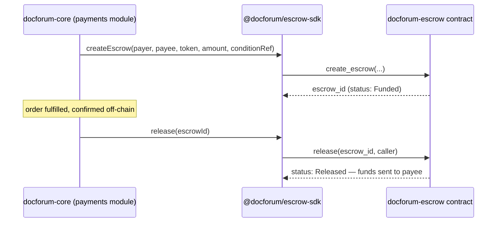

# docforum-escrow


**🔗 Live on testnet:** [`CAFI5QOTNLK5OIHEHGGQ7B22RN5IUOFGKKEID2OQCZSCJAQS4FLSS2DR`](https://stellar.expert/explorer/testnet/contract/CAFI5QOTNLK5OIHEHGGQ7B22RN5IUOFGKKEID2OQCZSCJAQS4FLSS2DR) — current upstream main deployment, including sponsored refunds (`refund_to`), verified with real create, release, refund, timeout refund, and `BalanceMismatch` calls. History and transaction links: [`docs/testnet-deployments.md`](docs/testnet-deployments.md).

A [Soroban](https://developers.stellar.org/docs/build/smart-contracts) (Stellar) smart contract for conditional payment escrow — lock funds, and release them to the payee only when release is authorized, or return them to the payer on refund. Paired with a TypeScript client SDK, `@docforum/escrow-sdk`.

This repo is deliberately **generic and domain-agnostic**. It has no
database, no server, and no knowledge of patients, doctors, referrals, or
any other healthcare concept — it is a reusable create/release/refund
escrow primitive, in the same category as other Stellar ecosystem escrow
projects (e.g. Trustless Work). Anything domain-specific — what condition
triggers a release, who the parties are — lives in the consuming
application, not here.

## Table of contents

- [Why this repo exists](#why-this-repo-exists-honestly)
- [Contract surface](#contract-surface)
- [How it's used](#how-its-used)
- [Repo layout](#repo-layout)
- [Getting started](#getting-started)
- [Documentation](#documentation)
- [Project status](#project-status)
- [Contributing](#contributing)
- [License](#license)

## Why this repo exists, honestly

Two reasons, stated plainly rather than blended together:

1. **Product reason.** [`docforum-core`](https://github.com/DocForum/docforum-core)'s facility-fulfillment flow needs a way to hold payment until a facility confirms it did the work, without trusting the facility's self-report alone.
2. **Ecosystem reason.** This is the one piece of the `DocForum` organization that's actually built *on* Stellar, as opposed to an application that merely accepts Stellar payments — see [`docforum-core`'s ADR 0002](https://github.com/DocForum/docforum-core/blob/main/docs/adr/0002-stellar-escrow-for-fulfillment-payout.md) for why that distinction shaped how the org is structured, and [`docs/adr/0001-generic-escrow-not-healthcare-specific.md`](docs/adr/0001-generic-escrow-not-healthcare-specific.md) for why the contract itself stays domain-blind.

## Contract surface

One generic escrow contract. A payer locks a token amount for a payee, and
the payout is settled by release (to the stored payee) or refund (to the
stored `refund_to`, which is the payer unless set otherwise at creation).
Creation options: a single releaser or an M-of-N releaser quorum, an
optional payee-acceptance gate, an optional `refund_after` timeout that
lets anyone trigger the refund, an optional `refund_to`, and an optional
release callback to a contract payee. An optional protocol fee
(`fee_recipient`/`fee_bps`, fixed at creation, at most 10 %) is taken off
the top at release and never on a refund — see
[ADR 0010](docs/adr/0010-protocol-fee-at-release.md). Funded escrows can be
topped up by the original payer, and `get_status`/`get_escrow` are
read-only (`get_escrow` is for funded escrows; a settled escrow's record is
reclaimed, so use `get_status` and the state event:
[ADR 0013](docs/adr/0013-reclaim-storage-for-settled-escrows.md)). `settle_many` releases or refunds up to 20 escrows in one
transaction with per-op results (the fast response to a leaked releaser
key, see [ADR 0012](docs/adr/0012-batch-settlement-best-effort.md)). A
token allowlist is fixed at deploy time. Pooled escrows — one agreement funded
by many payers, with per-payer contribution records and pull-based
pro-rata refunds — are a separate creation entry point
(`create_pooled_escrow`, see [ADR 0011](docs/adr/0011-pooled-escrow-funding.md)
and the contract surface list). A read-only `solvency(token)` view returns
the contract's balance of a token next to the total it owes across every
`Funded` escrow in that token (SDK: `client.getSolvency(token)`), so
monitors can check `balance >= liabilities` in one call — see
[threat model → Solvency monitoring](docs/threat-model.md#solvency-monitoring-issue-39).

**The full function list, signatures and rules are in
[`ARCHITECTURE_ESSENTIALS.md` → Contract surface](ARCHITECTURE_ESSENTIALS.md#contract-surface).**
It's kept in that one place so that adding or changing a contract function
is a single edit. Update that list, not this summary.

**Design rule, enforced deliberately:** the contract decides **who** may
call `release`/`refund`, never **why**. `condition_ref` is an opaque
string the contract stores but never interprets; all domain
interpretation (what counts as "fulfilled", who's authorized to attest to
it) is the consuming application's job. See
[ADR 0001](docs/adr/0001-generic-escrow-not-healthcare-specific.md).

## How it's used



`docforum-core` imports `@docforum/escrow-sdk` as a **library dependency**
— it never calls this contract as a running network service, and this
repo never crosses back into `docforum-core`'s database or domain model.

## Repo layout

```
contracts/escrow/
  src/lib.rs             Contract implementation
  tests/                 Integration tests (soroban-sdk testutils) — required for any contract change
  test_snapshots/        Committed Soroban snapshots (events/auth/storage) per test — issue #120
  Cargo.toml
certora/
  escrow.spec            Property list for invariants I1–I3 and the timeout rule (see docs/formal-verification.md)
sdk/
  src/index.ts           @docforum/escrow-sdk — hand-written public surface
  src/generated/         Machine-generated contract bindings — never hand-edit (issue #121)
  src/signers/           SEP-43 signer types + optional Stellar Wallets Kit adapter
  package.json
packages/escrow-react/   @docforum/escrow-react — React Query hooks (no UI)
sdk-go/                  Go client for the same contract (big.Int i128 amounts)
examples/web-demo/       Vite + React demo wiring hooks, wallet and telemetry
scripts/
  check-generated-bindings.sh   CI/regeneration check for the generated bindings
  stellar-cli-version           Pinned generator version (+ release checksum)
docs/adr/                Architecture decision records
.github/                 CI workflow, issue/PR templates
```

## Getting started

Requires the pinned Rust toolchain in [`rust-toolchain.toml`](rust-toolchain.toml), which includes `wasm32v1-none`.
For a hash-comparable release build, run `bash scripts/build-wasm.sh` from
the repository root; it normalizes source paths and the build timestamp.

```bash
git clone https://github.com/DocForum/docforum-escrow.git
cd docforum-escrow/contracts/escrow

# Run the test suite (also writes the
# committed test_snapshots/ files — see CONTRIBUTING.md)
cargo test

# Build the deployable contract
cargo build --target wasm32v1-none --release
# → target/wasm32v1-none/release/docforum_escrow.wasm
```

Already deployed to Stellar **testnet** — see
[`docs/testnet-deployments.md`](docs/testnet-deployments.md) for the
contract id, transaction links, and the exact `stellar` CLI commands to
redeploy. **Mainnet is out of scope until the Phase E4 security review is
complete — see [hard rule 4](ARCHITECTURE_ESSENTIALS.md#hard-rules).**

The SDK supports relayed release/refund calls. `authorizeRelease` and
`authorizeRefund` simulate the invocation, ask the releaser to sign only
its short-lived contract authorization entry, and return a serialized
transaction. `submitRelayed` restores that transaction and lets a separate
relayer sign the envelope and pay its fee. The auth entry is bound to the
simulated invocation and expires after ten ledgers:

```ts
const authorization = await client.authorizeRelease({ escrowId, releaser, relayer });
const { txHash } = await client.submitRelayed("release", authorization, relayer);
```

Keep the serialized authorization private until submission and do not
retry it after its expiration ledger.

### Milestone escrows

A milestone escrow pays out in fixed tranches instead of one lump sum.
The deployed contract is single-tranche, so the SDK models a schedule as a
**group of escrows** — one per tranche — created by `createMilestoneEscrow`.
No contract change is involved, and every per-escrow guarantee (releaser
auth, refund deadline, `Funded`/`Released` state) applies to each tranche:

```ts
const group = await client.createMilestoneEscrow({
  payer,
  payee,
  token,
  amount: 1_000_000n,             // must equal the sum of `milestones`
  conditionRef: "milestone-schedule",
  releaser,
  milestones: [600_000n, 400_000n],
});
group.escrowIds;    // [101n, 102n] — one single-tranche escrow per tranche

await client.releaseMilestone({ escrow: group, milestoneIndex: 0, caller: releaser }); // 600_000 to payee
await client.getMilestones(group); // [{ index: 0, … status: "released" }, { index: 1, … status: "unreleased" }]
await client.refundMilestone({ escrow: group, milestoneIndex: 1, caller: releaser });
```

The schedule is validated before the first transaction: entries must be
positive and sum exactly to `amount`, otherwise `createMilestoneEscrow`
rejects with `MilestoneScheduleError` and spends nothing. Each tranche's
`conditionRef` is tagged `<conditionRef>#m<i+1>/<n>` so a tranche stays
traceable on-chain, and a tag that would exceed the contract's 64-byte
`condition_ref` limit is rejected up front.

Two consequences of "one escrow per tranche" are worth knowing:

- A group costs one transaction per tranche, and creation is not atomic. If
  tranche *k* fails, the earlier escrows are already funded; the thrown
  `MilestoneEscrowPartialError` carries their ids so you can release or
  refund them instead of paying twice.
- Each tranche settles independently: refunding tranche 1 does not touch
  tranche 2, and released tranches are final.

### Pooled escrows

A pooled escrow funds **one agreement from many payers** (group purchase,
shared cost, crowdfunded work) while keeping every contribution on-chain
and refunding each payer exactly what they put in (issue #113,
[ADR 0011](docs/adr/0011-pooled-escrow-funding.md)). It is a distinct
creation entry point; single-payer escrows are untouched. All amounts are
raw token units.

```ts
// 1. Anyone creates the pool: target 1_000_000, funding closes at a deadline.
const { escrowId } = await client.createPooledEscrow({
  creator, payee, token,
  fundingTarget: 1_000_000n,
  conditionRef: "group-order-42",
  releaser,
  fundingDeadline: 1_760_000_000n, // unix seconds, must be in the future
});

// 2. Contributors fund it — accepted only before the deadline and only
//    while the total stays within the target (overfunding is rejected).
await client.contribute({ escrowId, payer: alice, amount: 400_000n });
await client.contribute({ escrowId, payer: bob,   amount: 350_000n });
await client.contribute({ escrowId, payer: alice, amount: 250_000n }); // accumulates: alice = 650_000

// 3a. Target reached (1_000_000): the releaser releases the pooled total.
await client.release({ escrowId, caller: releaser }); // 1_000_000 to payee

// 3b. Deadline passed below target: the round failed — release is blocked
//     (`FundingIncomplete`), late contributions are rejected, and every
//     contributor pulls back their own exact record, in any order.
await client.claimRefund({ escrowId, contributor: alice }); // 650_000 back to alice
await client.claimRefund({ escrowId, contributor: bob });   // 350_000 back to bob
```

Rules worth knowing before integrating:

- **Release needs the full target.** A partially funded pool can never
  be released; once the target is met, the deadline no longer matters —
  the round succeeded and the ordinary releaser rules apply.
- **The deadline is the only early exit.** Contributors cannot withdraw
  before it. After it passes with the target unmet, contributions are
  frozen forever and `claim_refund` opens to each contributor, once each
  (`AlreadyRefunded` afterwards), payable at any later time.
- **Refunds are pull-based and order-independent:** each claim pays only
  the calling contributor's recorded amount under their own signature —
  no one can claim anyone else's (`NoContribution`), and no entry point
  ever loops over contributors, so there is no contributor cap to hit.
- **Push refunds and `top_up` do not exist for pooled escrows**
  (`NotSupportedForPooled`): they would route the pool to one address or
  grow it without a per-payer record. Pooled escrows have no
  `refund_after` either — a *failed* round is the only refund window.
- **Read funding state with `getPooled`:** `getStatus` still returns
  `"Funded"` for a failed round (status describes settlement), so poll
  `getPooled()` (`fundingTarget`, `fundingDeadline`) plus the escrow's
  `amount` to tell open / succeeded / failed apart.
- The live testnet deployment predates these entry points; pooled
  functions work locally until the next redeploy
  ([`docs/testnet-deployments.md`](docs/testnet-deployments.md)).

## Verify this deployment

Contract WASM releases attach `docforum_escrow.wasm` and its
`docforum_escrow.wasm.sha256` checksum to each `contract-v*` GitHub
release. Download both files and verify the artifact with
`sha256sum -c docforum_escrow.wasm.sha256`.

To compare a fresh source build with a deployed contract, use Linux or
macOS with Rust 1.96.0, Docker, and Stellar CLI 28.1.0. The CLI archive
version and Linux x86-64 SHA-256 are recorded in
[`scripts/stellar-cli-version`](scripts/stellar-cli-version). For the
Linux x86-64 release archive, verify its checksum before extracting it:

```bash
curl -fsSLO https://github.com/stellar/stellar-cli/releases/download/v28.1.0/stellar-cli-28.1.0-x86_64-unknown-linux-gnu.tar.gz
echo 'c1680deee94301d33ada7a17f98411e642a4248c727afbd2e43050d345746462  stellar-cli-28.1.0-x86_64-unknown-linux-gnu.tar.gz' | sha256sum -c -
```

On other systems, install Stellar CLI 28.1.0 using its official
instructions and check `stellar --version` before continuing.

From the repository root, run the verifier with the contract ID. It builds
the current source and fetches deployed WASM from testnet:

```bash
bash scripts/verify-deployment CAFI5QOTNLK5OIHEHGGQ7B22RN5IUOFGKKEID2OQCZSCJAQS4FLSS2DR
```

Matching SHA-256 values mean the deployed bytes equal this source build.
A mismatch is a verification failure; confirm the contract ID, source
revision, toolchain, and build inputs match the deployment. The recorded
testnet deployment predates later contract changes, so its hash is
expected to differ from newer source. To confirm that different checkout
paths produce identical bytes, run
`bash scripts/check-wasm-reproducibility.sh`; CI runs the comparison in
the pinned `rust:1.96.0-bookworm` container. No `stellar contract optimize`
step is used.

### Deploying with `scripts/deploy`

`scripts/deploy` is the one command for deploy, verify and record. From a
clean checkout it builds the WASM, checks its SHA-256 (optionally against
`--expected-wasm-hash`), uploads and deploys it with the constructor
allowlist (default: the network's native XLM contract), and confirms the
on-chain WASM matches. Then it runs a scripted live check: create,
release, refund, and three rejections (stranger release, double release,
zero amount). The record goes to `deployments.json`,
`docs/testnet-deployments.md` and the SDK's bundled deployments module.

```bash
# Against a local quickstart (writes nothing tracked):
docker run --rm -d -p 8000:8000 stellar/quickstart --local
scripts/deploy --dry-run

# Against testnet (accounts are generated and friendbot-funded unless
# DEPLOY_SOURCE_SECRET is set):
scripts/deploy
```

It refuses a dirty git tree and any network other than testnet or the local
quickstart. The SDK resolves recorded ids with `knownContractId("testnet")`
or `knownNetworkConfig("testnet")`.

An escrow created with `createQuorumEscrow` settles with M-of-N approvals;
each supplied keypair signs only the contract auth entry for that one call, and
the first pays the fee:

```ts
const { escrowId } = await client.createQuorumEscrow({
  payer, payee, token, amount, conditionRef,
  releasers: [a, b, c],
  threshold: 2,
});
await client.releaseWithApprovals({ escrowId, approvers: [a, c] });
```

### Lifecycle amendments

Top up a funded escrow, accept as the payee, or cancel as the payer before
the payee accepts. Each call reads the escrow first and throws
`EscrowPreconditionError` (with a `code` such as `"AlreadyAccepted"`) instead
of sending a transaction the contract would reject:

```ts
await client.topUp({ escrowId, payer, amount: 500_000n });

const { escrowId: gated } = await client.createEscrow({ ...params, requiresAcceptance: true });
await client.accept({ escrowId: gated, payee });   // payer can no longer cancel
// before acceptance: await client.cancel({ escrowId: gated, payer });
```

When the signer and the submitter are on different machines, pass the call
between them as JSON:

```ts
// Machine A (submitter, pays the fee)
const prepared = await client.prepareLifecycleCall({
  call: { method: "top_up", escrowId, payer: payerAddress, amount: 500_000n },
  source: relayerAddress,
});
// Machine B (each address in prepared.pendingSigners)
const signed = await client.signLifecycleCall(prepared, payer);
// Machine A
await client.submitLifecycleCall(signed, relayer, "top_up");
```

### Fee estimation and fee-bump sponsorship

Sponsors can price a call before paying for it, and wrap a user-signed
transaction in a fee-bump with a hard cap. `estimate` simulates against
the configured RPC — nothing is signed or sent — and returns the resource
fee (with a 20% buffer over the simulated minimum, rounded up), the
inclusion fee, and their total, all in stroops:

```ts
import { Address, nativeToScVal } from "@stellar/stellar-sdk";

const estimate = await client.estimate({
  source: payer,
  method: "release",
  args: [nativeToScVal(escrowId, { type: "u64" }), new Address(releaser).toScVal()],
});
if (estimate.total > budget) throw new Error("too expensive to sponsor");
```

`guardSponsorship` decides whether a transaction is safe to sponsor: it
inspects **every** operation and every contract-address auth entry, and
rejects anything that is not an invocation of the escrow contract (a
foreign contract id, a smuggled payment, a double fee-bump). Account
auth entries — the payer's and releaser's signatures — are expected and
allowed:

```ts
const guard = client.guardSponsorship(signedXdr);
if (!guard.ok) throw new Error(guard.reasons.join("; "));
// or: client.assertSponsorable(signedXdr) — throws SponsorshipGuardError
```

`feeBump` wraps the signed envelope for the sponsor. Its fee is
`baseFee × (inner operations + 1)` (the inner fee is refunded), and it
throws `MaxFeeExceededError` before building anything if that would
exceed `maxFee` — the cap is never silently overshot:

```ts
const { xdr, fee } = client.feeBump(signedXdr, sponsor, { maxFee: 10_000n });
```

### Browser wallets (Stellar Wallets Kit)

`WalletsKitSigner` adapts the selected Stellar Wallets Kit wallet to the SDK's
SEP-43 `Signer`, so `createEscrow`/`release`/`refund` sign in the browser with
the same calls used server-side. The adapter has **no runtime import** of the
kit (it is an optional peer dependency), and lives on a subpath so server
bundles never include wallet code:

```ts
import { WalletsKitSigner } from "@docforum/escrow-sdk/signers/wallets-kit";
import { Networks, StellarWalletsKit } from "@creit.tech/stellar-wallets-kit";

StellarWalletsKit.init({ modules, network: Networks.TESTNET });
const signer = await WalletsKitSigner.connect({
  kit: StellarWalletsKit,
  networkPassphrase: Networks.TESTNET,
});
await client.release({ escrowId, caller: signer });
```

A wallet on another network throws `WalletNetworkMismatchError` before
signing. A user rejecting the prompt is returned as SEP-43
`{ signedTxXdr: "", error: { code: -4 } }` rather than a crash. Complete
example: [`examples/web-demo/src/wallet.ts`](examples/web-demo/src/wallet.ts).

### React hooks

[`@docforum/escrow-react`](packages/escrow-react) provides `useEscrow(id)`,
`useEscrowActions(signer)` and `useEscrowTimeline(escrow)` on top of TanStack
Query. Polling stops at `Released`/`Refunded`; the timeline documents ledger
time vs local time. Hooks only — no components or styling.

```tsx
<QueryClientProvider client={queryClient}>
  <EscrowProvider client={escrowClient} clientKey={contractId}>
    <EscrowView id={escrowId} />
  </EscrowProvider>
</QueryClientProvider>
```

### Telemetry

`EscrowClient` accepts optional instrumentation (OpenTelemetry is an optional
peer dependency, no-op when absent) with one span each for `simulate`, `sign`,
`submit` and `confirm`, plus an `onEvent` hook for integrators who don't run
OTel:

```ts
const client = new EscrowClient({
  contractId,
  instrumentation: { tracer: await otelTracer() },
  onEvent: (event) => metrics.record(event.name, event.durationMs),
});
```

Attributes are contract id, function, escrow id, transaction hash and retry
count. Account addresses are **omitted by default** and only included with
`includeAddresses: true`.

### Go client

[`sdk-go/`](sdk-go) mirrors the TypeScript surface (`CreateEscrow`,
`GetStatus`, `GetEscrow`, `Release`, `Refund`) with context-aware methods,
typed contract errors and `big.Int` i128 amounts. See
[`sdk-go/README.md`](sdk-go/README.md).

## Documentation

| Doc | Purpose |
|---|---|
| [`ARCHITECTURE_ESSENTIALS.md`](ARCHITECTURE_ESSENTIALS.md) | Stack, contract surface, hard rules (no PHI ever, tests required for contract changes, testnet-only until security review). |
| [`ROADMAP.md`](ROADMAP.md) | Phase breakdown and current status. |
| [`AGENTS.md`](AGENTS.md) / [`CLAUDE.md`](CLAUDE.md) | Rules for coding agents working in this repo — read `README.md` + `ARCHITECTURE_ESSENTIALS.md` first; you should rarely need `docforum-core`'s docs to work here. |
| [`docs/formal-verification.md`](docs/formal-verification.md) | Formal-verification spike for invariants I1–I3: what `certora/escrow.spec` covers, the assumptions it relies on, and its current status (specified, not yet machine-checked). |
| [`docs/adr/0001-generic-escrow-not-healthcare-specific.md`](docs/adr/0001-generic-escrow-not-healthcare-specific.md) | Why the contract stays domain-blind. |

## Project status

**Phase E1 (contract skeleton): done.** `create_escrow` and `get_status`
are implemented, tested, and deployed live on testnet — not just locally
tested. Phases E2 (release/refund), E3 (TypeScript SDK), and E4 (security
review, blocking for any mainnet use) are tracked as open issues. Phase E5
now also includes an optional in-contract M-of-N releaser quorum
([ADR 0007](docs/adr/0007-in-contract-m-of-n-releaser-quorum.md)) and a
documented decision **not** to adopt OpenZeppelin's pause/upgradeable/access
modules ([ADR 0006](docs/adr/0006-openzeppelin-stellar-library-evaluation.md));
both are implemented, tested, and deployed on testnet (see
[`docs/testnet-deployments.md`](docs/testnet-deployments.md)). Phase E7 adds
committed contract test snapshots (issue #120) and a CI check that the
generated SDK bindings match the contract WASM (issue #121):

| Issue | Phase | Complexity |
|---|---|---|
| ~~#1 Deploy to testnet~~ — done, see above | E1 | Trivial |
| [#2 Implement `release()`](https://github.com/DocForum/docforum-escrow/issues/2) | E2 | High |
| [#3 Implement `refund()`](https://github.com/DocForum/docforum-escrow/issues/3) | E2 | High |
| [#4 SDK: wrap `create_escrow`/`get_status`](https://github.com/DocForum/docforum-escrow/issues/4) | E3 | Medium |
| [#5 ADR: npm vs GitHub Packages](https://github.com/DocForum/docforum-escrow/issues/5) | E3 | Trivial |
| [#6 Threat model + external security review](https://github.com/DocForum/docforum-escrow/issues/6) | E4 | High |

Full breakdown: [`ROADMAP.md`](ROADMAP.md).

## Contributing

Issues are scoped as small, independent units with a stated complexity
(Trivial/Medium/High) — see the
[good-first-issue template](.github/ISSUE_TEMPLATE/good-first-issue.md).
Any contract logic change **must** include tests in `contracts/escrow/tests/`
in the same PR — see `AGENTS.md` hard rules. This repo targets the Stellar
ecosystem's [Drips Wave](https://docs.drips.network/wave/) program; see
`docforum-core`'s
[ADR 0002](https://github.com/DocForum/docforum-core/blob/main/docs/adr/0002-stellar-escrow-for-fulfillment-payout.md)
for the readiness plan.

Questions, or want to talk through an issue before picking it up? Join the
DocForum contributor chat on [Telegram](https://t.me/+J9eZoFker_E4Y2M8).

## License

[Apache License 2.0](LICENSE)