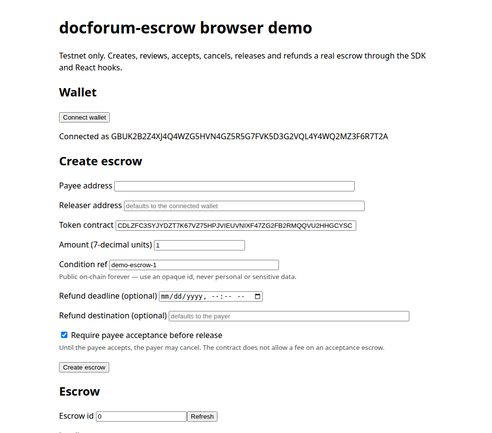
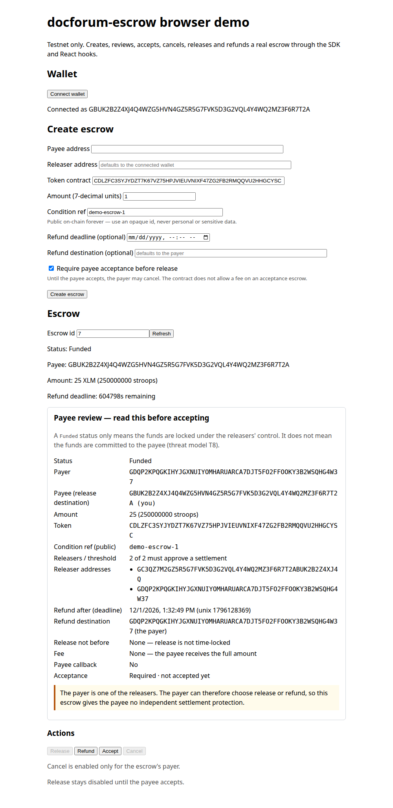
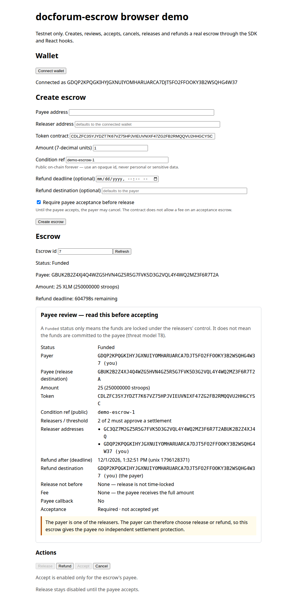

# Browser demo

A minimal Vite + React app showing:

- `useEscrow`, `useEscrowActions` and `useEscrowTimeline` from
  `@docforum/escrow-react` (issue #126)
- `WalletsKitSigner` from `@docforum/escrow-sdk/signers/wallets-kit` (issue #127)
- `EscrowClient` telemetry via `onEvent` (issue #129, see `src/main.tsx`)
- Escrow creation, the payee acceptance gate, and the payer cancel window
  (issue #366)

Testnet only. Nothing here is published; it exists to keep the integrator
surface honest. The demo consumes this repo's packages through Vite aliases
pointing at their built `dist/` output (the SDK and hooks package are not on
npm yet), so build the workspace packages once and install their deps:

```bash
cd sdk && npm ci && npm run build && cd ../..
cd packages/escrow-react && npm ci && npm run build && cd ../..
cd examples/web-demo
npm install
VITE_ESCROW_CONTRACT_ID=C... npm run dev
```

`npm run dev` and `npm run build` rebuild the SDK and hooks package first via
their `predev`/`prebuild` scripts.

`VITE_RPC_URL` is optional and defaults to the SDK's Soroban testnet RPC.

The demo deliberately keeps wallet wiring in one file (`src/wallet.ts`). The
SDK has no runtime import of Stellar Wallets Kit, so a server importing
`@docforum/escrow-sdk` never pulls wallet code.

## Payee acceptance and payer cancel (issue #366)

Acceptance and cancel are the two flows where a UI matters most: the payee has
to see the exact deal before accepting, and the payer has to see that cancel
disappears once the payee accepts.

The screenshots below are captured from the demo rendering a fixture escrow;
they show the UI, not a recorded testnet transaction.

### Creating an acceptance escrow

The **Create escrow** form covers the fields the contract needs. Leaving the
releaser blank uses the connected wallet (which is also the T8 case the review
panel warns about). The form assumes a 7-decimal token, like the native XLM
contract.



Ticking **Require payee acceptance before release** makes the demo call
`create_escrow_with_acceptance` through `actions.createEscrow`. The contract
does not allow a fee on an acceptance escrow, so the form has no fee inputs and
the review panel reports the fee as “None”.

`conditionRef` is written to public on-chain storage forever (threat model
T9), so the demo defaults to an opaque id and the form says not to put
personal or sensitive data there.

### Payee review

When the loaded escrow is `Funded`, was created with acceptance, and has not
been accepted yet, the demo renders the full deal from `getEscrow` before the
accept button:

- status, payer, payee, amount and token
- the opaque `conditionRef`
- every releaser address and the threshold (“2 of 3 must approve a
  settlement”)
- `refundAfter` (or “no deadline”) with the unix timestamp
- `refundTo`, called out when it is not the payer
- `releaseNotBefore`, the protocol fee, and the payee callback flag
- the acceptance state

Two T8 notices appear next to the values they apply to: whether the payer is
also a releaser (no independent settlement protection for the payee), and
whether a refund pays an address other than the payer.



### Accept and cancel enablement

Both actions are rendered only while the escrow is `Funded`, was created with
acceptance, and has not been accepted — the exact window in which the contract
allows them. Within that window:

| Action | Enabled when |
|---|---|
| Accept | the connected wallet is the escrow's `payee` |
| Cancel | the connected wallet is the escrow's `payer` |
| Release | a wallet is connected, the escrow is `Funded`, and the acceptance gate is satisfied (or not configured) |
| Refund | a wallet is connected and the escrow is `Funded` (a refund does not need acceptance) |



Once the payee accepts, the review panel and both buttons disappear; the payer
sees “Cancel is no longer available: the payee accepted this escrow”. After
that point the release/refund rules are the same as an ordinary escrow.
